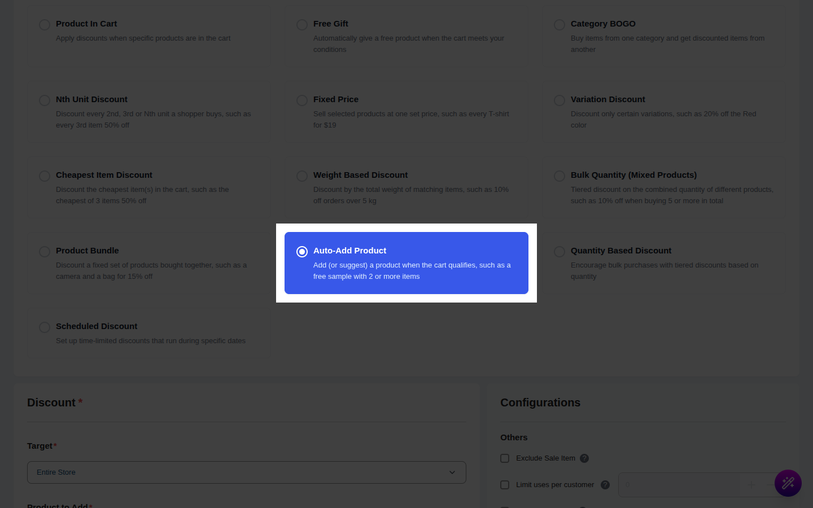
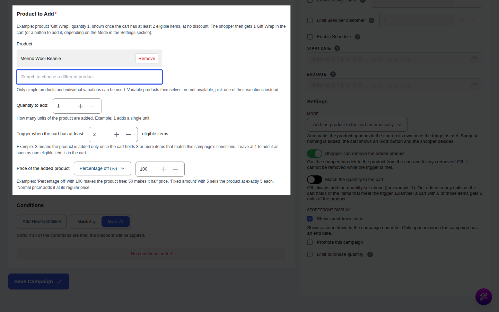
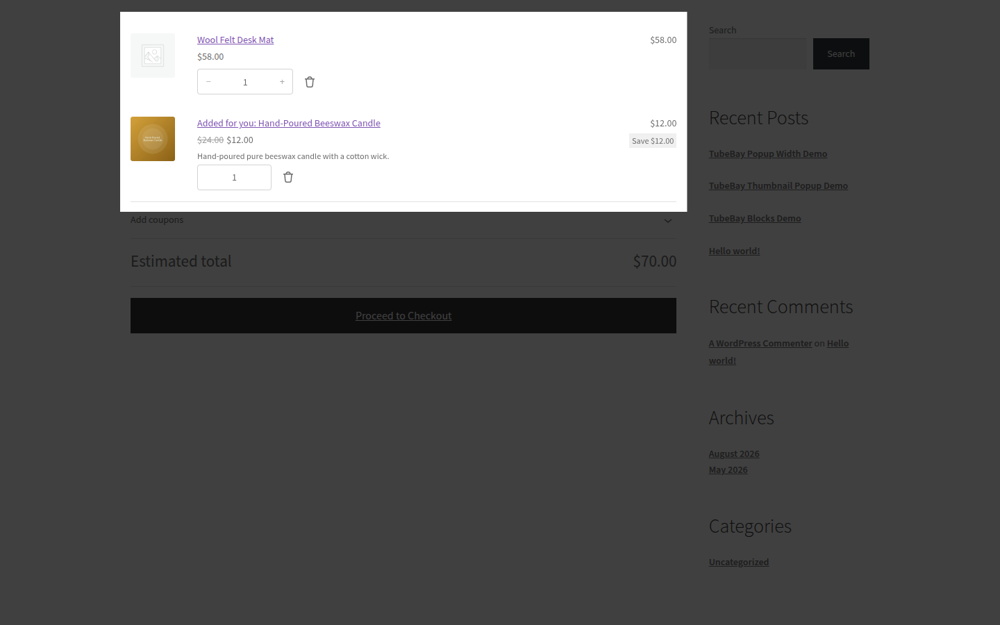

# Campaign Type: Auto-Add Recommended Product

::: tip Pro Feature
This is a **CampaignBayPro** feature. [Upgrade to Pro](https://wpanchorbay.com/campaignbay) to unlock Auto-Add Product campaigns and other powerful features.
:::

An **Auto-Add Product** campaign adds a product to the cart (or suggests it) when the cart holds enough qualifying items. The added product can be sold at its normal price, at a percentage off, or at a fixed price.

Use it for:

- "Buy any **Hoodie** and we add a **Sticker Pack** for you at 50% off."
- "Spend on **Coffee** and get a **Filter Pack** for $5."
- Suggesting an accessory with a one-click **Add** button, without changing the cart yourself.

## Step 1: Select Your Campaign Type

Navigate to **CampaignBay → Add Campaign**.

- **Select Discount Type:** Choose **Auto-Add Product** ("Add (or suggest) a product when the cart qualifies").
- **Campaign Title** and **Status** work as in the other campaign types.

## Step 2: Set the Trigger Items (Target)

The **Target** section defines which products count as trigger items. Choose Entire Store, Products, Categories or Tags as described in [Targeting](../core-concepts/targeting.md). The added reward product never counts as a trigger for itself.

## Step 3: Choose the Product to Add

In the **Product to Add** section:

| Field | What it does |
| :--- | :--- |
| **Product** ("Search a product to add…") | The reward. Only simple products and single variations can be chosen, not a variable parent. It must be published and purchasable. |
| **Quantity to add** | Units added (minimum 1). |
| **Trigger when the cart has at least: N eligible items** | How many trigger units the cart needs (minimum 1). |
| **Price of the added product** | **Normal price (no discount)**, **Percentage off (%)**, or **Set price to a fixed amount ($)**. |

A fixed price is exactly that price per unit.

## Step 4: Settings

| Setting | Default | What it does |
| :--- | :--- | :--- |
| **Mode** | Add automatically | **Add the product to the cart automatically**, or **Only suggest it (shopper clicks a button)**. |
| **Shopper can remove the added product** | On | When off, the cart gives no remove link for the added line. |
| **Match the quantity to the cart** | Off | When on, the number added follows the number of trigger units in the cart instead of the fixed quantity. |

If you choose a discount, the **Others** section offers **Enable Usage Limit**. It is not available when the price is "Normal price" (there is nothing to limit).

## Step 5: Messages the Shopper Sees

Edit them in **CampaignBay Pro → Settings → Offer type messages**.

| Message | Default |
| :--- | :--- |
| Cart line label | `Added for you: {product_name}` |
| Suggestion title | `Recommended for you` |
| Suggestion button | `Add {product_name}` |
| Product page message | `Add this to your cart and get {product_name} {discount}` |

`{discount}` becomes "50% off", "for free" (100% or more) or "for $5.00". Toggles: **Show the auto add message on product pages** and **Show the recommended product suggestion in the cart**. The product page message shows the price after the discount.

## Step 6: Save the Campaign

Click **Save Campaign**.

## Worked Examples

Prices: Hoodie $100, Sticker Pack $30.

### Example 1: Automatic add at 50% off

Trigger: Hoodie, at least 1; reward: Sticker Pack x1, **Percentage 50%**, Mode automatic.

- **Product page (Hoodie):** "Add this to your cart and get Sticker Pack 50% off".
- **Cart after adding a Hoodie:** a second line "Added for you: Sticker Pack" at $15 (struck-through $30). Subtotal $115.
- **Checkout and order:** the line appears with the discounted price. The order keeps the campaign as the owner of that line.

### Example 2: Suggest mode

Same offer with **Only suggest it**. The cart shows "Recommended for you" with an **Add Sticker Pack** button and no line yet. After the shopper clicks it, the line is added at $15.

### Example 3: Match the quantity

Trigger: at least 1 Hoodie, **Match the quantity to the cart** on, reward Sticker Pack at a fixed price of $5. A cart with 3 Hoodies gets 3 Sticker Packs at $5 each ($15). The shopper cannot change the quantity of the added line (it is shown as plain text), and lowering the Hoodies lowers the packs.

## Gotchas

- **Stock cap:** the added quantity never exceeds the reward's stock. If stock drops after checkout loads, the line is lowered to what remains, with no error, and an out-of-stock reward is not added.
- **Reward already in the cart:** if the shopper also adds the reward themselves, the discount applies to the matching units, not to extra ones. Check the result in a test cart before launch.
- **Removal:** if the shopper removes the added line (when allowed), it stays removed until the trigger stops applying or the cart is emptied or an order is placed.
- **No loops:** the reward line never counts as a trigger.
- **Usage counting:** each order containing the discounted reward counts as one use. With no discount, nothing is counted and a usage limit is rejected.
- **Several campaigns, same reward:** the best price wins and only one line is shown.
- **Stacking:** when stacking is off, a reward already discounted by a free CampaignBay campaign is not discounted again. WooCommerce coupons are removed while a CampaignBay discount applies unless coupon stacking is enabled, and free shipping is offered but the shopper must select it.
- **Conditions:** cart-level conditions (such as cart total) do not count the added line.

Next, give a free gift when the cart qualifies.

- **[Free Gift &rarr;](./free-gift.md)**
