# Campaign Type: BOGO Advanced (Buy X Get Y)

::: tip Pro Feature
This is a **CampaignBayPro** feature. [Upgrade to Pro](https://wpanchorbay.com/campaignbay) to unlock BOGO Advanced and other powerful features.
:::

A **BOGO Advanced (Buy X, Get Y)** discount is a powerful upgrade to the standard BOGO campaign. While the standard BOGO requires the customer to buy and get the _same_ product (Buy T-Shirt, Get T-Shirt), the Advanced version deals with _different_ products.

This is perfect for cross-selling and bundling scenarios like:

- "Buy 3 **Hoodies**, Get a **Simple Mug** for Free"
- "Buy 2 **Jeans**, Get a **Belt** at 50% Off"

## Step 1: Select Your Campaign Type

To begin, navigate to **CampaignBay → Add Campaign**.

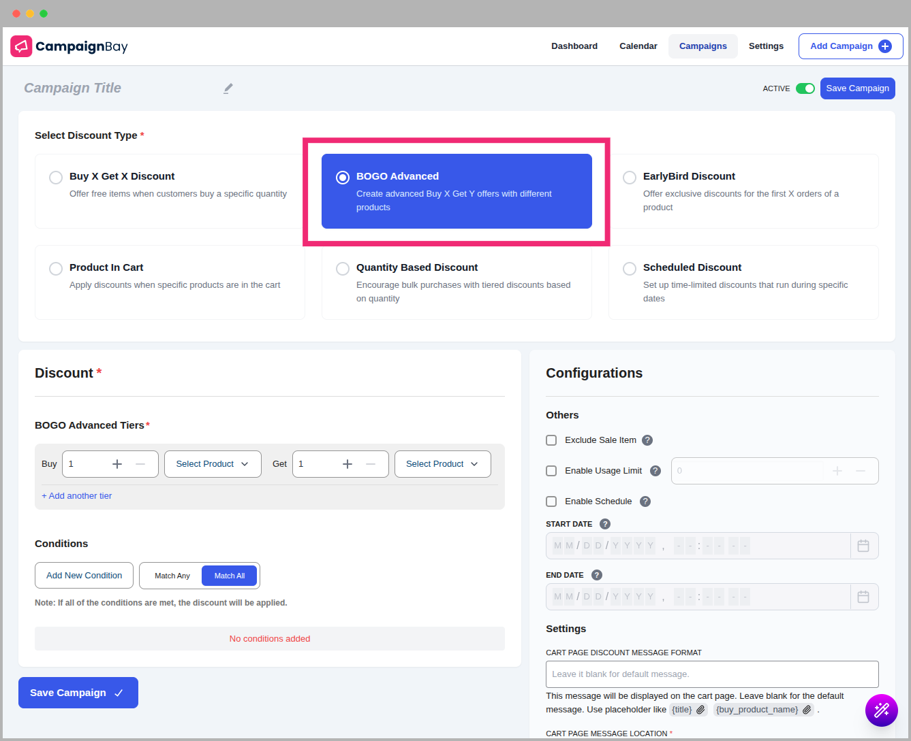

- **Select Discount Type:** Choose **`BOGO Advanced`** from the list of available campaign types. This will unlock the specific configuration fields for Buy X Get Y offers.

- **Campaign Title:** Give your campaign a descriptive name (e.g., "Free Mug with Hoodies Bundle"). This name will appear in the "All Campaigns" list and can be used in your cart messages using the `{title}` placeholder.

- **Set Status:** Ensure the status is set to **Active** to make the campaign live immediately upon saving.

## Step 2: Define the BOGO Tiers

This is where you define the "Buy X Get Y" logic. You can create multiple tiers to encourage bulk purchases.

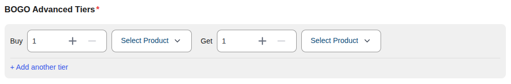

### Configuration Fields

1.  **Buy Quantity:** Enter how many items the customer must purchase to trigger the deal.
2.  **Buy Product:** Select the specific product the customer must purchase.
3.  **Get Quantity:** Enter how many of the "Get Product" they will receive.
4.  **Get Product:** Select the product the customer will receive as a discount.

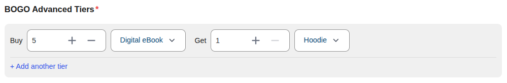

### Example: The "Hoodie Bundle"

You want to give a free Simple Mug with every 3 Hoodies purchased.

- **Buy Product:** Hoodie
- **Buy Quantity:** 3
- **Get Product:** Simple Mug
- **Get Quantity:** 1

When a customer adds **3 Hoodies** to their cart, the system will automatically add **1 Simple Mug** to the cart for free (depending on your display settings).

## Step 3: Set Conditions (Optional)

You can add specific rules to restrict who can use this discount.

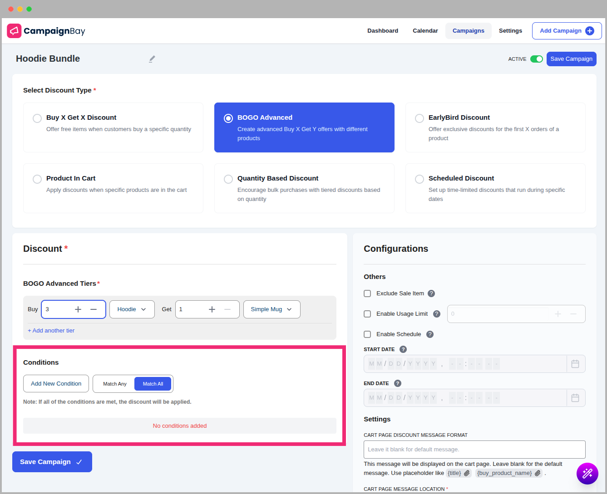

**[Read the Full Guide: How to Use Conditions &rarr;](../core-concepts/conditions.md)**

## Step 4: Set Other Configurations (Optional)

This section provides additional rules for your campaign.

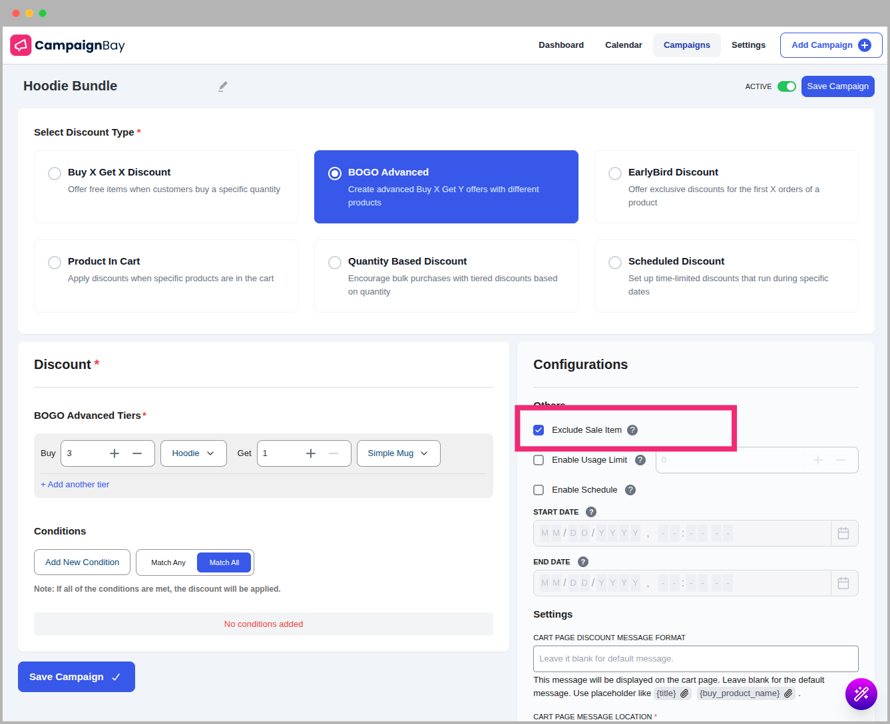

- **Exclude Sale Items:** Check this box if you do not want this campaign's discount to apply to products that are already on sale in WooCommerce. This is useful for preventing "double discounting."

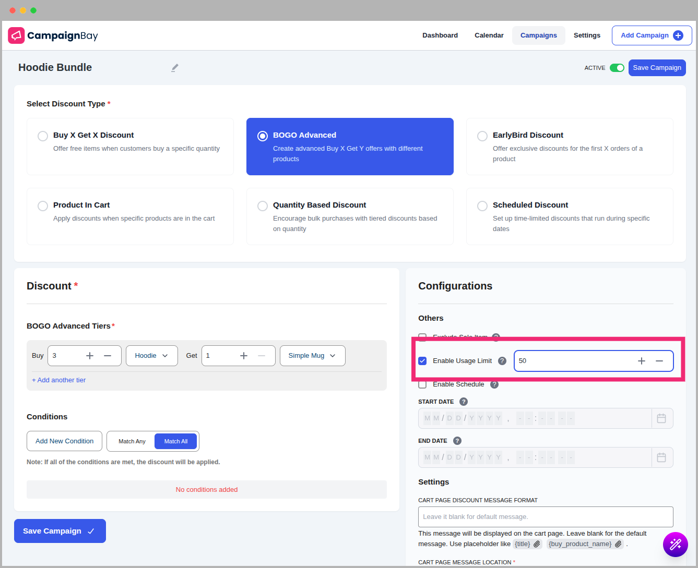

- **Enable Usage Limit:** Check this box to set a maximum number of times this campaign can be used across your entire store. Once the limit is reached, the campaign will automatically become inactive.

## Step 5: Set the Schedule (Optional)

You can optionally schedule your campaign to run during a specific time window. This section controls when your campaign will automatically start and end.

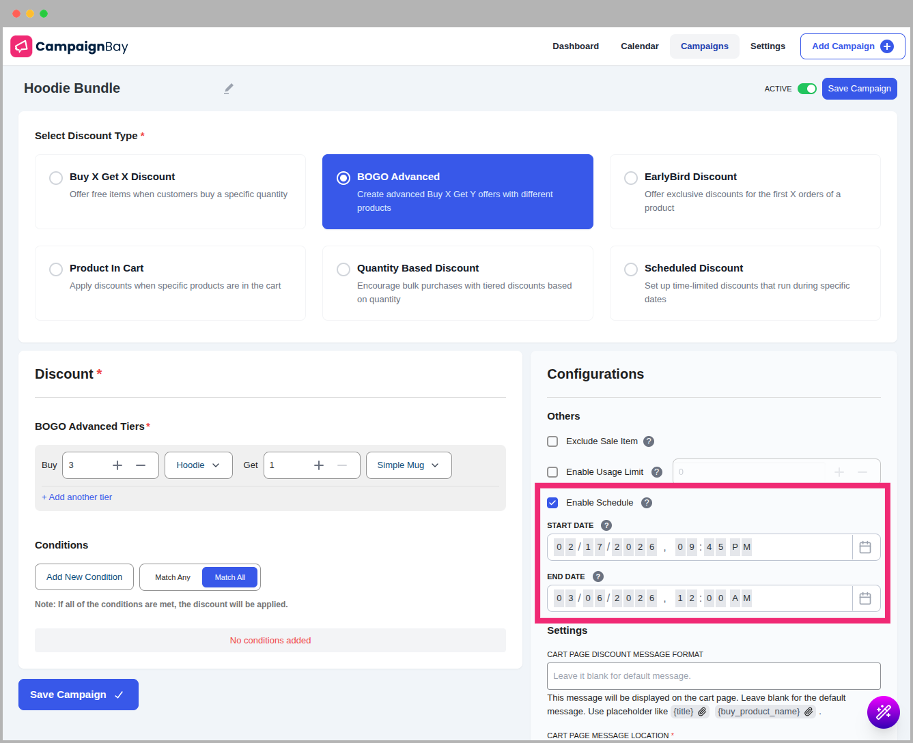

- **Start Time / End Time:** Use the date and time pickers to set the exact moment for the campaign to activate and expire.

::: tip Timezone Information
All dates and times are based on the timezone you have configured in your main WordPress settings under **Settings → General → Timezone**. The system automatically handles all UTC conversions for you.
:::

::: info Learn More About Automation
The status of your campaign is closely tied to the scheduling system, which uses WordPress Cron to automate activation and expiration.

**[Read the Full Guide: Scheduling & Automation &rarr;](../core-concepts/scheduling-and-automation.md)**
:::

## Step 6: Display Configurations

- **Repeat for every full set:** Buy 2 get 1: with this on, buying 4 gives 2 free. Off: the offer applies once, so buying 2, 4 or 9 all give 1 free. See [How the Free Items Work](#how-the-free-items-work).
- **Add the free product to the cart automatically** (shown as _Automatically Add Free Product To Cart_ in older versions):
  - **On (Recommended):** The "Get Product" is added to the cart for the shopper as its own free line.
  - **Off:** The shopper adds the "Get Product" themselves and it becomes free.
- **Apply the free item as:** shown **only when automatic adding is off**. Choose **A lower price on the item** (the free unit's price drops to zero) or **A separate discount line in the cart totals** (the item keeps its price and a negative line appears in the totals).

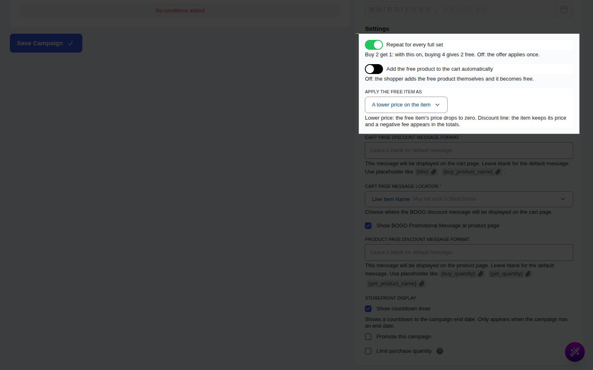

### Messaging Options

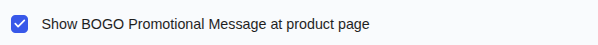

- **Show BOGO Promotional Message at product page:** Toggle this to enable or disable the custom message on the product page.

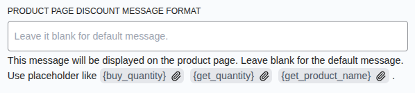

- **Product Page Discount Message Format:** Enter a message to display on the product page. Use placeholders like `{buy_quantity}`, `{get_quantity}`, and `{get_product_name}` to inform customers about the deal.

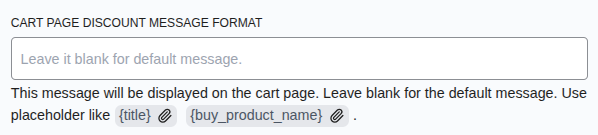

- **Cart Page Discount Message Format:** Enter a message to display in the cart. You can use `{title}` for the campaign name and `{buy_product_name}` to specify what they bought.

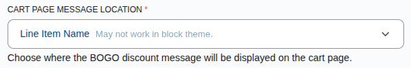

- **Cart Page Message Location:** Choose where the cart message should appear: **Line Item Name** (under the item's name), **Notice** (a notice at the top of the cart) or **Don't Show**.

## Step 7: Save the Campaign

Once you have configured all the options, click the **Save Campaign** button. You will be redirected to the "All Campaigns" list.

## How the Free Items Work

### Automatic mode (free product added for the shopper)

- **The free item is its own cart line.** It is a separate line from anything the shopper bought, priced at zero. If the shopper also buys the same product, they get a paid line and a free line, never one mixed line.
- **The quantity is locked.** The shopper sees a plain number (no quantity box, no remove link). The line follows the buy quantity: change the Hoodies and the free Mug count updates.
- **Stock limits the free quantity.** If you have 1 Mug in stock and the offer earns 2, the shopper gets 1 free. The cap also takes into account Mugs the shopper is already paying for in the cart. If the product allows **backorders**, no cap is applied.
- **Free lines never count as buy units.** A free, gift or automatically added line cannot help the shopper earn another free item.
- **On the order** the free line is labelled **Free item**.

### Manual mode (shopper adds the free product)

The shopper adds the "Get Product" to the cart as usual and the deal makes up to the earned quantity free, in place. Nothing is added for them.

- Example: Buy 2 Hoodies (A, 100.00), get 1 Mug (F, 30.00). Cart: A ×2 and F ×3. One Mug is free, so F costs 20.00 on average per unit for the line (30 + 30 + 0 = 60.00). **Total 260.00.**
- The free quantity is never more than the units in the cart.
- With **A separate discount line in the cart totals**, the Mug keeps its price of 30.00 and a line of −30.00 appears in the totals. The total is the same.
- A unit is **never used twice**: a unit that counted as a buy unit cannot also be the free reward.

### How many free items are earned

| Buy 2 get 1 | Repeat on | Repeat off |
| --- | --- | --- |
| Buy 1 | 0 free | 0 free |
| Buy 2 | 1 free | 1 free |
| Buy 3 | 1 free | 1 free |
| Buy 4 | 2 free | 1 free |
| Buy 9 | 4 free | 1 free |

Repeat also works in manual mode. With Buy 2 Hoodies (100.00) get 1 Mug, a cart of A ×4 and F ×2: repeat on makes both Mugs free (total 400.00); repeat off makes one free (total 430.00).

### Several tiers on the same buy product

Tiers that share a Buy Product are **alternatives, not extras**. The tier with the greatest Buy Quantity that the cart reaches is used; if two tiers have the same Buy Quantity, the one with the larger Get Quantity wins.

Example: tier 1 is Buy 2 get 1, tier 2 is Buy 4 get 3 (repeat on). A ×4 gives 3 free (tier 2), and A ×8 gives 6 free (tier 2 twice). Tiers with **different** Buy Products are independent of each other.

### Usage limits

An order counts as **one** use of the campaign, however many free units it contains. Once the usage limit is reached, the free line is no longer added. If the order is cancelled or refunded, the use is given back.

### Cart messages

The cart message appears in the place you chose under **Cart Page Message Location**. In the block-based cart the quantity is read-only as in the classic cart, but the "Offer" row is not displayed. The product page banner shows the first tier of the campaign.

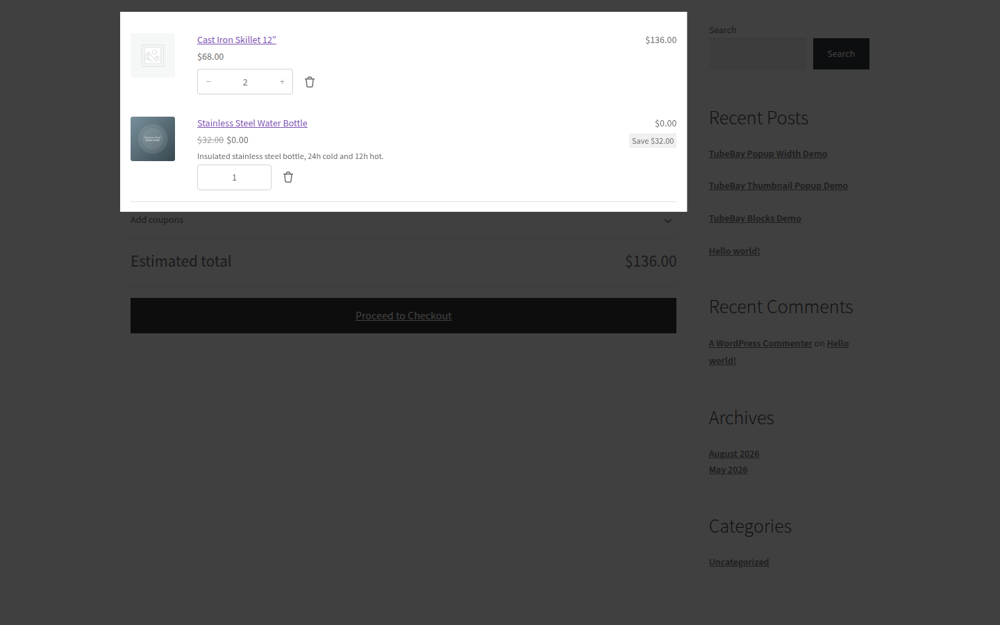

Next, learn how to offer discounts based on other products in the cart.

- **[Product In Cart &rarr;](./product-in-cart-discounts.md)**
