# Campaign Type: BOGO Discount (Buy X Get X)

A **BOGO (Buy One, Get One)** discount is a popular promotional tool that rewards customers with free or discounted items when they purchase a specific quantity of a product. This guide covers the **"Buy X Get X"** type, where the item the customer "gets" is the same as the item they "buy".

This is the perfect campaign type for scenarios like:

- "Buy 2 T-Shirts, Get 1 Free"
- "Buy 3, Get 1 Free" on specific items.

This guide will walk you through every field required to set up this campaign type.

## Step 1: Select Your Campaign Type

To begin, navigate to **CampaignBay → Add Campaign**.

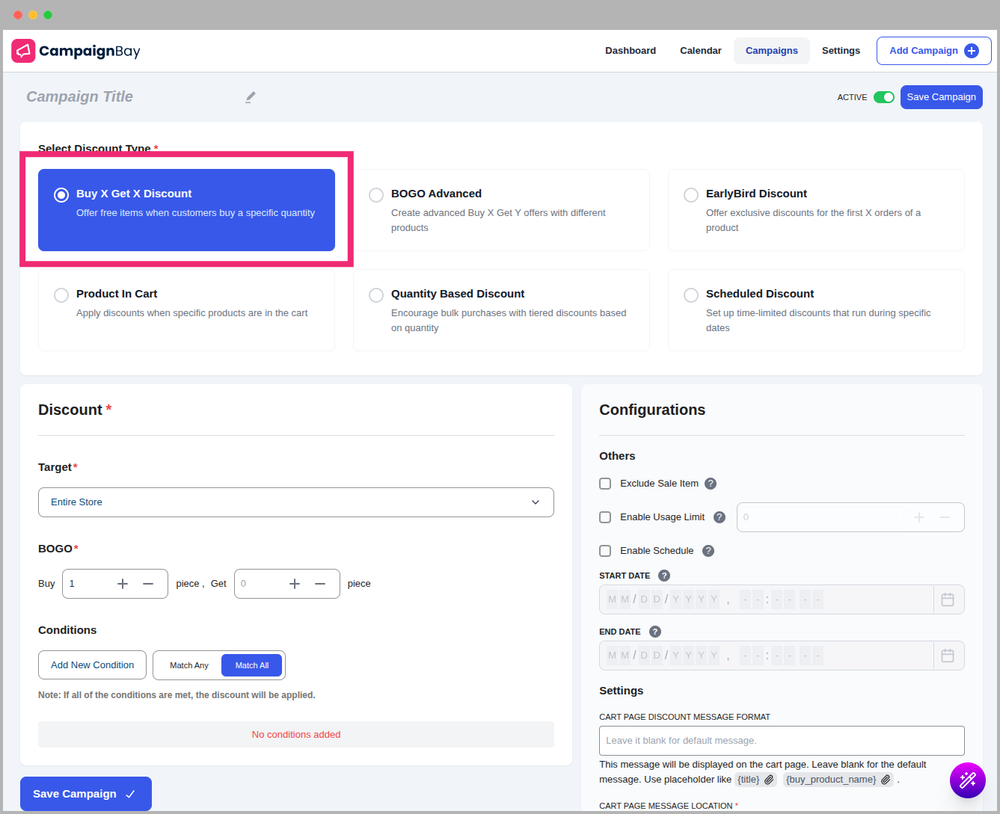

- **Select Discount Type:** Choose **`Buy X Get X`** from the list. This will reveal the configuration fields for the standard BOGO offer, where the "Buy" item and the "Get" item are the same.

- **Campaign Title:** Give your campaign a clear and descriptive name (e.g., "Hoodie BOGO Deal").

- **Select Status:**
  - **Active:** The campaign will be live as soon as its start time is reached.
  - **Inactive:** The campaign will be saved as a draft.

## Step 2: Set the Discount Target

This crucial step defines which products in your store are eligible for the BOGO offer.

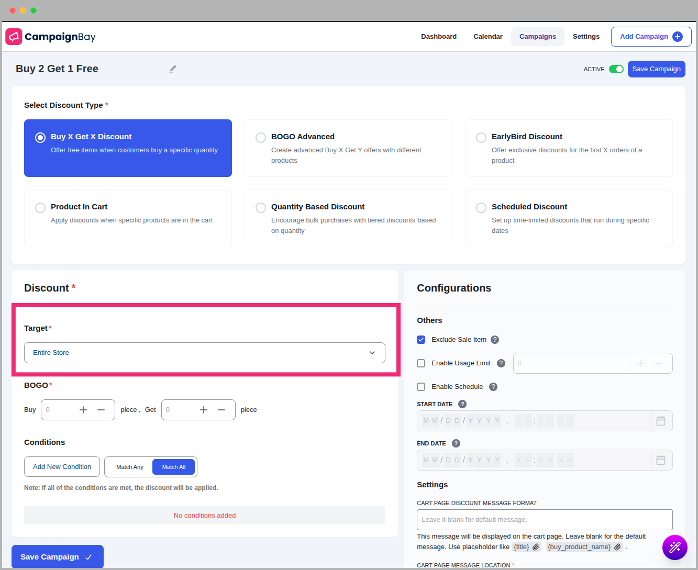

The **DISCOUNT TARGET** dropdown provides options to apply the offer to your entire store, specific products, or categories.

::: info Learn More About Targeting
The "Discount Target" setting is a powerful feature shared by all campaign types. We've created a dedicated guide to explain all of its options and conditional fields in detail.

**[Read the Full Guide: Targeting &rarr;](../core-concepts/targeting.md)**
:::

## Step 3: Define the BOGO Rule

This is the core logic of your campaign.

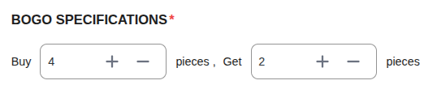

- **Buy X pieces:** Enter the number of items the customer needs to purchase to trigger the offer (e.g., `2`).
- **Get Y pieces:** Enter the number of items the customer will receive for free (e.g., `1`).

::: tip How it works
If you set **Buy 2 Get 1** on a Hoodie, and a customer adds 2 Hoodies to their cart, 1 free Hoodie will be automatically added to the cart. If they add 4 Hoodies, 2 free Hoodies will be added.

The number of free items is `floor(quantity / Buy) x Get`. For **Buy 2 Get 1**: quantity 1 gives 0 free, 2 and 3 give 1, 4 and 5 give 2, 6 gives 3, 9 gives 4. The customer pays only for the items they added.
:::

::: info Free items are their own cart line
The free items appear as a **separate cart line** at `0.00`, not as extra quantity on the paid line. The customer cannot change or remove the free line (it is rebuilt automatically), and removing the paid line removes the free line too. Several BOGO campaigns each show their own free line and their own message. Stock is checked and reduced for paid and free units together.
:::

## Step 4: Set Conditions (Optional)

You can add specific rules to restrict who can use this discount (e.g., specific User Roles).

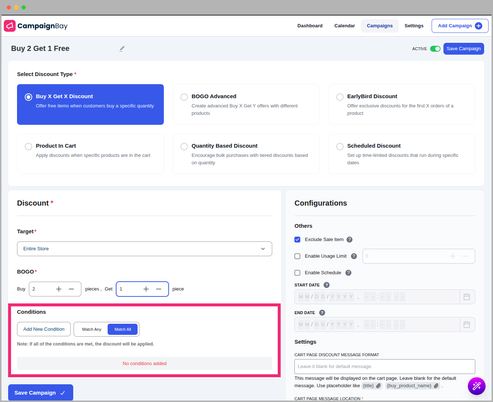

**[Read the Full Guide: How to Use Conditions &rarr;](../core-concepts/conditions.md)**

New in 1.2.0, two more conditions are available in the free plugin: **Guest / Logged-in** (apply the offer only to guests or only to logged-in customers) and **Cart Item Quantity**.

## Step 5: Set Other Configurations (Optional)

This section provides additional rules for your campaign.

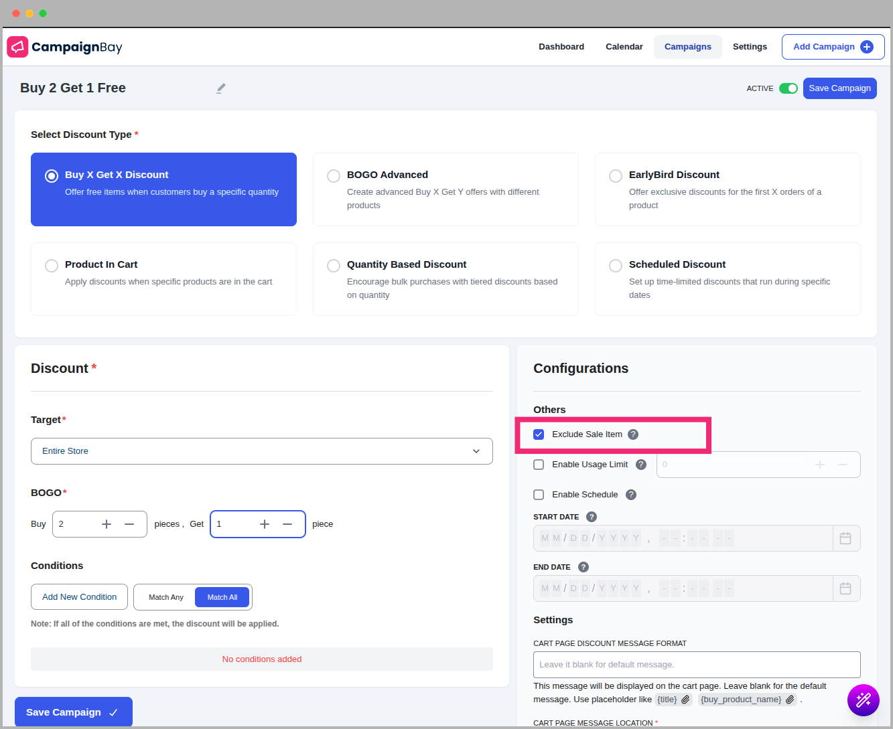

- **Exclude Sale Items:** Check this box if you do not want this campaign's discount to apply to products that are already on sale in WooCommerce. This is useful for preventing "double discounting."

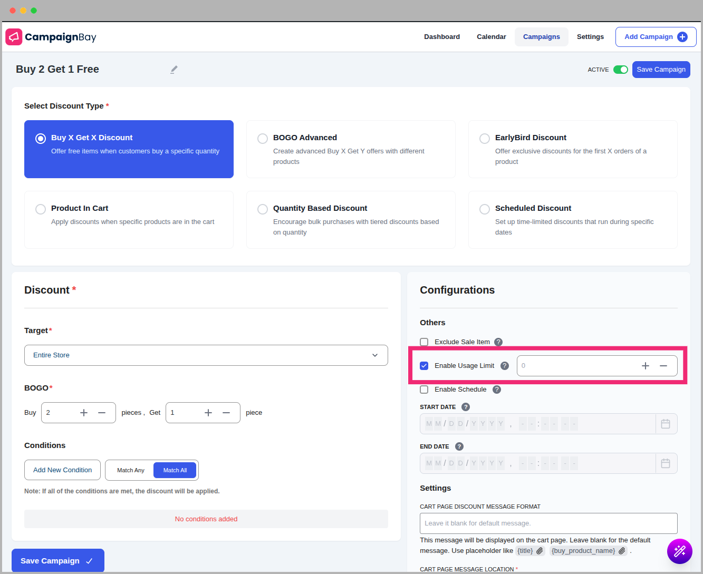

- **Enable Usage Limit:** Check this box to set a maximum number of **orders** that can use this campaign across your entire store. A limit of `N` expires the campaign after exactly `N` orders (a limit of `1` expires it after the first order). Only orders that reach **Processing** or **Completed** are counted. If a counted order is later cancelled, refunded or fails, its use is given back and a campaign that had expired because of its limit becomes active again.

## Step 6: Set the Schedule (Optional)

You can optionally schedule your campaign to run during a specific time window. This section controls when your campaign will automatically start and end.

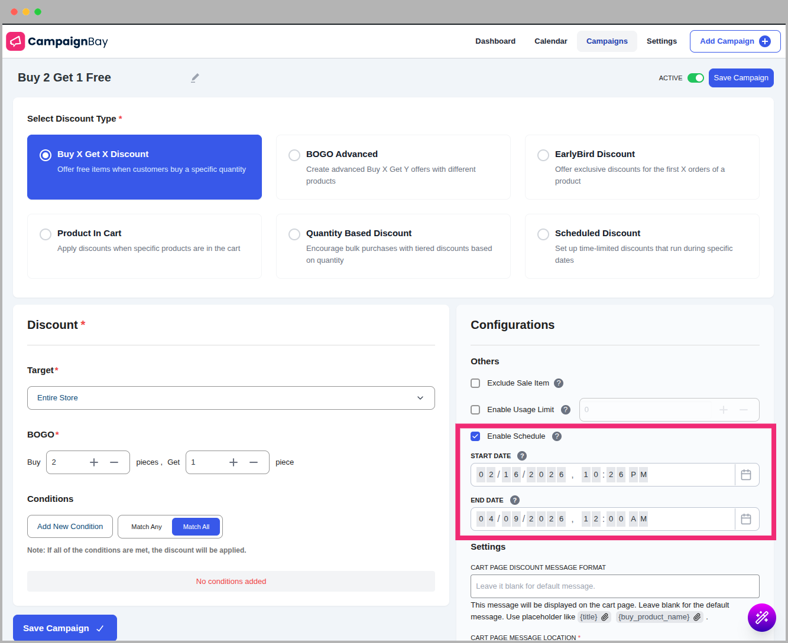

- **Start Time / End Time:** Use the date and time pickers to set the exact moment for the campaign to activate and expire.

::: tip Timezone Information
All dates and times are based on the timezone you have configured in your main WordPress settings under **Settings → General → Timezone**. The system automatically handles all UTC conversions for you.
:::

::: info Learn More About Automation
The status of your campaign is closely tied to the scheduling system, which uses WordPress Cron to automate activation and expiration.

**[Read the Full Guide: Scheduling & Automation &rarr;](../core-concepts/scheduling-and-automation.md)**
:::

## Step 7: Define Display Configurations

This section controls how the offer is communicated to the customer.

The free items are always added to the cart automatically at no cost when the customer reaches the "Buy" quantity, so there is no setting for that in the editor.

### Messaging Options

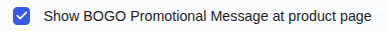

- **Show BOGO Promotional Message at product page:** Toggle this to enable or disable the custom message on the product page.

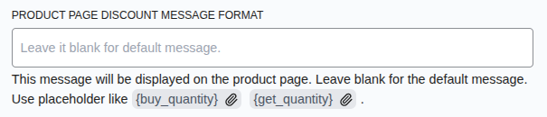

- **Product Page Discount Message Format:** Enter a message to display on the product page. Use placeholders like `{buy_quantity}` and `{get_quantity}`.
  - _Example:_ `Buy {buy_quantity} and get {get_quantity} free!`

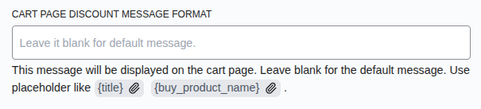

- **Cart Page Discount Message Format:** Enter a message to display in the cart. Use `{title}` to show the campaign name. Leave it blank for the default ("{title} discount applied.").
  - _Example:_ `Discount '{title}' has been applied!`

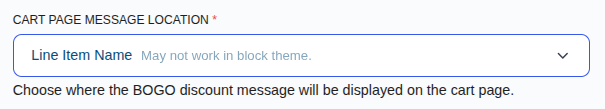

- **Cart Page Message Location:** Choose where the cart message should appear: **Line Item Name**, **Notice** or **Don't Show**. Note that **Notice** is not active yet.

The default product page banner is "Buy {buy_quantity} and get {get_quantity} free!". Leave the format blank to use the default.

### Storefront Display: Countdown Timer and Promotion

Every campaign type has a **Storefront display** group at the bottom of the Display Configurations.

- **Show countdown timer:** Shows a live countdown to the campaign's end date. It only appears when the campaign has a **schedule enabled with an end date in the future**. Where it appears (product page, shop and category listings, cart) and what it says is controlled in **Settings → Product Settings → Countdown Timer**. You can also place it anywhere with the `[campaignbay_countdown id="12"]` shortcode.
- **Promote this campaign:** Tick this to let the campaign advertise itself on category pages and through the promotion blurb. Optionally type a **Promotion text**; leave it blank to use the default. You can use `{campaign_title}`, `{end_date}` and `{discount}` in the text.

::: info Learn More
The wording, colours and locations of the countdown timer, sale badge, category and shop offer messages and promotion blurbs are global settings. See the [Product Settings guide](../settings/product-settings.md).
:::

### Limit Purchase Quantity (Optional)

Tick **Limit purchase quantity** to set a **Minimum quantity**, **Maximum quantity** and **Quantity step** for the products this campaign targets, while the campaign is active.

- Leave a field empty for no limit. Each field has a minimum value of `1`.
- Quantities must be a multiple of the step. For example, minimum `5`, maximum `20`, step `5` allows only 5, 10, 15 or 20.
- Customers see a note on the product page such as "Purchase limits: minimum 5, maximum 20, multiples of 5", and get an error if they try to add or keep a quantity outside the limits.
- If a product is covered by more than one campaign with limits, the strictest combination applies.
- The limits are saved only if at least one of the three fields is filled, the minimum is not above the maximum, and some quantity actually fits the step.

::: warning Not enforced with some conditions
Limits are not enforced for campaigns that use **Cart Total** or **Cart Item Quantity** conditions.
:::

## Step 8: Save the Campaign

Once you have configured all the options, click the **Save Campaign** button. You will be redirected to the "All Campaigns" list where you can see your new BOGO offer.

Next, learn how to create advanced BOGO deals where product X gives product Y.

- **[BOGO Advanced (Buy X Get Y) &rarr;](./bogo-advanced-discounts.md)**
