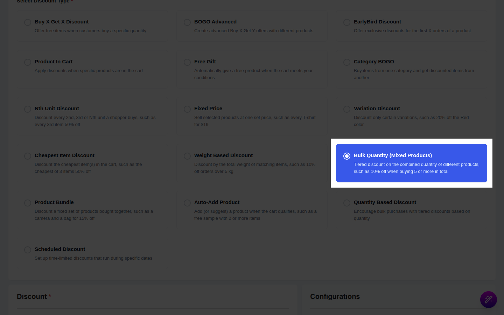
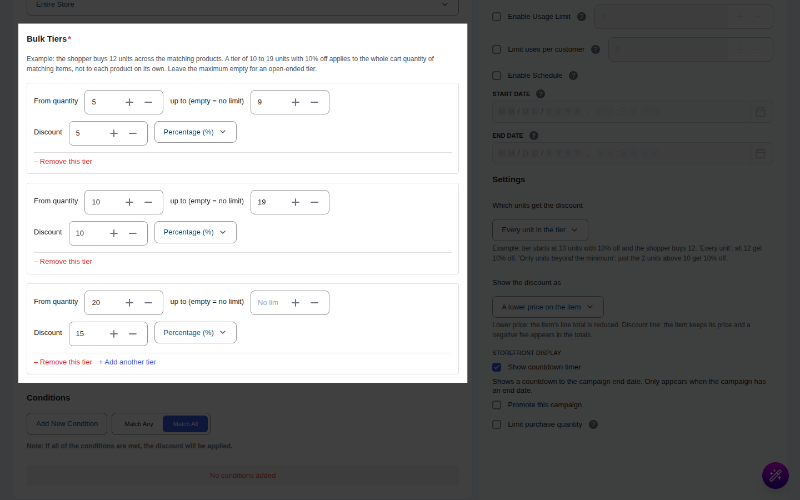
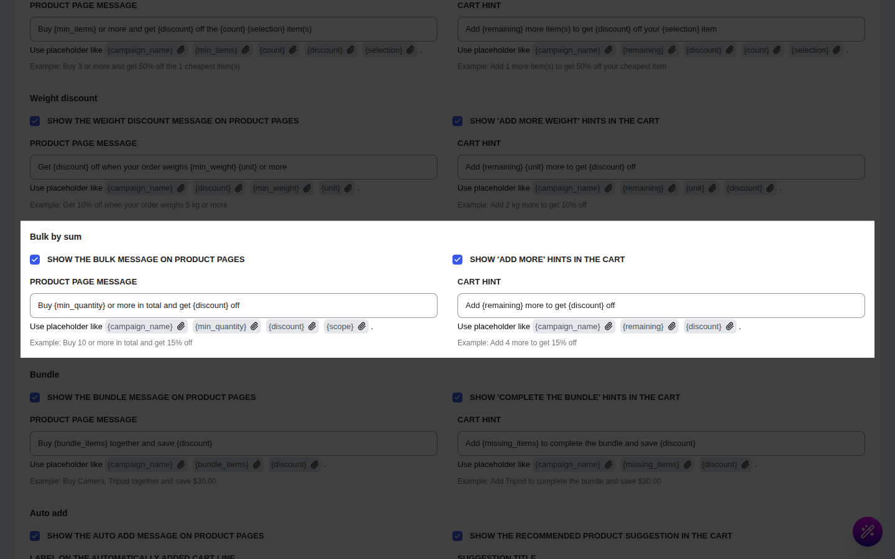

# Campaign Type: Bulk Quantity (Mixed Products)

::: tip Pro Feature
This is a **CampaignBayPro** feature (Pro 1.1.0 and later). [Upgrade to Pro](https://wpanchorbay.com/campaignbay) to unlock Bulk Quantity (Mixed Products) discounts and other powerful features.
:::

A **Bulk Quantity (Mixed Products)** campaign gives a tiered discount based on the **combined quantity of different products** in the cart. Unlike the [Quantity Discount](./quantity-discounts.md), which looks at one product at a time, this one adds up every matching item.

This is the perfect campaign type for scenarios like:

- "10% off when you buy **5 or more in total** from the Summer range"
- "Mix and match any 10 candles and get **20% off**"
- A better rate the more a customer adds, whichever products they pick.

This is a **cart-level** campaign. It never changes the price on the product page or in the shop. The discount appears in the cart, at checkout and on the order.

## Step 1: Select Your Campaign Type

Go to **CampaignBay → Add Campaign**.

- **Select Discount Type:** Choose **`Bulk Quantity (Mixed Products)`** ("Tiered discount on the combined quantity of different products, such as 10% off when buying 5 or more in total").
- **Campaign Title:** e.g., "Mix & Match Savings". When the discount is shown as a separate line, this title is its name in the cart.
- **Select Status:** **Active** or **Inactive** (draft).

## Step 2: Set the Discount Target

Choose which products are counted and discounted. Only matching items add to the combined quantity.

**[Read the Full Guide: Targeting &rarr;](../core-concepts/targeting.md)**

## Step 3: Add Bulk Tiers

The **Bulk Tiers** section holds up to 20 tiers. Each tier says "when the combined quantity is between X and Y, give this discount".

The section's own example: with 12 units across the matching products, a tier of 10 to 19 units at 10% applies to the whole cart quantity of matching items.

Each tier has:

- **From quantity:** the lowest combined quantity for this tier.
- **up to (empty = no limit):** the highest combined quantity. Leave empty for an open-ended top tier.
- **Discount:** the amount, and its type:
  - **Percentage (%):** a percentage off each discounted unit.
  - **Fixed amount:** a flat amount off **each discounted unit**. It is never more than that unit's price.
- **Which units get the discount:**
  - **Every unit in the tier** (default): all matching units are discounted once the tier is reached.
  - **Only the units beyond the tier minimum:** the first units stay at full price and only the rest are discounted. See "Gotchas" for exactly which units.

The tier that applies is the one with the **greatest "From quantity"** that the combined quantity has reached. Both ends are inclusive.

Use **+ Add another tier** and **– Remove this tier** to manage tiers.

### Show the discount as

- **A lower price on the item** (default): each discounted line's price is reduced and shown crossed out.
- **A separate discount line in the cart totals:** the items keep their price and one negative line named after the campaign appears in the totals.

A coupon-line option is not offered for this campaign type.

## Step 4: Conditions, Other Configurations and Schedule

- **[Conditions &rarr;](../core-concepts/conditions.md)**: who is eligible, or a minimum cart total.
- **Exclude Sale Items:** sale items are neither counted nor discounted.
- **Enable Usage Limit:** one order counts as one use.
- **Start Time / End Time:** see **[Scheduling & Automation &rarr;](../core-concepts/scheduling-and-automation.md)**.

## Step 5: Shopper Messages (Optional)

Set these under **CampaignBay → Settings → Cart Settings → Offer type messages → Bulk**.

| Setting | What it does | Default |
| --- | --- | --- |
| **Show the bulk message on product pages** | Message above Add to Cart. | On |
| **Show 'add more' hints in the cart** | A hint while the cart is below the next tier. | On |
| **Product page message** | Placeholders: `{campaign_name}`, `{min_quantity}`, `{discount}`, `{scope}` | `Buy {min_quantity} or more in total and get {discount} off` |
| **Cart hint** | Placeholders: `{campaign_name}`, `{remaining}`, `{discount}` | `Add {remaining} more to get {discount} off` |

A blank field uses the default. Unknown placeholders are removed.

## Step 6: Save the Campaign

Click **Save Campaign**.

## Worked Examples

All examples use these tiers: **T1** 3 to 5 units at 10%, **T2** 6 to 9 units at 15%, **T3** 10 units and up at 20%, **Every unit in the tier**. Products: A 100.00, B 50.00, D 80.00.

### Example 1: Reaching the first tier

**Cart:** A ×1, B ×1, D ×1.

- Combined quantity = 3, so **T1** applies: 10% of 230.00 = **23.00**.
- Each line is reduced by 10%: A 90.00, B 45.00, D 72.00. **Total 207.00.**

| Where | What the shopper sees |
| --- | --- |
| Product page | "Buy 3 or more in total and get 10% off" (the first tier). Prices unchanged. |
| Cart | Crossed-out prices on the three lines. With only A in the cart, the hint "Add 2 more to get 10% off". |
| Checkout and order | Discounted lines; the campaign is recorded in the discount breakdown. |

### Example 2: A bigger tier

**Cart:** A ×2, B ×3, D ×1 (value 430.00).

- Combined quantity = 6, so **T2** applies: 15% of 430.00 = **64.50**. **Total 365.50.**

### Example 3: A fixed amount per unit, as a separate line

**Setup:** T2 is changed to **Fixed amount** = 5, and **Show the discount as** = **A separate discount line in the cart totals**. Same cart as example 2.

- 6 units × 5.00 = **30.00** off. Item lines stay at full price (subtotal 430.00).
- The totals show a line named after the campaign: **−30.00**. **Total 400.00.**

If the fixed amount is more than a unit's price (a fixed 40 on a 30.00 unit), that unit is discounted by its price only, never below zero.

## Gotchas

- **"Only the units beyond the tier minimum" keeps your most expensive units at full price.** Units are sorted from the dearest to the cheapest. The first (minimum − 1) units stay at full price and the rest, from the minimum onward, are discounted. Example with T1 set to this option: A ×2 and B ×3 (5 units, minimum 3). The two A units stay at full price and the three B units are discounted: 10% of 150.00 = 15.00, **total 335.00**. Another example: a 20% tier from 4 units on D ×2 and A ×3: the two D units (the cheapest) are the ones discounted, 32.00 off, total 428.00. Check this against the editor's help text when you set it up and test it on a real cart.
- **Variations are pooled.** The sizes and colors of one variable product, and different products, all add to the same combined quantity.
- **Fixed amount means different things in different campaigns.** Here it is an amount **per unit**. In a [Weight Based](./weight-discounts.md) campaign it is **one** amount for the whole cart.
- **Units already discounted by another Pro campaign do not count.** The order is [Cheapest Item](./cheapest-item-discounts.md), then [Weight](./weight-discounts.md), then Bulk. A unit already discounted by an earlier campaign is not discounted again by this one and is left out of the combined quantity. With stacking off in [Cart Settings](../settings/cart-settings.md), units already discounted by a standard campaign are also skipped.
- **Overlapping tiers are accepted.** The tier with the highest "From quantity" that the cart reaches is used; keep tiers tidy.
- **Difference from the Quantity Discount.** [Quantity Discount](./quantity-discounts.md) tiers count each product on its own. Use this one when the shopper may mix products.
- **Product and shop prices never change.** Advertise the offer with the product page message.

Next, see how other Pro offers work with free items.

- **[BOGO Advanced &rarr;](./bogo-advanced-discounts.md)**
