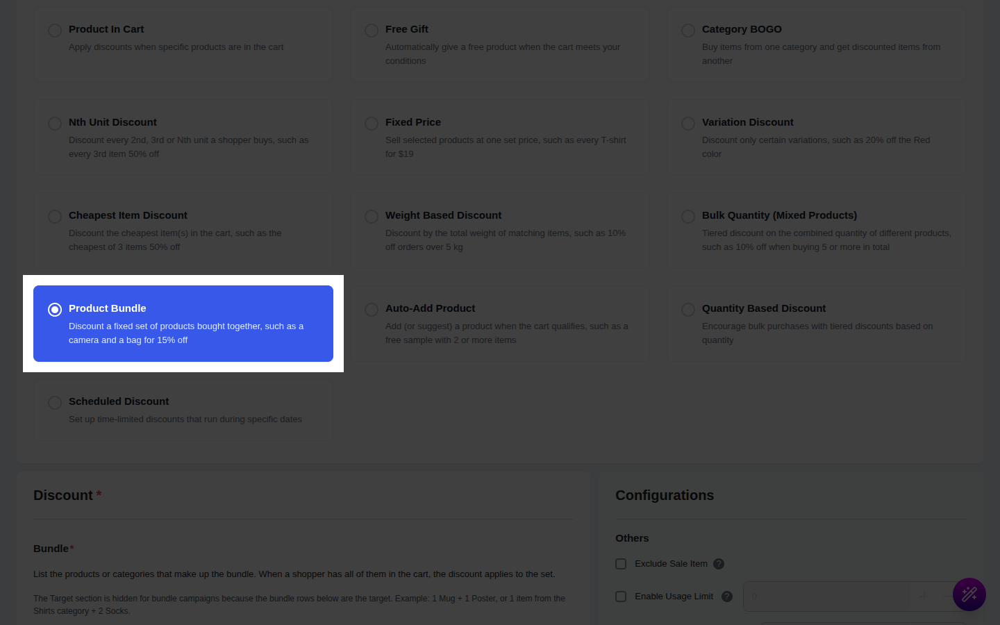
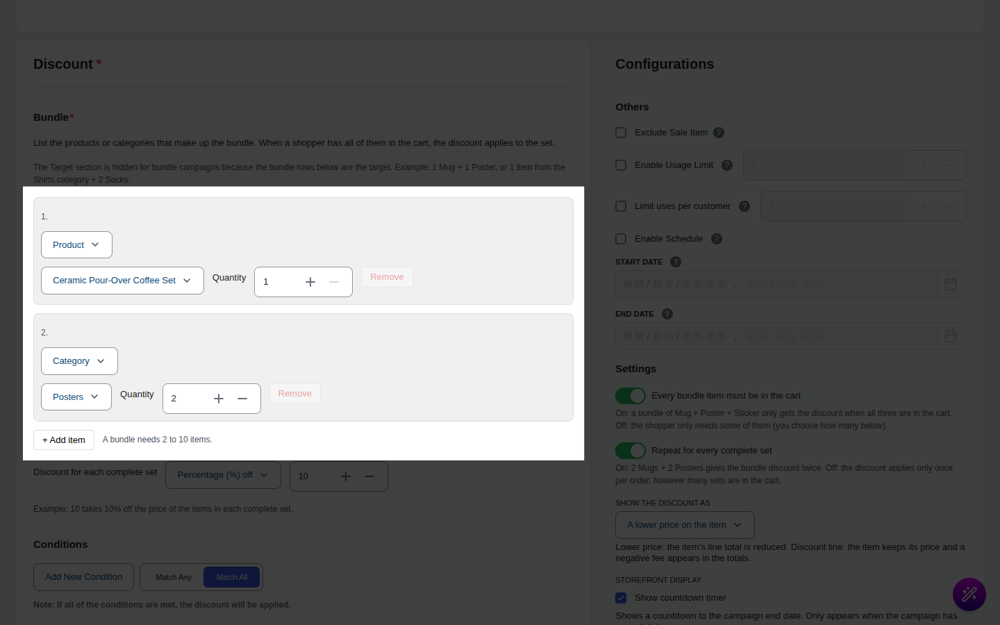
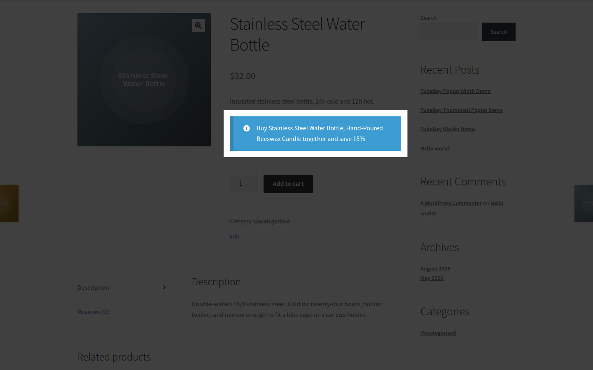

# Campaign Type: Product Bundle

::: tip Pro Feature
This is a **CampaignBayPro** feature. [Upgrade to Pro](https://wpanchorbay.com/campaignbay) to unlock Product Bundle discounts and other powerful features.
:::

A **Product Bundle** campaign discounts a fixed set of products when they are bought together. You list 2 to 10 items (products or categories), each with a quantity, and then choose the discount for each complete set: a percentage off, a fixed amount off, or a fixed bundle price.

Use it when you want offers such as:

- "Buy a **Mug** and a **Poster** together and save 20%."
- "Any **Shirt** plus any **Hat** for a bundle price of $120."
- "2 **Candles** and 1 **Matchbox** for $5 off."

The campaign never adds products to the cart. It discounts items the shopper has already added. If you want the store to add a product for the shopper, see [Auto-Add Recommended Product](./auto-add-recommended-product.md) or [Free Gift](./free-gift.md).

## Step 1: Select Your Campaign Type

Navigate to **CampaignBay → Add Campaign**.

- **Select Discount Type:** Choose **Product Bundle** ("Discount a fixed set of products bought together").
- **Campaign Title:** Give the campaign a clear name, for example "Mug + Poster bundle".
- **Select Status:** Set to **Active** to make it live on save.

::: info
There is no **Target** section for this type. The products that make up the bundle are chosen in the **Bundle** section below, and the campaign always applies store-wide to those items.
:::

## Step 2: Build the Bundle

In the **Bundle** section, each row is one item of the bundle.

| Field | What it does |
| :--- | :--- |
| **Kind** (Product or Category) | Decide whether this row is one specific product or any product from a category. |
| **Picker** ("Select a product" / "Select a category") | Choose the product or category. |
| **Quantity** | How many units of this item make one set (minimum 1). |
| **Remove** | Deletes the row. Disabled when only 2 rows are left. |
| **+ Add item** | Adds another row. Disabled at 10 rows. |

A bundle needs 2 to 10 items.

**How rows match cart items**

- A **Product** row matches that product. For a variable product, picking the parent matches all of its variations, and you can also pick a single variation.
- A **Category** row matches products that are placed **directly** in that category. Products that are only in a child category do not match, so pick the exact category.

## Step 3: Choose the Discount for Each Complete Set

Under **Discount for each complete set**, pick one:

| Option | Meaning | Example with Mug $30 + Poster $20 |
| :--- | :--- | :--- |
| **Percentage (%) off** | Percent off the total price of the set. | 20% off $50 = $10 off |
| **Fixed amount off ($)** | A fixed amount off each set (never more than the set's price). | $8 off = $42 |
| **Bundle price ($)** | The set costs exactly this price. | Price $40 = $10 off |

## Step 4: Bundle Settings

| Setting | Default | What it does |
| :--- | :--- | :--- |
| **Every bundle item must be in the cart** | On | When on, a set needs every row. When off, a set can be built from only some of the rows (see below). |
| **Minimum different items needed** | 2 | Only shown when the setting above is off. The set must contain at least this many different rows (2 to 10). |
| **Repeat for every complete set** | On | When on, buying two sets gives the discount twice. When off, the discount is given once. |
| **Show the discount as** | See below | Chooses how the discount appears in the cart. |

When **Every bundle item must be in the cart** is off, the campaign builds exactly one set from the rows the shopper can fill, provided at least **Minimum different items needed** rows are satisfied. **Repeat** has no effect in that mode.

### Show the discount as

- **A lower price on the item:** the cart line shows a lower price with the original price struck through.
- **A separate discount line in the cart totals:** items keep their price and a negative line is added to the totals. When your prices include tax, the amount is converted so tax is calculated correctly.

## Step 5: Conditions, Exclusions and Limits

- **Conditions** let you restrict the bundle by cart total, user role and so on. See [Conditions](../core-concepts/conditions.md).
- **Exclude Sale Item:** under **Others**, skip products that are already on sale.
- **Enable Usage Limit:** under **Others**, stop the campaign after a number of orders. See the gotchas below.
- **Schedule:** see [Scheduling and Automation](../core-concepts/scheduling-and-automation.md).

## Step 6: Messages the Shopper Sees

Messages are edited globally in **CampaignBay Pro → Settings**, in the **Offer type messages** card.

| Message | Default text | Where it shows |
| :--- | :--- | :--- |
| Product page message | `Buy {bundle_items} together and save {discount}` | Above the add to cart form on any product that belongs to a bundle row. |
| Cart hint | `Add {missing_items} to complete the bundle and save {discount}` | On the cart when at least one bundle item is in the cart but the bundle is not complete. |

Placeholders: `{campaign_name}`, `{bundle_items}` (for example "2 x Mug, Poster"), `{discount}` and `{missing_items}`. Unknown placeholders are removed. Two toggles, **Show the bundle message on product pages** and **Show 'complete the bundle' hints in the cart**, turn each message on or off. Leave a format blank to use the default. HTML in message formats is stripped when you save.

## Step 7: Save the Campaign

Click **Save Campaign**.

## Worked Examples

Prices: Mug $30, Poster $20, Candle $10, Matchbox $2.

### Example 1: Percentage bundle

Bundle: 1 x Mug + 1 x Poster, **Percentage 20%**, repeat on.

- **Product page (Mug):** "Buy 1 x Mug, 1 x Poster together and save 20%".
- **Cart with Mug only:** hint "Add 1 x Poster to complete the bundle and save 20%".
- **Cart with Mug + Poster:** set total $50, discount $10. The cart shows $40 across the two lines (Mug $24, Poster $16, since the discount is shared in proportion to price).
- **Checkout and order:** totals $40, the line prices are the discounted ones.

### Example 2: Repeat on and off

Same bundle, but the cart has 2 Mugs and 2 Posters.

- Repeat **on:** two complete sets, discount $20, total $80.
- Repeat **off:** one set, discount $10, total $90.

### Example 3: Bundle price with a category row

Bundle: 1 x any item from category **Candles** + 1 x Matchbox, **Bundle price $10**. Cart: 1 Candle ($10) + 1 Matchbox ($2) = $12.

- Discount = $12 - $10 = $2. Total $10.
- If the items already cost $10 or less, no discount is given (a bundle price never increases the price).

## Gotchas

- **Stock:** the campaign only discounts items already in the cart, so normal WooCommerce stock rules apply. Nothing extra is added.
- **Bundle price wording:** with the **Bundle price** type, `{discount}` shows the bundle price itself, so the default text "save $10.00" reads wrongly. Reword the messages, for example "Buy {bundle_items} together for {discount}".
- **Categories:** a category row matches only direct categories, not child categories.
- **Usage counting:** each order that contains this campaign's discount counts as one use, however many sets it holds.
- **Per-customer limits and conditions** apply, and messages are hidden for shoppers who do not qualify.
- **Stacking:** with stacking off (the default in the Cart settings), a line that another CampaignBay discount already reduced is not discounted again by the bundle. Units discounted by an earlier Pro offer in the same cart are not discounted twice, and a line's Pro discounts never exceed its line total.
- **Draft or private products** never reveal their name in messages.
- **WooCommerce coupons** are removed while a CampaignBay discount applies, unless coupon stacking is enabled in the Cart settings. See [Cart Settings](../settings/cart-settings.md).

Next, learn how to add a recommended product automatically.

- **[Auto-Add Recommended Product &rarr;](./auto-add-recommended-product.md)**
