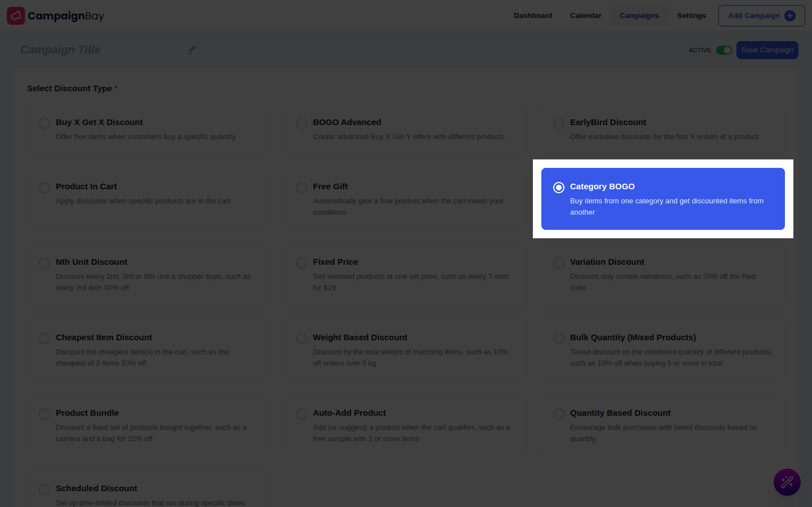
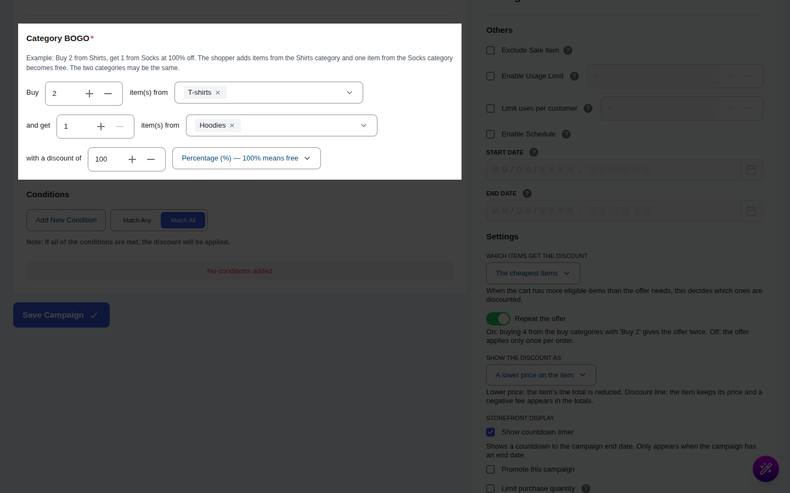

# Campaign Type: Category BOGO

::: tip Pro Feature
This is a **CampaignBayPro** feature. [Upgrade to Pro](https://wpanchorbay.com/campaignbay) to unlock Category BOGO and other powerful features.
:::

A **Category BOGO** campaign says: "Buy items from one category and get discounted items from another." For example, buy 1 item from **Clothing** and get 1 item from **Accessories** free.

It works on the shopper's existing cart. Nothing is added, so there are no free lines: the get items are discounted in place. The two category sets can even be the same ("buy 1 shirt, get the second shirt half price").

For product-to-product BOGO see [BOGO Advanced](./bogo-advanced-discounts.md).

## Step 1: Select Your Campaign Type

Navigate to **CampaignBay → Add Campaign**.

- **Select Discount Type:** Choose **Category BOGO** ("Buy items from one category and get discounted items from another").
- **Campaign Title** and **Status** work as usual. There is no **Target** section.

## Step 2: Define the Offer

The **Category BOGO** section reads as one sentence:

> Buy **[qty]** item(s) from **[categories]** and get **[qty]** item(s) from **[categories]** with a discount of **[value]** **[type]**

| Field | What it does |
| :--- | :--- |
| Buy quantity and categories | Units from these categories that must be bought. |
| Get quantity and categories | Units from these categories that receive the discount. |
| Discount | **Percentage (%)** (100% means free) or **Fixed amount off each item ($)**. A fixed amount never goes below the item's price. |

Defaults when you pick the type: buy 1, get 1, percentage, 100.

## Step 3: Settings

| Setting | Default | What it does |
| :--- | :--- | :--- |
| **Which items get the discount** | The cheapest items | **The cheapest items**, **The most expensive items**, or **The items added to the cart first**. |
| **Repeat the offer** | On | Gives the offer again for every full set in the cart. |
| **Show the discount as** | | **A lower price on the item** (struck-through price) or **A separate discount line in the cart totals**. |

Also set Conditions, **Others** (Exclude Sale Item, Enable Usage Limit) and the schedule as in [Quantity Discounts](./quantity-discounts.md).

## Step 4: Messages

In **CampaignBay Pro → Settings → Gifts and offers messages**, the product page message format is `Buy {buy_quantity} from {buy_categories}, get {discount} off {get_quantity} from {get_categories}`. The toggle **Show Category BOGO and Nth Unit offers on product pages** turns it on or off. The message shows on products in either category set.

## Step 5: Save the Campaign

Click **Save Campaign**.

## Worked Examples

Prices: A (Clothing) $100, B (Clothing) $50, E (Accessories) $25.

### Example 1: Buy Clothing, get Accessories free

Buy 1 Clothing, get 1 Accessories, 100%.

- **Product page (E):** the offer message appears.
- **Cart A + E:** E shows $0.00 with $25.00 struck through. Subtotal $100.
- **Checkout and order:** E's line total is $0 and the order total is $100.

### Example 2: Same category

Buy 1 from Clothing, get 1 from Clothing, 100%, cheapest. Cart A x1, B x2.

- Only one set forms (a unit is never both bought and discounted at once with 3 units). A is the buy item and one B is free: $200 - $50 = $150.

### Example 3: Repeat and buy 2 get 1

Buy 2 from Clothing, get 1 from Clothing, 100%, cheapest, Repeat on. Cart A x2, B x4 (6 units): two sets, the two cheapest B units are free. Total $200 + $200 - $100 = $300. With Repeat off only one B is free.

## Gotchas

- **Claiming order:** buy units are claimed first. A unit in both category sets is used as a buy unit only when buy-only units are not enough.
- **Sets:** the number of sets is the most the cart can supply; a set is all or nothing (buying 1 of a "get 2" offer gives nothing).
- **Which item is free:** your choice (cheapest, most expensive, first added) decides, not what the shopper added last.
- **Stacking:** with stacking off, a unit already discounted by another CampaignBay campaign can serve as a buy unit but never as a get unit. Units discounted by an earlier Pro offer are not discounted twice.
- **Zero-price and free lines** (gifts, BOGO free items) are ignored.
- **Usage counting:** an order with this discount counts as one use of the campaign.
- **Stock:** nothing is added, so stock only matters for what the shopper puts in the cart.
- **Product page price** does not change; the discount is calculated in the cart.
- **Fee display:** with "A separate discount line", rounding can differ by 1 cent from the item-price mode when tax is involved.

Next, discount every Nth unit.

- **[Nth Unit Discount &rarr;](./nth-unit-discounts.md)**
