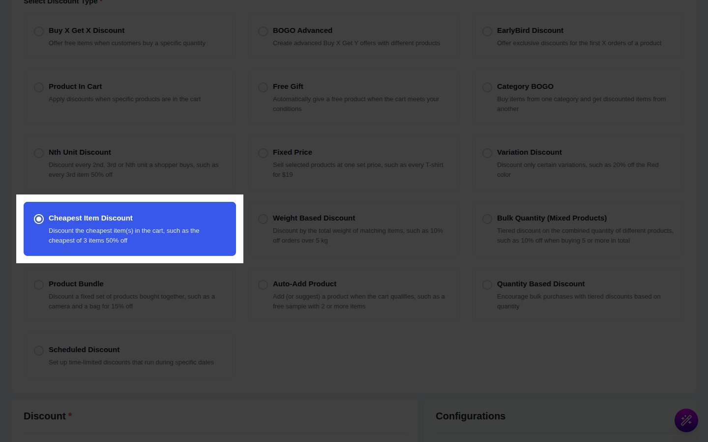
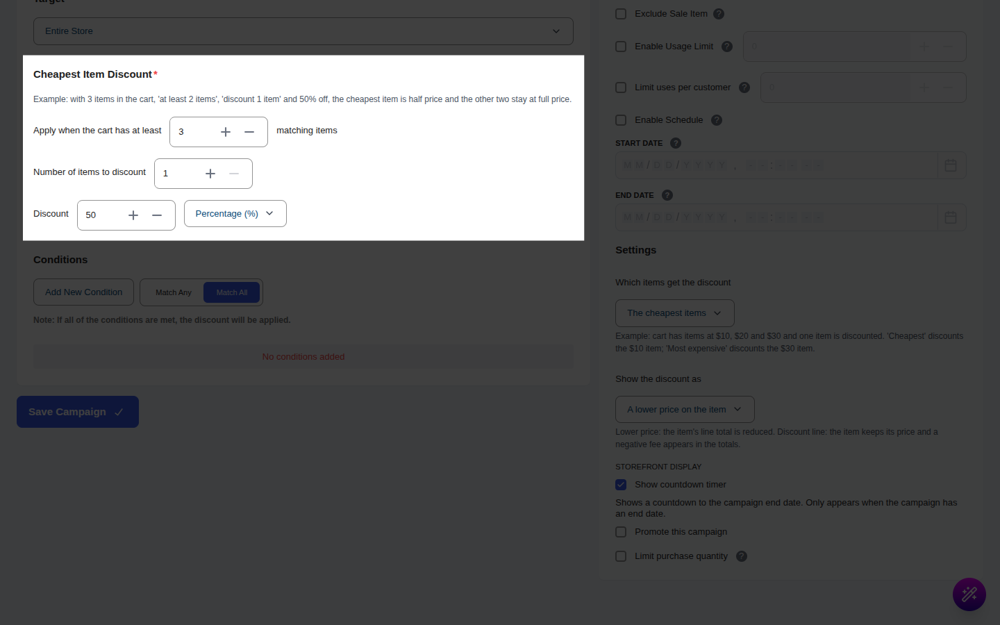
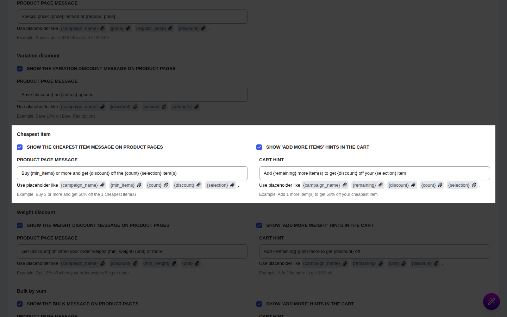

# Campaign Type: Cheapest Item Discount

::: tip Pro Feature
This is a **CampaignBayPro** feature (Pro 1.1.0 and later). [Upgrade to Pro](https://wpanchorbay.com/campaignbay) to unlock Cheapest Item Discounts and other powerful features.
:::

A **Cheapest Item Discount** takes a discount off the **cheapest item(s) in the cart** (or the most expensive, if you prefer) once the shopper has enough matching items. It is a classic "mix and match" offer.

This is the perfect campaign type for scenarios like:

- "Buy 3 or more, get the **cheapest one half price**"
- "Buy any 2 shirts, the cheaper one is **$10 off**"
- "Spend on 4 items and the **2 cheapest are 30% off**"

This is a **cart-level** campaign. It never changes the price on the product page or in the shop. The discount appears in the cart, at checkout and on the order. The product page can show an optional message about the offer.

## Step 1: Select Your Campaign Type

Go to **CampaignBay → Add Campaign**.

- **Select Discount Type:** Choose **`Cheapest Item Discount`** ("Discount the cheapest item(s) in the cart, such as the cheapest of 3 items 50% off").
- **Campaign Title:** e.g., "Third Shirt Half Price". When the discount is shown as a separate line, this title is its name in the cart.
- **Select Status:** **Active** or **Inactive** (draft).

## Step 2: Set the Discount Target

Choose which products count towards the offer. Only items matched by the target are counted and only they can be discounted.

**[Read the Full Guide: Targeting &rarr;](../core-concepts/targeting.md)**

## Step 3: Set Up the Cheapest Item Discount

The section's own example: with 3 items in the cart, "at least 2 items", "discount 1 item" and 50% off, the cheapest item is half price and the other two stay at full price.

- **Apply when the cart has at least (matching items):** how many matching items must be in the cart before the discount starts. Quantity counts, so 2 of the same product are 2 items. Must be a whole number of at least 1. If you leave it empty, 2 is used.
- **Number of items to discount:** how many items get the discount. Must be a whole number of at least 1. If there are fewer items than this number, all of them are discounted.
- **Discount:** the amount, and its type:
  - **Percentage (%):** a percentage off each discounted item. Above 0, at most 100.
  - **Fixed amount off each discounted item:** a flat amount off **each** discounted item. It is never more than that item's price.
- **Which items get the discount:**
  - **The cheapest items** (default). With items at $10, $20 and $30 and one item discounted, the $10 item is discounted.
  - **The most expensive items.** In the same cart, the $30 item is discounted.
- **Show the discount as:**
  - **A lower price on the item** (default): the item's price in the cart is reduced and shown crossed out.
  - **A separate discount line in the cart totals:** the item keeps its price and one negative line named after the campaign appears in the totals.

A coupon-line option is not offered for this campaign type.

## Step 4: Conditions, Other Configurations and Schedule

- **[Conditions &rarr;](../core-concepts/conditions.md)**: who is eligible, or a minimum cart total.
- **Exclude Sale Items:** sale items are neither counted nor discounted.
- **Enable Usage Limit:** one order counts as one use, however many items were discounted.
- **Start Time / End Time:** see **[Scheduling & Automation &rarr;](../core-concepts/scheduling-and-automation.md)**.

## Step 5: Shopper Messages (Optional)

Set these under **CampaignBay → Settings → Cart Settings → Offer type messages → Cheapest item**.

| Setting | What it does | Default |
| --- | --- | --- |
| **Show the cheapest item message on product pages** | Message above Add to Cart. | On |
| **Show 'add more items' hints in the cart** | A hint while the cart is below the minimum. | On |
| **Product page message** | Placeholders: `{campaign_name}`, `{min_items}`, `{count}`, `{discount}`, `{selection}` | `Buy {min_items} or more and get {discount} off the {count} {selection} item(s)` |
| **Cart hint** | Placeholders: `{campaign_name}`, `{remaining}`, `{discount}`, `{count}`, `{selection}` | `Add {remaining} more item(s) to get {discount} off your {selection} item` |

`{selection}` prints "cheapest" or "most expensive". A percentage prints as `50%`; a fixed amount prints as a price such as `$10.00`. A blank field uses the default.

## Step 6: Save the Campaign

Click **Save Campaign**.

## Worked Examples

Prices used: A 100.00, B 50.00, D 80.00. Setup in examples 1 and 2: minimum 2 items, discount 1 item, 50%, the cheapest items, "A lower price on the item".

### Example 1: Two different products

**Cart:** A ×1 (100.00), B ×1 (50.00).

- Two items reach the minimum. The cheapest is B.
- Discount = 50% of 50.00 = **25.00**.
- B's line becomes 25.00; A stays 100.00. **Total 125.00.**

| Where | What the shopper sees |
| --- | --- |
| Product page | Message "Buy 2 or more and get 50% off the 1 cheapest item(s)". Prices unchanged. |
| Cart | B shown as ~~$50.00~~ $25.00. Before the minimum, a hint "Add 1 more item(s) to get 50% off your cheapest item". |
| Checkout and order | B's order line is 25.00; the campaign appears in the order's discount breakdown. |

### Example 2: Several of the same product

**Cart:** B ×3 and A ×1.

- Four items, so the offer applies. The cheapest item is one unit of B.
- Discount 25.00 on **one** B unit only: the B line is 150.00 − 25.00 = **125.00**. A stays 100.00. **Total 225.00.**
- The cart shows the B line's average unit price (41.67), but the line total is exactly 125.00.

### Example 3: Two items discounted, as a separate line

**Setup:** discount 2 items, **Fixed amount off each discounted item** = 10, minimum 2, **A separate discount line in the cart totals**.

**Cart:** B ×2, A ×1, D ×1.

- The 2 cheapest units are both B (50.00 each). Each gets 10.00 off → **20.00**.
- Item lines stay at full price: subtotal 280.00.
- The cart totals show one negative line named after the campaign: **−20.00**. **Total 260.00.**

If you set "Which items get the discount" to **The most expensive items** with the same cart, A and D are discounted instead (10.00 each).

## Gotchas

- **Ties:** when two items cost the same, the one added to the cart first is discounted. The total is the same either way.
- **Quantity counts.** Two units of the same product reach a minimum of 2.
- **Only the first set of values is used.** There is one rule per campaign, not tiers.
- **Cart discounts on other campaigns count as "already used".** Pro cart campaigns run in this order: Cheapest Item, then [Weight Discount](./weight-discounts.md), then [Bulk Quantity](./bulk-sum-discounts.md). A unit that a Cheapest Item campaign has already discounted is not discounted again by the others (it also no longer counts towards the Bulk Quantity sum). With a 100/50/80 cart, a Cheapest Item discount on B (25.00) means a Bulk Quantity campaign has only A and D left to count.
- **Stacking.** If **Allow Stacking with Other Discount Campaigns** is off in [Cart Settings](../settings/cart-settings.md), an item that another campaign already discounted cannot take part in this one, and the cart hint is not shown for it either.
- **Product and shop prices never change.** Do not expect a sale badge. Use the product page message to advertise the offer.
- **Tax.** Discounts shown as a separate line reduce the tax in the same way the price reduction would.

Next, discount a cart by its total weight.

- **[Weight Based Discount &rarr;](./weight-discounts.md)**
