# Campaign Type: Early Bird Discount

An **Early Bird Discount** is a powerful marketing tool designed to create urgency and drive rapid sales by rewarding your first customers. The discount is based on the total number of **successful orders** that have already used the campaign.

This is the perfect campaign type for scenarios like:

- "50% off for the first 100 customers!"
- "Launch Special: The first 50 orders get $20 off, the next 100 get $10 off."
- Creating a flash sale with a limited number of available slots.

::: warning Important: Order vs. Quantity
An Early Bird discount is based on the number of **orders**, not the quantity of items purchased. If one customer buys 100 items in a single transaction, it only counts as **one** use toward the campaign's limit.
:::

This guide will walk you through every field required to set up this campaign type.

## Step 1: Select Your Campaign Type

To begin, navigate to **CampaignBay → Add Campaign**.

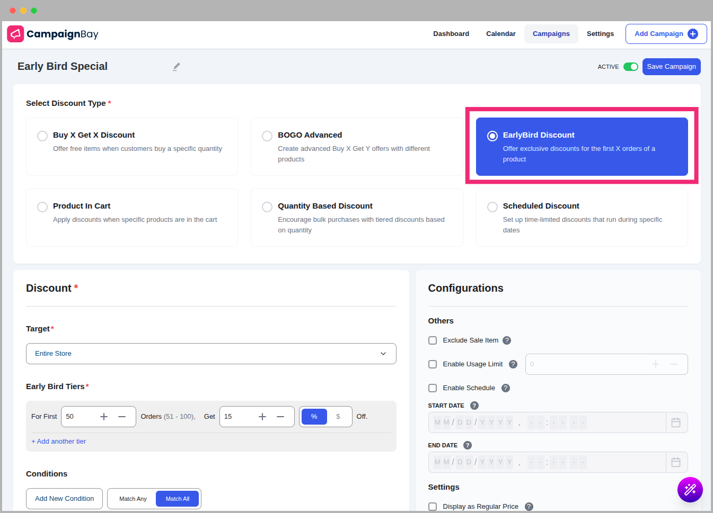

- **Select Discount Type:** Choose **`EarlyBird Discount`** from the list. This will reveal the tiered configuration for rewarding your first customers.

- **Campaign Title:** Give your campaign a clear and descriptive name (e.g., "New Product Launch Offer").

- **Select Status:**
  - **Active:** The campaign will be live immediately (or on its scheduled start time).
  - **Inactive:** Save the campaign as a draft.

## Step 2: Set the Discount Target

This crucial step defines which products in your store are eligible for the early bird discount.

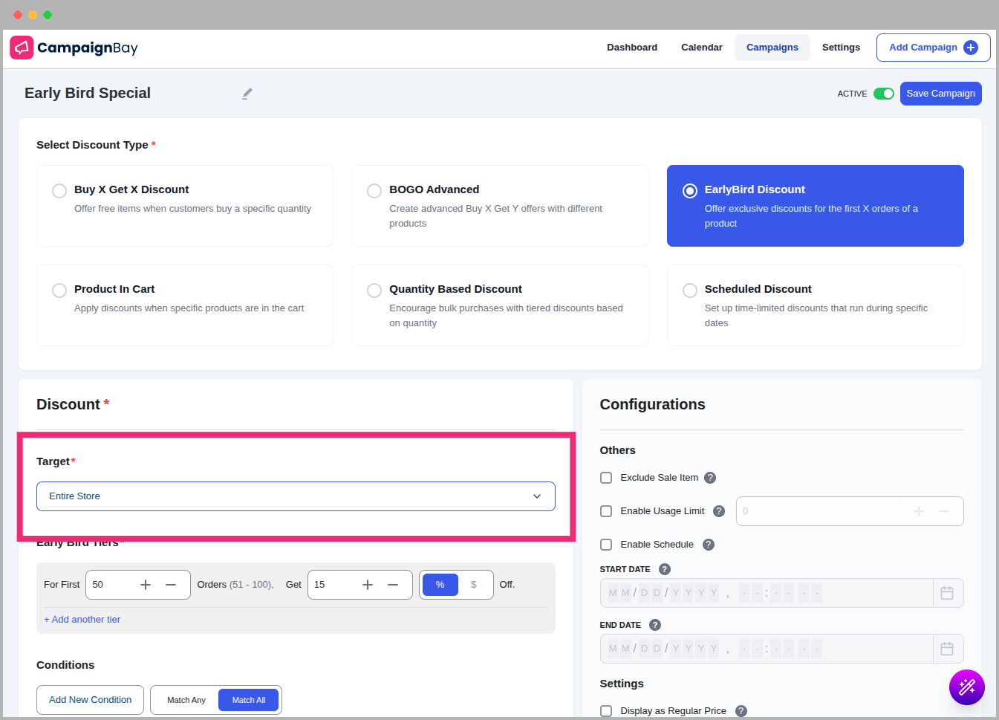

The **DISCOUNT TARGET** dropdown provides powerful options to control the scope of your campaign, such as applying it to the entire store, specific products, or categories.

::: info Learn More About Targeting
The "Discount Target" setting is a powerful feature shared by all campaign types. We've created a dedicated guide to explain all of its options and conditional fields in detail.

**[Read the Full Guide: Targeting &rarr;](../core-concepts/targeting.md)**
:::

## Step 3: Define Discount Tiers For First Sales

This is the core of the Early Bird Discount. Here you will define the tiers based on the number of successful orders.

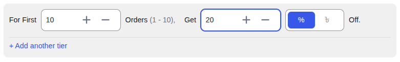

- **For First:** Enter the number of orders for this tier. For example, entering `10` here means this tier applies to the first 10 orders. This is a number of **orders**, not a number of items.
- **Orders (e.g., 1 - 10):** This label automatically updates to show the range of orders covered by this tier.
- **Get:** The numeric value of the discount.
- **% / Fixed ($) (Mode):** The type of discount to apply (Percentage or Fixed Currency amount).

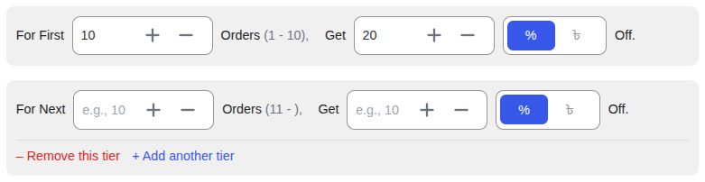

- **+ Add another tier:** Click this to add multiple levels of Early Bird offers (e.g., "For Next 10 Orders..."). Each subsequent tier will automatically pick up where the previous one left off. The first tier is labelled **For First** and later tiers **For Next**. Fill in the previous tier's number of orders and value first.
- **- Remove this tier:** Removes a tier. In a fixed-amount tier the text after the value reads **Off per Piece.**

::: warning At least one tier is required
An Early Bird campaign cannot be saved without tiers.
:::

### How Tiers Work

The tiers work sequentially from top to bottom.

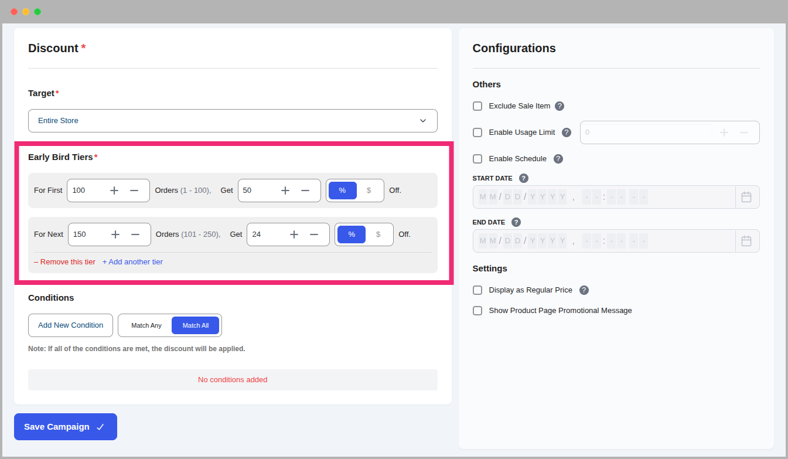

**Example Tier Setup:**

- **Tier 1:** For First `100 Sales (1 - 100)`, give `50` `%`
- **Tier 2:** For Next `150 Sales (101 - 250)`, give `25` `%`

**In this scenario:**

- Orders 1 through 100 will receive a 50% discount.
- Orders 101 through 250 will receive a 25% discount.
- Order 251 and beyond will receive no discount from this campaign.

### When the Tiers Are Used Up

Once every tier has been used up, the campaign gives **no discount, no countdown timer and no sale badge**, and its promotion and category offer messages disappear. This also applies to the shop pages, cart and shortcodes. Nothing advertises an offer that no longer exists.

::: warning The campaign still shows as Active
A campaign whose tiers are used up keeps the **Active** status in the campaign list unless a usage limit ends it (see Step 5). Set a usage limit equal to the total of all tier orders (for example 250 in the example above) to have it marked **Expired** automatically.
:::

::: info How orders are counted
- The whole cart takes the **current** tier. One order counts as one use, no matter how many items or what quantity it contains, and a big order never "overflows" into the next tier.
- An order is counted when it reaches **Processing** or **Completed**. Orders waiting for payment (for example bank transfer, On-hold) are not counted until then, so several waiting orders can all be priced at the same tier.
- If a counted order is cancelled, refunded in full or fails, its use is given back. A partial refund does not give the use back.
- Prices are never locked when an item is added to the cart. If the tier changes before the customer pays, the order is priced at the tier current at checkout.
:::

## Step 4: Set Conditions (Optional)

You can add specific rules to restrict who can use this discount (e.g., specific User Roles).

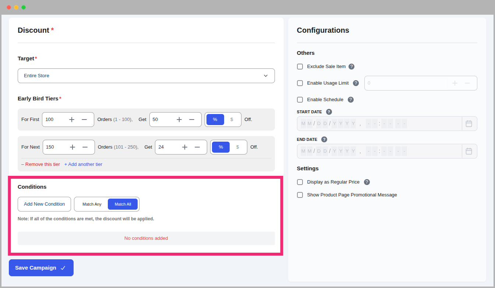

**[Read the Full Guide: How to Use Conditions &rarr;](../core-concepts/conditions.md)**

New in 1.2.0, two more conditions are available in the free plugin: **Guest / Logged-in** (apply the offer only to guests or only to logged-in customers) and **Cart Item Quantity**.

## Step 5: Set Other Configurations (Optional)

This section provides additional rules for your campaign.

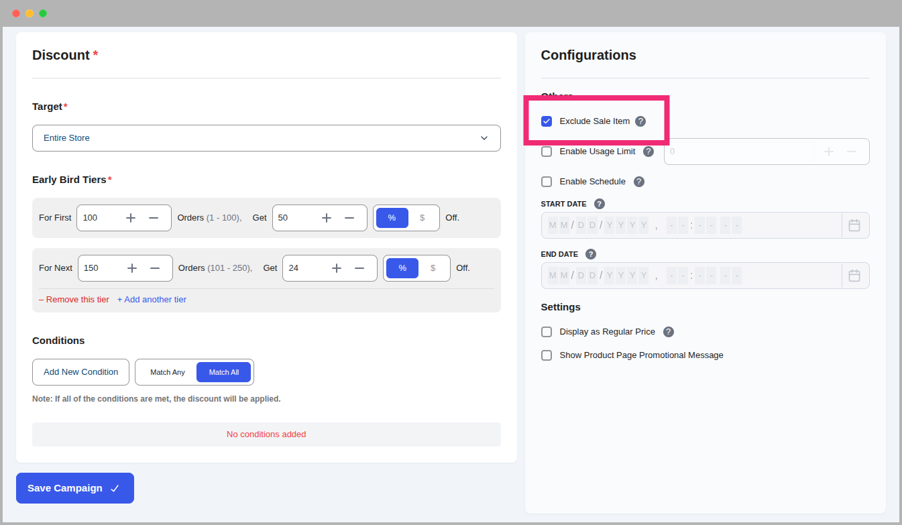

- **Exclude Sale Items:** Check this box if you do not want this campaign's discount to apply to products that are already on sale in WooCommerce. This is useful for preventing "double discounting."

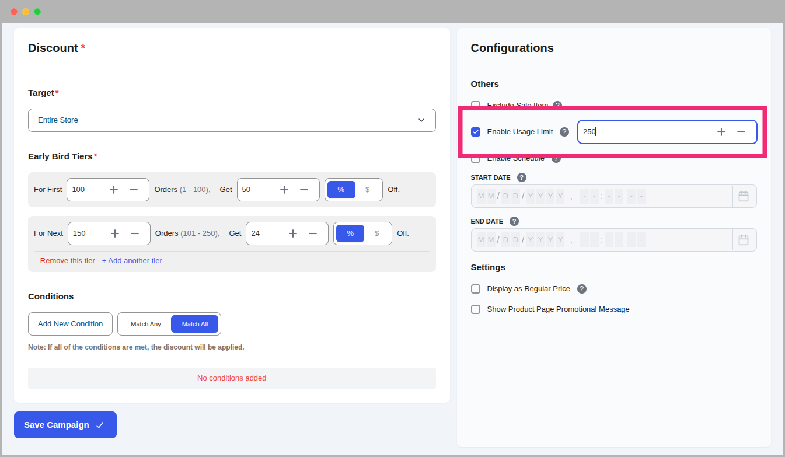

- **Enable Usage Limit:** Check this box to set a maximum number of **orders** that can use this campaign across your entire store. A limit of `N` expires the campaign after exactly `N` orders (a limit of `1` expires it after the first order). Only orders that reach **Processing** or **Completed** are counted. If a counted order is later cancelled, refunded or fails, its use is given back and a campaign that had expired because of its limit becomes active again.

## Step 6: Set the Schedule (Optional)

You can optionally schedule your campaign to run during a specific time window. This section controls when your campaign will automatically start and end.

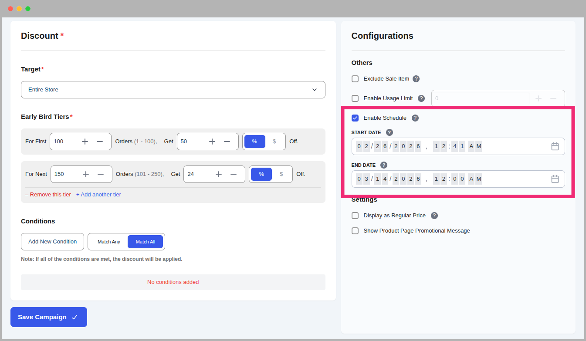

- **Start Time / End Time:** Use the date and time pickers to set the exact moment for the campaign to activate and expire.

::: tip Timezone Information
All dates and times are based on the timezone you have configured in your main WordPress settings under **Settings → General → Timezone**. The system automatically handles all UTC conversions for you.
:::

::: info Learn More About Automation
The status of your campaign is closely tied to the scheduling system, which uses WordPress Cron to automate activation and expiration.

**[Read the Full Guide: Scheduling & Automation &rarr;](../core-concepts/scheduling-and-automation.md)**
:::

## Step 7: Display Configurations

This section controls how the offer is communicated to the customer, both on the product page and in their cart.

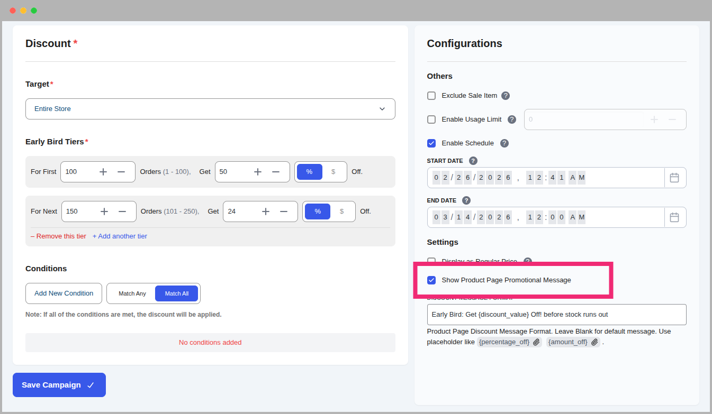

- **Show Product Page Promotional Message:** Toggle this to enable or disable the custom message on the product pages.

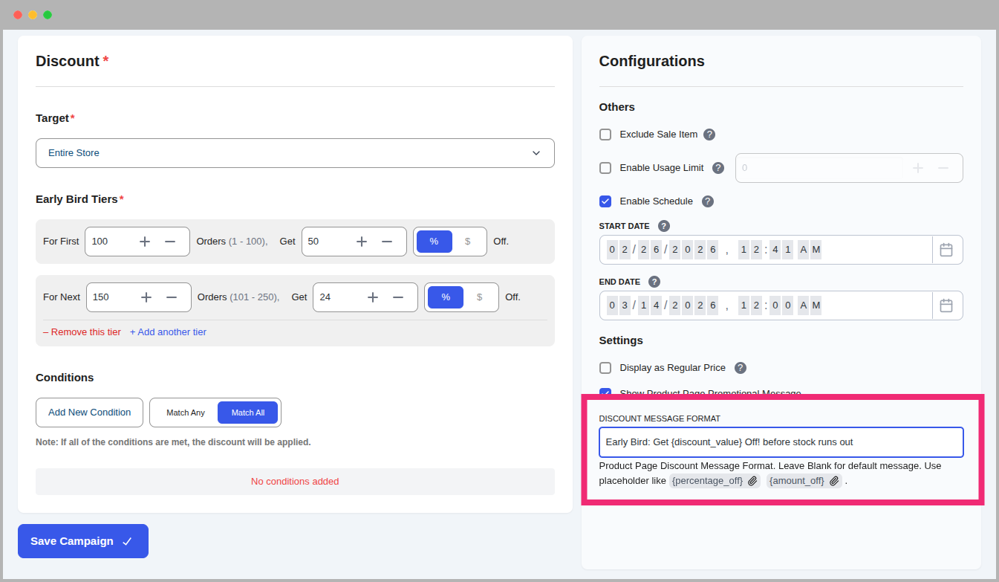

- **Discount Message Format:** Customize the promotional text using placeholders like `{percentage_off}` or `{amount_off}`. Leave it empty for the default ("You save {percentage_off}%" or "You save {amount_off} per item"). Both placeholders show the value of the **current** tier.
  - _Example:_ `Early Bird Special! Get {percentage_off}% off for a limited time!`

The message always reflects the current tier only, and it disappears when the tiers are used up. If **Display as Regular Price** is ticked, the message options are hidden.

### Storefront Display: Countdown Timer and Promotion

Every campaign type has a **Storefront display** group at the bottom of the Display Configurations.

- **Show countdown timer:** Shows a live countdown to the campaign's end date. It only appears when the campaign has a **schedule enabled with an end date in the future**. Where it appears (product page, shop and category listings, cart) and what it says is controlled in **Settings → Product Settings → Countdown Timer**. You can also place it anywhere with the `[campaignbay_countdown id="12"]` shortcode.
- **Promote this campaign:** Tick this to let the campaign advertise itself on category pages and through the promotion blurb. Optionally type a **Promotion text**; leave it blank to use the default. You can use `{campaign_title}`, `{end_date}` and `{discount}` in the text.

::: info Learn More
The wording, colours and locations of the countdown timer, sale badge, category and shop offer messages and promotion blurbs are global settings. See the [Product Settings guide](../settings/product-settings.md).
:::

### Limit Purchase Quantity (Optional)

Tick **Limit purchase quantity** to set a **Minimum quantity**, **Maximum quantity** and **Quantity step** for the products this campaign targets, while the campaign is active.

- Leave a field empty for no limit. Each field has a minimum value of `1`.
- Quantities must be a multiple of the step. For example, minimum `5`, maximum `20`, step `5` allows only 5, 10, 15 or 20.
- Customers see a note on the product page such as "Purchase limits: minimum 5, maximum 20, multiples of 5", and get an error if they try to add or keep a quantity outside the limits.
- If a product is covered by more than one campaign with limits, the strictest combination applies.
- The limits are saved only if at least one of the three fields is filled, the minimum is not above the maximum, and some quantity actually fits the step.

::: warning Not enforced with some conditions
Limits are not enforced for campaigns that use **Cart Total** or **Cart Item Quantity** conditions.
:::

::: tip Prices and Tax
Campaign prices follow your WooCommerce tax settings. The discount is worked out on the price as you entered it, and the final price shown to customers includes or excludes tax according to your **WooCommerce → Settings → Tax** display options.
:::

## Step 8: Save the Campaign

Once you have configured all the options, click the **Save Campaign** button at the top right of the page. After saving, you will be redirected back to the "All Campaigns" list.

## Next Steps

Next, learn how to create campaigns that offer "Buy One, Get One" style deals.

- **[Creating a BOGO Discount &rarr;](./bogo-discounts.md)**
