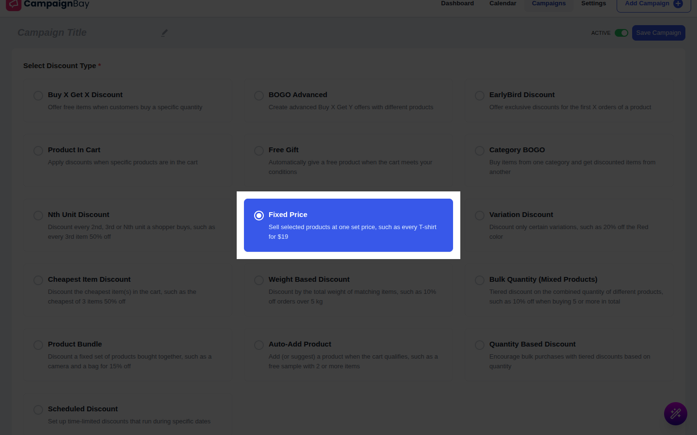
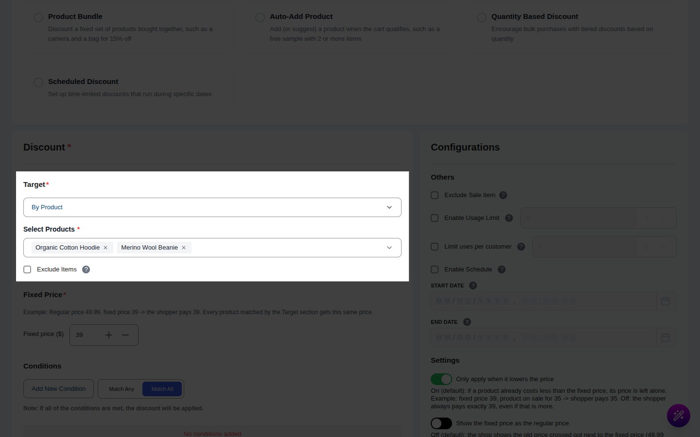
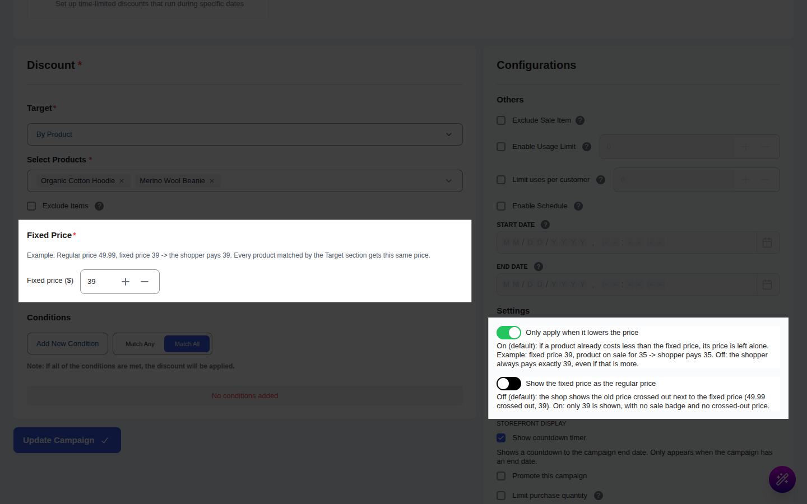
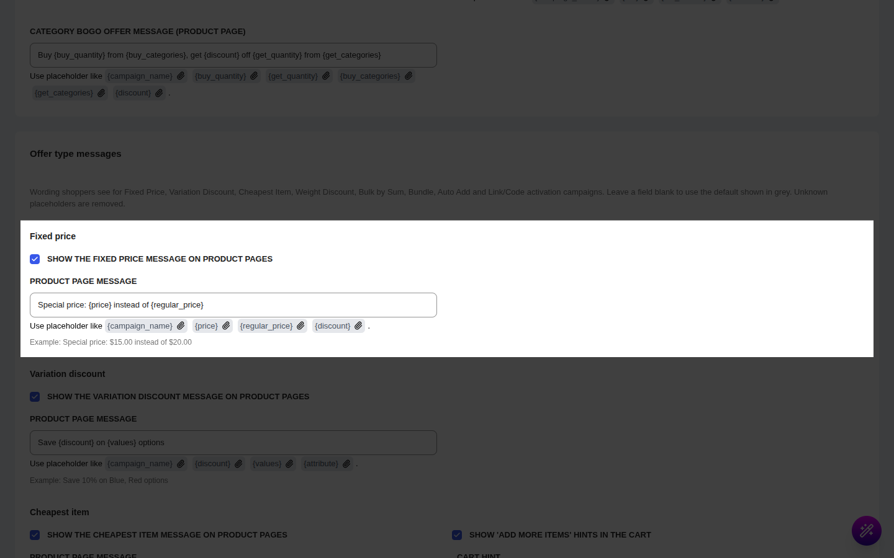

# Campaign Type: Fixed Price

::: tip Pro Feature
This is a **CampaignBayPro** feature (Pro 1.1.0 and later). [Upgrade to Pro](https://wpanchorbay.com/campaignbay) to unlock Fixed Price discounts and other powerful features.
:::

A **Fixed Price** campaign sells the products you choose at **one set price**, no matter what their regular price is. Instead of saying "20% off", you say "this costs $39".

This is the perfect campaign type for scenarios like:

- "Every T-shirt for $19"
- "Everything in the Clearance category for $9.99"
- A flash price on one product ("Today only: $79") where you want an exact number, not a percentage.

Fixed Price is a **product-level** campaign. The new price shows on the product page, in the shop and category listings, in the cart and at checkout, exactly like a Scheduled discount does.

## Step 1: Select Your Campaign Type

To begin, navigate to **CampaignBay → Add Campaign**.

- **Select Discount Type:** Choose **`Fixed Price`** from the list ("Sell selected products at one set price, such as every T-shirt for $19").
- **Campaign Title:** Give the campaign a clear name (e.g., "Spring T-Shirt Price"). The title is also the name used in the order's discount breakdown.
- **Select Status:**
  - **Active:** The campaign is live as soon as its start time is reached.
  - **Inactive:** The campaign is saved as a draft.

## Step 2: Set the Discount Target

Choose which products get the fixed price. Every product matched by the target gets the **same** price.

::: info Learn More About Targeting
The "Discount Target" setting is shared by all campaign types. See the full guide for entire store, products, categories and the Exclude toggle.

**[Read the Full Guide: Targeting &rarr;](../core-concepts/targeting.md)**
:::

::: tip Variable products
If you target a variable product (or its category), **every variation** gets the fixed price. To give different variations different prices, use a [Variation Discount](./variation-discounts.md) campaign instead.
:::

## Step 3: Enter the Fixed Price

In the **Fixed Price** section (required):

- **Fixed price (\$):** The price the shopper pays for each unit. Enter `39` and a product that normally costs 49.99 is sold for 39. The currency symbol follows your WooCommerce settings. Decimals are rounded to your store's number of price decimals.

There is exactly one price per campaign. Only the first value is used.

### Two switches decide how it behaves

- **Only apply when it lowers the price** (on by default)
  - **On:** If a product already costs **less** than the fixed price, the product is left alone. Example: fixed price 39, product on sale for 35 → the shopper pays 35.
  - **Off:** The shopper always pays exactly the fixed price, **even if that is more** than the current price. Use this only when you really want to _set_ a price (for example to move everything to a flat price list).
- **Show the fixed price as the regular price** (off by default)
  - **Off:** The shop shows the old price crossed out next to the fixed price (~~49.99~~ 39), with a sale badge.
  - **On:** Only 39 is shown, with no sale badge and no crossed-out price. The fixed price looks like the product's normal price. In the order, the line also shows the fixed price as its regular price.

## Step 4: Set Conditions (Optional)

You can restrict who gets the fixed price (for example only a certain user role, or only when the cart total is above an amount).

**[Read the Full Guide: How to Use Conditions &rarr;](../core-concepts/conditions.md)**

## Step 5: Set Other Configurations (Optional)

- **Exclude Sale Items:** Check this box to skip products that are already on sale in WooCommerce.
- **Enable Usage Limit:** Set the maximum number of orders that may use this campaign. When the limit is reached the campaign expires automatically. One order counts as **one** use, however many units it contains.

## Step 6: Set the Schedule (Optional)

Use **Start Time / End Time** to run the price only for a time window.

::: tip Timezone Information
All dates and times are based on the timezone you have configured in your main WordPress settings under **Settings → General → Timezone**.
:::

::: info Learn More About Automation
**[Read the Full Guide: Scheduling & Automation &rarr;](../core-concepts/scheduling-and-automation.md)**
:::

## Step 7: Product Page Message (Optional)

Fixed Price shows a short message above the Add to Cart button, such as:

> Special price: $80.00 instead of $100.00

This message is controlled **globally** in the Pro settings, not inside the campaign. Go to **CampaignBay → Settings → Cart Settings → Offer type messages → Fixed price**:

| Setting | What it does | Default |
| --- | --- | --- |
| **Show the fixed price message on product pages** | Turns the message on or off for all Fixed Price campaigns. | On |
| **Product page message** | The wording. Placeholders: `{campaign_name}`, `{price}`, `{regular_price}`, `{discount}`. | `Special price: {price} instead of {regular_price}` |

Leave the field blank to use the default. Unknown placeholders are removed and HTML is stripped.

## Step 8: Save the Campaign

Click **Save Campaign**. You will be redirected to the "All Campaigns" list.

## Worked Examples

### Example 1: Every unit at $80

**Setup:** Fixed Price campaign, target = product "Hoodie" (regular price 100.00), Fixed price = 80, defaults for both switches.

| Where | What the shopper sees |
| --- | --- |
| Product page | ~~$100.00~~ **$80.00** with a sale badge, plus "Special price: $80.00 instead of $100.00" |
| Shop / category page | Same crossed-out price and sale badge |
| Cart with 3 Hoodies | Unit price ~~$100.00~~ $80.00, line total **$240.00** |
| Checkout / order | Hoodie line 240.00. The discount of 60.00 is recorded in the order's discount breakdown. Shipping, tax and free-shipping thresholds are all worked out on the discounted amount. |

### Example 2: A sale item and "Only apply when it lowers the price"

A product "Mug" has a regular price of 20.00 and is on sale at 15.00. You run a Fixed Price campaign of **18.00**.

- The campaign compares the fixed price with the price **the discount is calculated from**. That is the regular price (20.00) by default, so 18.00 is lower, the campaign applies and the shopper pays **18.00**. This is _more_ than the 15.00 WooCommerce sale price.
- If you change **Calculate Discount From** to **Sale Price** in the [Global Settings](../settings/global-settings.md), the comparison is made with 15.00. With "Only apply when it lowers the price" on, 18.00 is not lower, so the campaign is skipped and the shopper pays 15.00. A fixed price of 12.00 would apply and be shown as ~~$15.00~~ $12.00.
- To keep sale items out of the campaign altogether, tick **Exclude Sale Items**.

### Example 3: Fixed Price versus another campaign

A product costs 100.00. A Fixed Price campaign sets it to 80.00. A Scheduled discount also targets the product. With stacking off, the **Discount priority method** in [Product Settings](../settings/product-settings.md#product-prioritization) decides who wins; the default is **Apply Highest Discount** (the biggest price reduction wins):

| Scheduled campaign | Its price | Winner under Apply Highest Discount | Shopper pays |
| --- | --- | --- | --- |
| 10% off | 90.00 | Fixed Price (80.00 is lower) | 80.00 |
| 30% off | 70.00 | Scheduled (70.00 is lower; the fixed price is skipped) | 70.00 |

Only the winning campaign is used for the order and only the winner's usage count goes up.

## Gotchas

- **It is not a percentage.** Every matched product gets the same number. Do not target your whole store unless you really want every product at one price.
- **"Only apply when it lowers the price" is on by default.** If a product does not change, check that the fixed price is not higher than its current price.
- **Turning that switch off can raise prices.** A fixed price of 120 on a 100 product makes it cost 120, and it will show as a normal price, not a sale.
- **Variable products:** the fixed price is applied per variation. With "only lower" on, variations already cheaper than the fixed price keep their price, so the price range on the parent product can look different from what you expect (for example, a fixed price of 55 on variations costing 50, 60 and 70 gives 50, 55 and 55 → the parent shows `$50.00 - $55.00`).
- **Parent price display:** when a fixed price is not lower than a variation's price (so the variation is not "on sale"), the parent shows a plain price without a crossed-out range.
- **Cache:** after editing a campaign, the variation price cache is refreshed automatically. If you use a full-page cache, purge it after changing a price campaign.
- **Pro add-on:** the campaign only works while CampaignBay Pro is active and the Pro add-on is switched on in the settings. If it is off or deactivated, products go back to their regular prices; the campaign stays in your list and works again when you re-enable Pro.

Next, discount only some variations of a product with a Variation Discount.

- **[Variation Discount &rarr;](./variation-discounts.md)**
