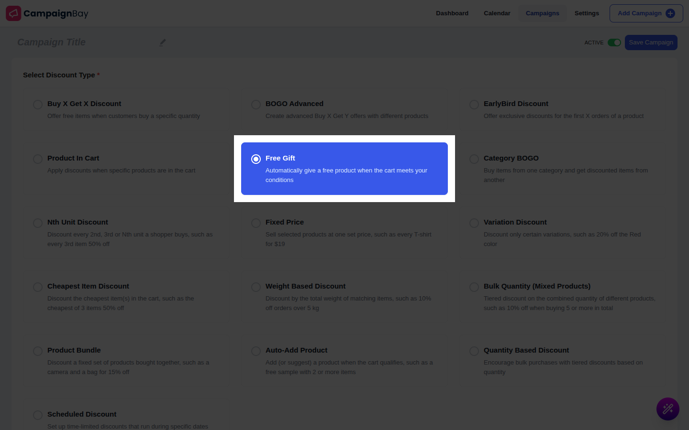
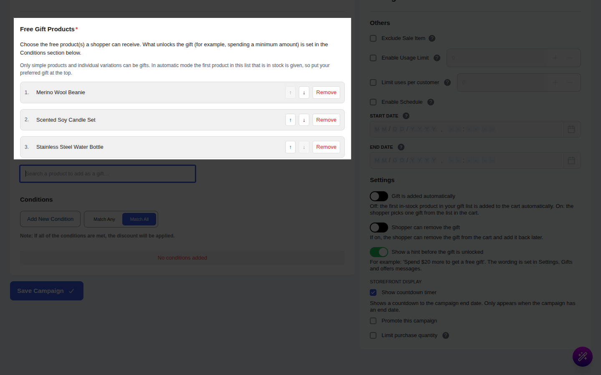
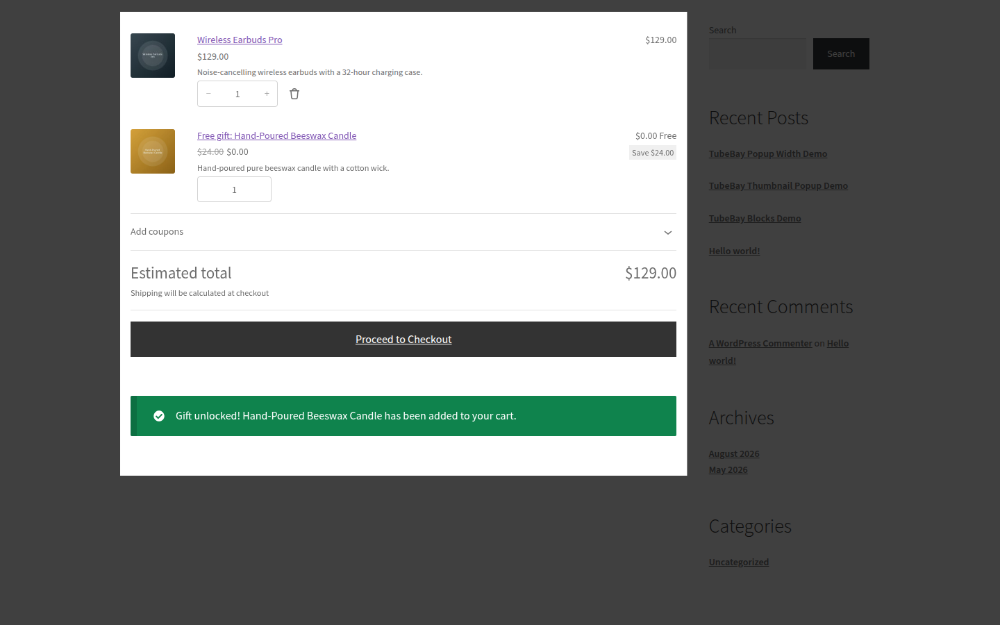

# Campaign Type: Free Gift

::: tip Pro Feature
This is a **CampaignBayPro** feature. [Upgrade to Pro](https://wpanchorbay.com/campaignbay) to unlock Free Gift campaigns and other powerful features.
:::

A **Free Gift** campaign automatically gives a free product when the cart meets the conditions you set, for example "Spend $150 and get a free Poster". The gift is added as its own cart line at a price of **Free**, always in a quantity of 1.

You provide a list of possible gifts. In automatic mode the shopper gets the first one that is in stock. In choose mode the shopper picks one from the list.

## Step 1: Select Your Campaign Type

Navigate to **CampaignBay → Add Campaign**.

- **Select Discount Type:** Choose **Free Gift** ("Automatically give a free product when the cart meets your conditions").
- **Campaign Title** and **Status** work as in the other campaign types.

::: info
There is no **Target** section for this type. What unlocks the gift is set in **Conditions** (Step 3).
:::

## Step 2: Add the Gift Products

In **Free Gift Products**, build an ordered list of 1 to 20 products.

- Search with "Search a product to add as a gift…". Only simple products and variations can be used, not a variable parent. They must be published and purchasable.
- Use the up and down arrows to reorder and **Remove** to delete.
- In automatic mode the **first in-stock product in the list** is given, so put your preferred gift at the top.

## Step 3: Set What Unlocks the Gift

Open **Conditions** ([Conditions](../core-concepts/conditions.md)) and add a rule, for example **Cart total** is greater than or equal to 150. With no condition, every shopper with a paid line in the cart gets the gift. The gift is never given to a cart that has only free items.

The "Spend X more" hint understands only a cart total rule using "greater than or equal to" or "greater than". Other rules still work for unlocking but show no hint.

## Step 4: Settings

| Setting | Default | What it does |
| :--- | :--- | :--- |
| **Gift is added automatically** / **Shopper chooses from the list** | Automatic | In choose mode the cart shows a picker and no gift is added until the shopper picks one. |
| **Shopper can remove the gift** | Off | When on, the shopper can remove the gift and an **Add your free gift back** button appears. |
| **Show a hint before the gift is unlocked** | On | Shows "Spend … more" on the cart. |

Use **Others → Enable Usage Limit** to cap the number of orders that can include the gift, and the per-customer limit to give the gift once per customer.

## Step 5: Messages the Shopper Sees

Edit them in **CampaignBay Pro → Settings → Gifts and offers messages**.

| Message | Default |
| :--- | :--- |
| Gift label in the cart | `Free gift: {gift_name}` |
| Cart hint | `Spend {remaining} more to get a free {gift_name}` |
| Unlocked notice | `Gift unlocked! {gift_name} has been added to your cart.` |
| Picker title | `Choose your free gift` |
| Add-back button | `Add your free gift back` |
| Out of stock text | `Your free gift is currently out of stock` |
| Product page offer | `Get a free {gift_name} with your order ({campaign_name})` |
| Shop badge | `Free gift` |
| Order and email label | `Free gift` |

There are toggles for the product message, the badge, the cart hint and the unlocked notice.

## Step 6: Save the Campaign

Click **Save Campaign**.

## Worked Examples

Prices: Hoodie $100 (A), Mug $50 (B), Poster $30 (gift). Rule: cart total >= $150.

### Example 1: Locked, then unlocked

- Cart with 1 Hoodie ($100): no gift. The cart says "Spend $50.00 more to get a free Poster".
- Cart with 2 Hoodies: the notice "Gift unlocked! Poster has been added to your cart." appears. The cart shows "Free gift: Poster" x1 at **Free**. Total $200.
- Exactly $150 (Hoodie + Mug) also unlocks it, because the rule is "greater than or equal to".

### Example 2: Choose mode

Gifts list: Poster, Sticker, Mug. Mode: **Shopper chooses from the list**. With the cart unlocked, the shopper sees "Choose your free gift", picks Sticker, and one line "Free gift: Sticker" appears. Choosing again swaps the gift, since there is only ever one.

### Example 3: Out-of-stock fallback

Automatic mode, list: Poster (0 in stock), Sticker (5 in stock). The cart gets the Sticker. If every gift is out of stock, no gift is given and the shopper sees the out-of-stock text.

At checkout and on the order, the gift line shows price 0 and the order item notes "Free gift: `campaign title`". Customer and admin emails use the same label.

## Gotchas

- **Quantity is always 1,** however large the cart.
- **Stock:** if a gift sells out or its stock is used by paid lines in the cart, the next gift in the list is used. If stock drops after the checkout page loaded, the gift is swapped for the next candidate or dropped, and the order is still created. On a non-cart page the mini-cart can briefly show an old gift line until the cart or checkout recalculates.
- **Usage counting:** each order with the gift counts as one use of the campaign. When the limit is reached, the gift stops.
- **Cart total:** the total used for unlocking is after discounts. Coupons, tax and shipping can change whether a cart qualifies, so test with your own setup. The gift does not help the cart reach a free shipping threshold.
- **Removing:** with removal off the cart offers no remove link.
- **Two gift campaigns:** each gives its own gift. If they share one limited-stock gift, stock is shared.
- **Choose mode requests** from the picker are rate limited.
- **Block cart:** the hint appears on page load only.

Next, discount items across categories.

- **[Category BOGO &rarr;](./category-bogo.md)**
