# All Campaigns

The **All Campaigns** page is your central hub for managing and organizing all discount campaigns. View, filter, sort, and perform actions using either a detailed **Table View** or a visual **Grid View**.

---

## Import & Export

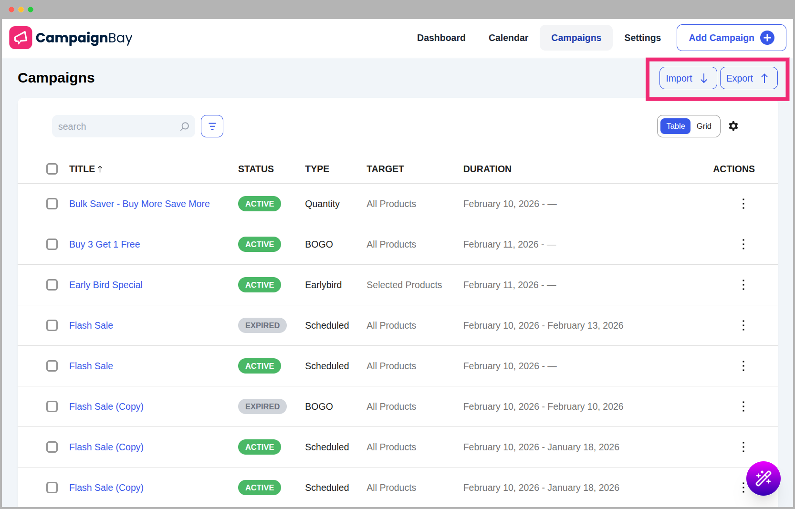

Quickly migrate or backup your campaigns:

- **Import:** Upload a CSV file to restore campaigns from another site or backup
- **Export:** Download all campaigns as CSV for backup or migration

---

## Toolbar

The toolbar provides instant search, filtering, and view switching.

### Search

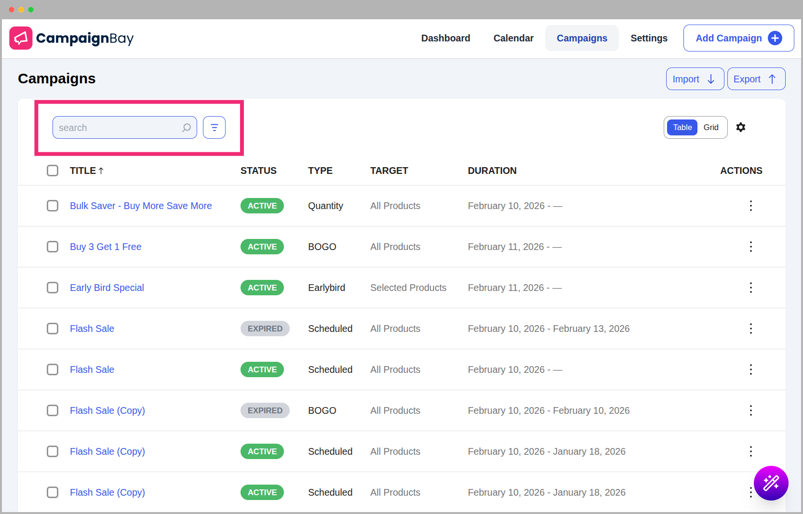

Start typing a campaign name to instantly filter results.

### Filtering

Click the filter icon to open advanced filtering options:

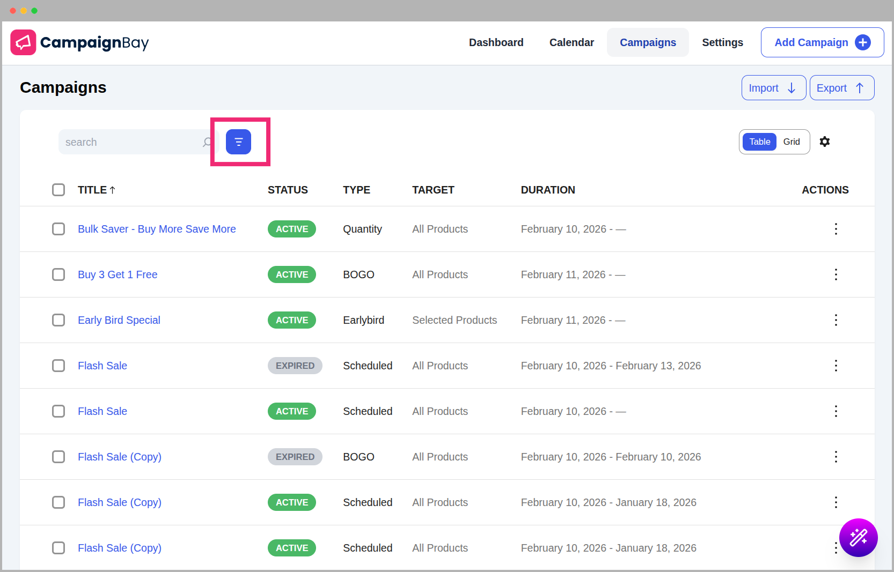

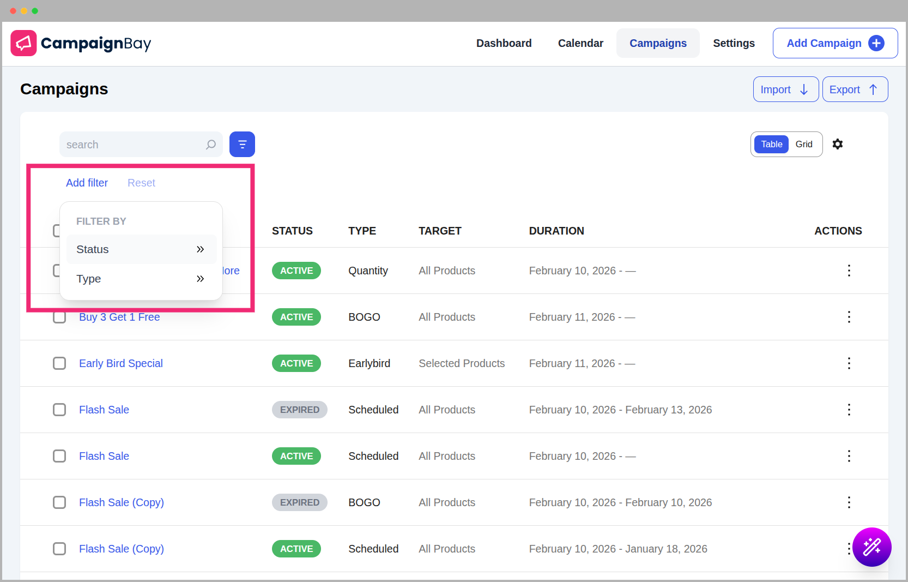

Filter by **Status** (Active, Inactive) or **Type** (Scheduled, Quantity, Early Bird, BOGO, and any Pro types).

Active filters appear as removable pills:

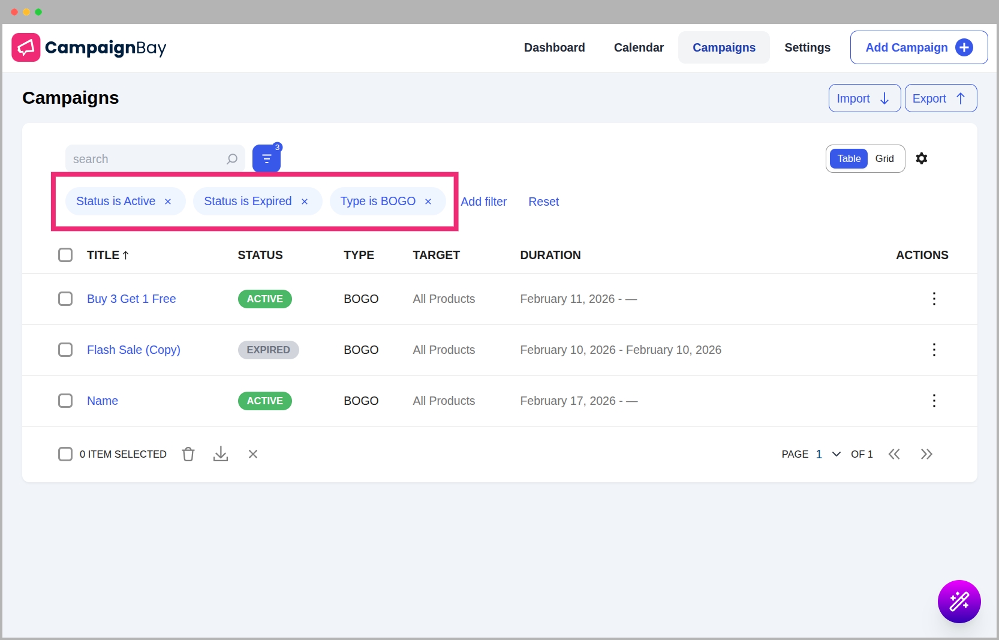

The filter icon shows a badge indicating how many filters are active:

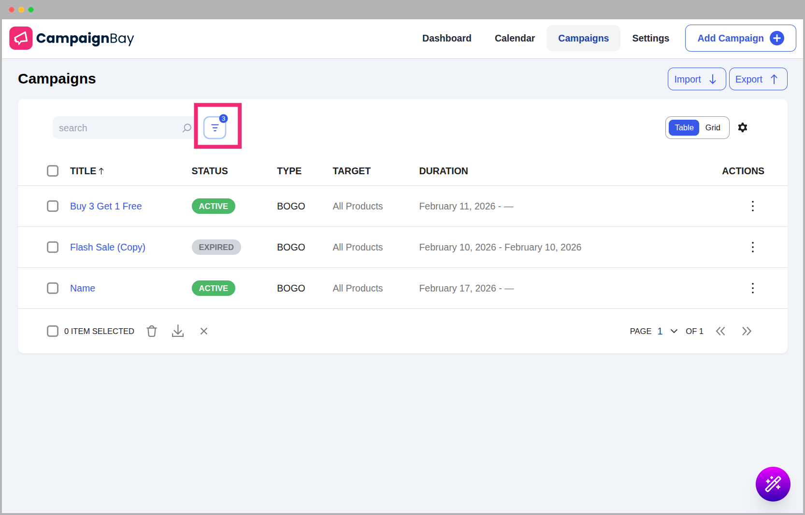

### View Toggle & Settings

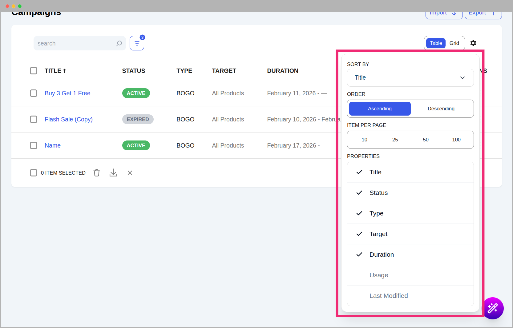

Click the gear icon to access display settings:

| Setting            | Options                      |
| ------------------ | ---------------------------- |
| **Sort By**        | Status, Title, Type, etc.    |
| **Order**          | Ascending / Descending       |
| **Items Per Page** | 10, 25, 50, 100              |
| **Properties**     | Toggle which columns to show |

---

## Table View

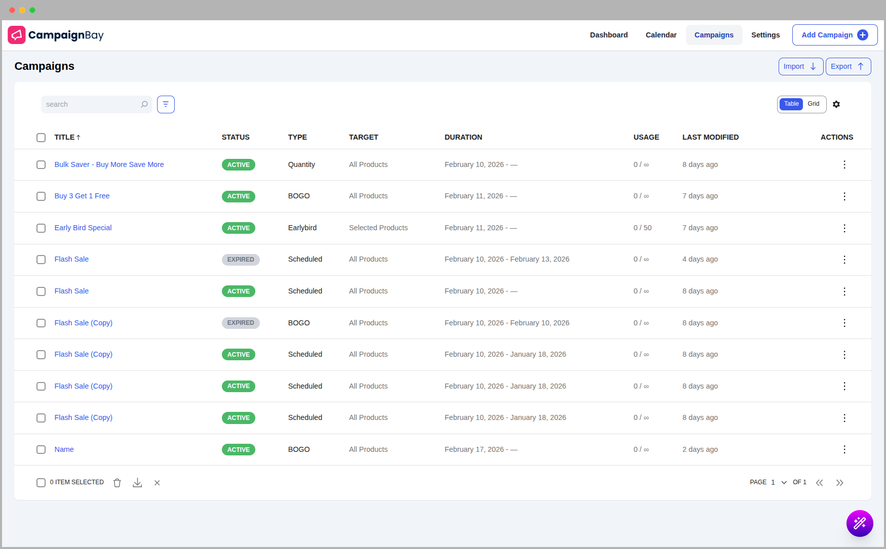

A dense, data-rich list with sortable columns:

| Column            | Description                             |
| ----------------- | --------------------------------------- |
| **Title**         | Campaign name (click to edit)           |
| **Status**        | Active/Inactive indicator               |
| **Type**          | Scheduled, Quantity, BOGO, etc.         |
| **Target**        | All Products, Selected Categories, etc. |
| **Duration**      | Start and end dates                     |
| **Usage**         | Times applied _(hidden by default)_     |
| **Last Modified** | When last updated _(hidden by default)_ |
| **Actions**       | Row action menu                         |

### Row Actions

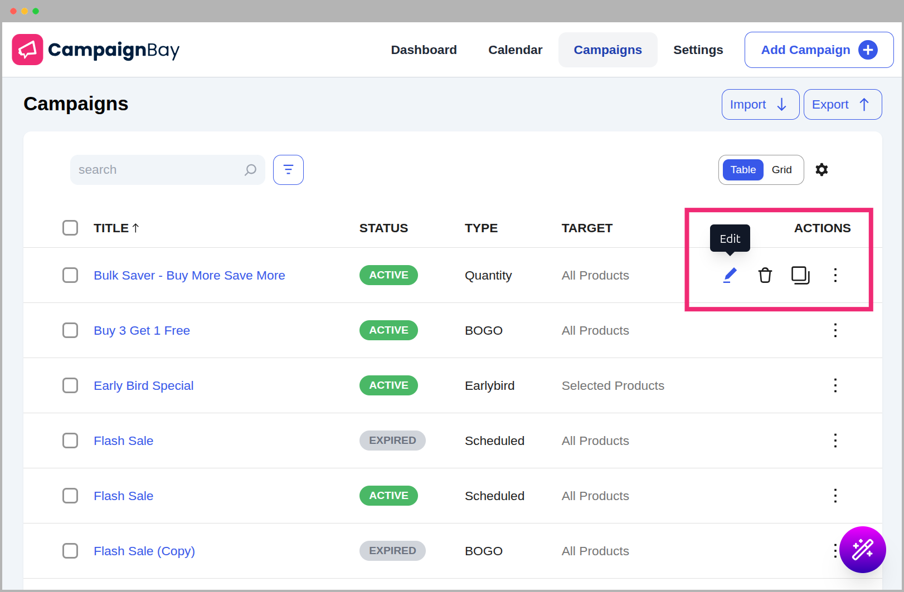

Click the action icons at the end of each row:

- **Edit** (pencil) — Open the campaign editor
- **Delete** (trash) — Remove the campaign
- **Duplicate** (copy) — Create an exact copy

Or hover over / click the three-dot menu (⋮) to reveal the same options.

---

## Grid View

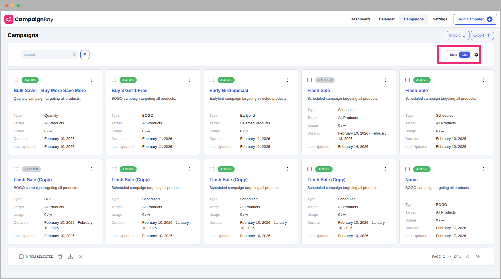

A visual, card-based layout showing key information at a glance:

- **Status Badge** — Color-coded Active/Inactive
- **Campaign Name** — Title of the campaign
- **Type & Target** — Campaign logic and scope
- **Usage** — How many times applied
- **Duration** — Start and end dates
- **Last Updated** — When last modified

---

## Bulk Actions & Pagination

Select multiple campaigns using checkboxes, then use the bulk action bar at the bottom:

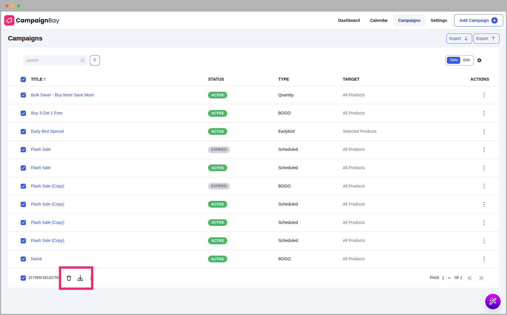

- **Delete** — Remove all selected campaigns
- **Export** — Download selected as CSV

---

## Free vs Pro Campaign Types

CampaignBay Free includes four campaign types. [CampaignBayPro](https://wpanchorbay.com/campaignbay) adds many more.

| Campaign type | What it does | Plan |
| --- | --- | --- |
| [Scheduled](./scheduled-discounts.md) | Time-limited sale with start and end dates | Free |
| [Quantity](./quantity-discounts.md) | Tiered discounts as quantity grows | Free |
| [Early Bird](./early-bird-discounts.md) | Special pricing for the first X orders | Free |
| [BOGO](./bogo-discounts.md) | Buy X, get the same product free or discounted | Free |
| [BOGO Advanced](./bogo-advanced-discounts.md) | Buy X of one set, get Y from another | Pro |
| [Product In Cart](./product-in-cart-discounts.md) | Discount triggered by specific products in the cart | Pro |
| [Fixed Price](./fixed-price-discounts.md) | Sell at an exact price | Pro |
| [Variation Discounts](./variation-discounts.md) | Discount chosen variations | Pro |
| [Cheapest Item](./cheapest-item-discounts.md) | Discount the cheapest item(s) in the cart | Pro |
| [Weight Discounts](./weight-discounts.md) | Discount by total cart weight | Pro |
| [Bulk Sum](./bulk-sum-discounts.md) | Tiers on the combined quantity of a product group | Pro |
| [Bundle](./bundle-discounts.md) | Discount for buying a set together | Pro |
| [Auto-add / Recommended Product](./auto-add-recommended-product.md) | Add or suggest a product automatically | Pro |
| [Free Gift](./free-gift.md) | Free product when the cart qualifies | Pro |
| [Category BOGO](./category-bogo.md) | Buy from one category, get from another | Pro |
| [Nth Unit](./nth-unit-discounts.md) | Discount every Nth unit | Pro |

::: tip Tiers are required
Quantity and Fixed Price campaigns need at least one tier. Since Free 1.2.0 they can't be saved without one.
:::

---

## Next Steps

Now that you know how to manage your campaigns, explore each campaign type using the table above.

**Conditions:**

- **[Conditions &rarr;](../core-concepts/conditions.md)** – Target by User Role, guest vs logged-in, Cart Total and Cart Item Quantity (Free)
- **[Pro Conditions &rarr;](../core-concepts/pro-conditions.md)** – Order history, coupon activation, day and time, stock, shipping and more
- **[Offer Messages &rarr;](../settings/offer-messages.md)** – Shopper messages for Pro offer types
