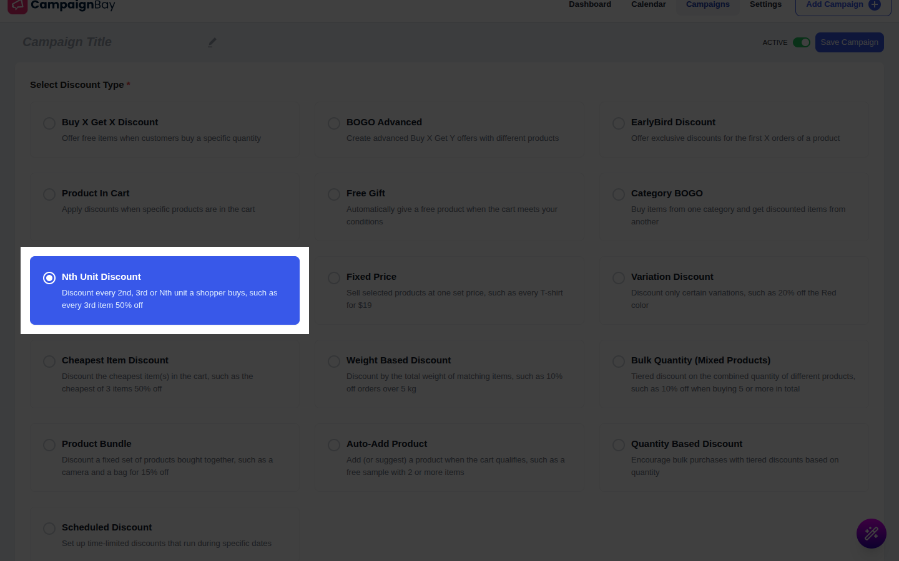
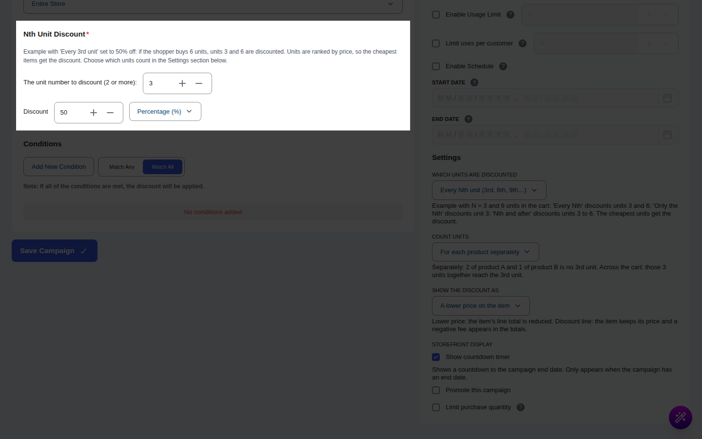

# Campaign Type: Nth Unit Discount

::: tip Pro Feature
This is a **CampaignBayPro** feature. [Upgrade to Pro](https://wpanchorbay.com/campaignbay) to unlock Nth Unit discounts and other powerful features.
:::

An **Nth Unit Discount** discounts every 2nd, 3rd or Nth unit of the products a shopper buys. Use it for offers like "Every 3rd unit is 50% off" or "Buy 2 and the second one is 100% off".

It works on units already in the cart and adds nothing. Within the counted units, the more expensive ones keep their price and the cheaper ones get the discount.

## Step 1: Select Your Campaign Type

Navigate to **CampaignBay → Add Campaign**.

- **Select Discount Type:** Choose **Nth Unit Discount**.
- **Campaign Title** and **Status** work as usual.

## Step 2: Set the Target

In **Target**, choose which products count ([Targeting](../core-concepts/targeting.md)).

## Step 3: Define the Discount

| Field | What it does |
| :--- | :--- |
| **The unit number to discount (2 or more)** | N. Default 2. |
| **Discount** and type | **Percentage (%)** or **Fixed amount off each discounted unit ($)**. Default 50%. A fixed amount never goes below the unit price. |

## Step 4: Settings

| Setting | Default | What it does |
| :--- | :--- | :--- |
| **Which units are discounted** | Every Nth unit (3rd, 6th, 9th…) | Or **Only the Nth unit (just the 3rd)**, or **The Nth unit and every unit after it (3rd, 4th, 5th…)**. |
| **Count units** | For each product separately | Or **Across all matching products in the cart**. Variations of one variable product count together as one product. |
| **Show the discount as** | | A lower price on the item, or a separate discount line in the cart totals. |

Units in a group are ranked from the most expensive to the cheapest (ties keep cart order). Rank N, 2N and so on get the discount, which means the cheapest units are discounted.

Also set Conditions, **Others** and the schedule as in [Quantity Discounts](./quantity-discounts.md).

## Step 5: Messages

In **CampaignBay Pro → Settings → Gifts and offers messages**: the product message `Buy {nth} and get {discount} off the {nth_ordinal} item` (placeholders `{campaign_name}`, `{nth}`, `{nth_ordinal}`, `{discount}`), shown when **Show Category BOGO and Nth Unit offers on product pages** is on.

## Step 6: Save the Campaign

Click **Save Campaign**.

## Worked Examples

Product A is $100.

### Example 1: Defaults (N=2, 50%, every Nth)

Cart A x2. Unit ranks 1 and 2, rank 2 is half price. Total $150. The cart line shows an average unit price of $75 with $100 struck through. Cart A x1 gets nothing.

### Example 2: N=3, three modes, 50%

Quantities 3, 4 and 6 of A:

| Mode | 3 units | 4 units | 6 units |
| :--- | :--- | :--- | :--- |
| Every Nth | $250 | $350 | $500 |
| Only the Nth | $250 | $350 | $550 |
| Nth and after | $250 | $300 | $400 |

### Example 3: Mixed products

N=2, 100%, **Across all matching products**. Cart: A ($100) and B ($50) in one category. Ranked A then B, so B is free; total $100. With **For each product separately**, each product has one unit, so there is no discount.

## Gotchas

- **Cheapest is discounted,** not the Nth item the shopper added.
- **Variations** of one variable product share one count.
- **Stacking:** with stacking off, units already discounted by free CampaignBay campaigns are skipped; Pro offers do not discount the same unit twice.
- **Usage counting:** one use per order that contains this discount.
- **Stock:** nothing is added.
- **Tax rounding:** tax is rounded per line.

Back to the campaign overview:

- **[Campaign Types &rarr;](./index.md)**
