# Campaign Type: Quantity Based Discount

A **Quantity Based Discount** is a powerful tool for creating tiered pricing structures that reward customers for buying in bulk. This encourages larger order values by reducing the per-item cost as the quantity increases.

This is the perfect campaign type for scenarios like:

- "Buy 3 or more, get 10% off each"
- "Buy a case of 12 and get $2 off each bottle"
- Creating wholesale-style pricing for regular customers.

This guide will walk you through every field required to set up this campaign type.

## Step 1: Select Your Campaign Type

To begin, navigate to **CampaignBay → Add Campaign**.

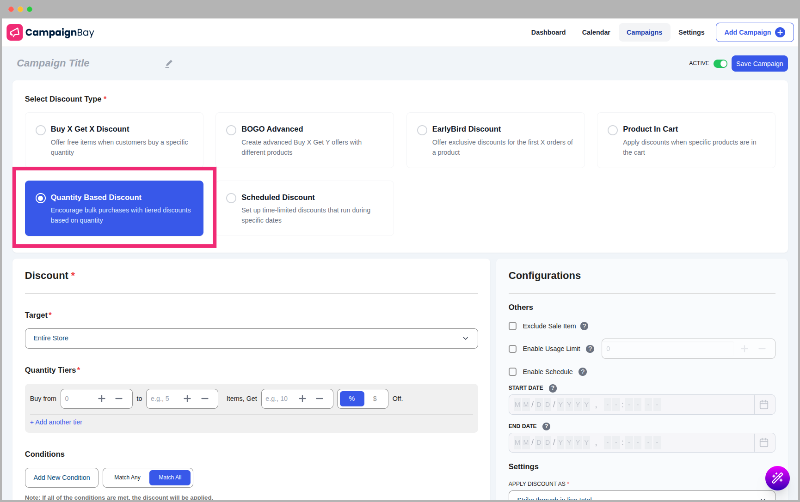

- **Select Discount Type:** Choose **`Quantity Based Discount`** from the list. This configures the campaign to apply tiered pricing based on the number of items purchased.

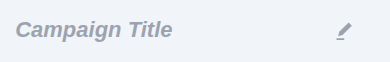

- **Campaign Title:** Give your campaign a clear and descriptive name (e.g., "T-Shirt Bulk Discount").

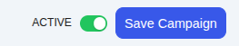

- **Select Status:**
  - **Active:** The campaign will be live as soon as its start time is reached.
  - **Inactive:** The campaign will be saved as a draft.

## Step 2: Set the Discount Target

This crucial step defines which products in your store are eligible for the quantity discount.

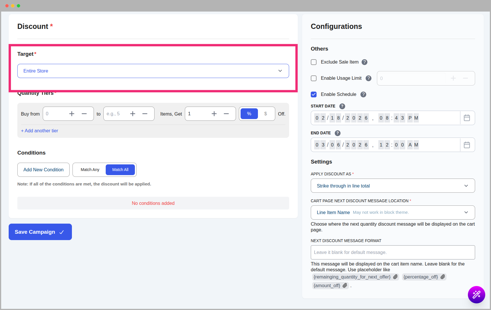

The **DISCOUNT TARGET** dropdown provides powerful options to control the scope of your campaign, such as applying it to the entire store, specific products, or categories.

::: info Learn More About Targeting
The "Discount Target" setting is a powerful feature shared by all campaign types. We've created a dedicated guide to explain all of its options and conditional fields in detail.

**[Read the Full Guide: Targeting &rarr;](../core-concepts/targeting.md)**
:::

## Step 3: Define Quantity Tiers

This is the core of the Quantity Based Discount. Here you will define the specific pricing levels for your promotion.

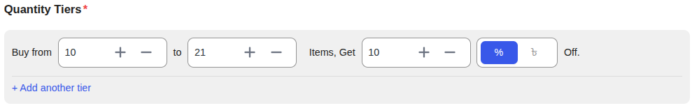

You can create one or more tiers. Each tier has the following fields:

- **Buy from:** The minimum quantity of an item a customer must have in their cart to qualify for this tier's discount.
- **to:** The maximum quantity for this tier. **Leave this blank** for the final tier to mean "and up" (e.g., 11 or more).
- **Items, Get:** The numeric value of the discount.
- **% / Fixed ($) (Mode):** The type of discount to apply. The text after the value reads **Off.** for a percentage and **Off per Piece.** for a fixed amount.
  - **Percentage (%):** A percentage discount calculated on the price of each item.
  - **Fixed ($):** A fixed amount deducted from the price. By default it comes off **each individual item**; see **Fixed discount applies** in Step 7 to take it off the whole line once instead.
- **Label (optional):** A short name for the tier (up to 40 characters), shown on the product page discount table or cards. Click one of the suggestion chips (**Best Value**, **Most Popular**, **Bulk Deal**) or type your own.

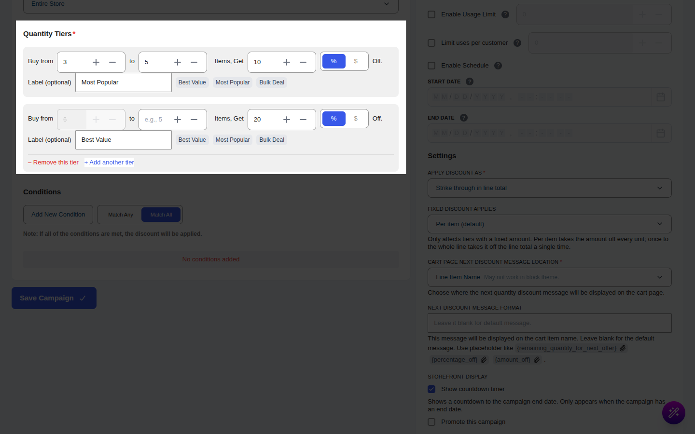

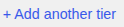

- **+ Add another tier:** Click this to add more pricing levels to your campaign. A new tier starts one above the previous tier's maximum and copies the previous tier's discount mode. Fill in the previous tier's maximum and value first, and make each maximum larger than its minimum, or the editor will ask you to correct it.
- **- Remove this tier:** Removes a tier. The first tier cannot be removed.

::: warning At least one tier is required
A Quantity campaign cannot be saved without tiers.
:::

::: info How tiers are matched
- Tiers are matched against the quantity of **one cart line** (one product, or one variation of a variable product). Quantities of different products are not added together.
- **Open-ended last tier:** leave **to** blank on the last tier and it means "and up". If the last tier has a maximum, quantities above it get no discount.
- Gaps between tiers are allowed (a quantity in the gap gets no discount). If tiers overlap, the customer gets the lowest price. The order of the tiers does not matter.
:::

### Example Tier Setup

Here is an example of a multi-level discount for a product:

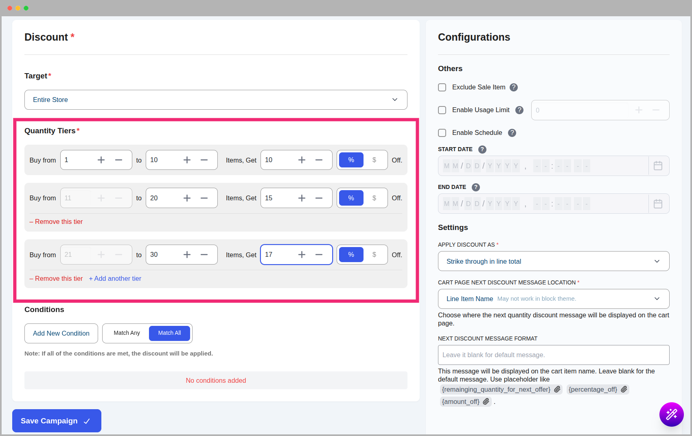

- **Tier 1:** Buy from `1` to `10` items, get `10` `%`
- **Tier 2:** Buy from `11` to `20` items, get `15` `%`
- **Tier 3:** Buy from `21` to `30` items, get`20` `%`

## Step 4: Set Conditions (Optional)

You can add specific rules to restrict who can use this discount (e.g., specific User Roles).

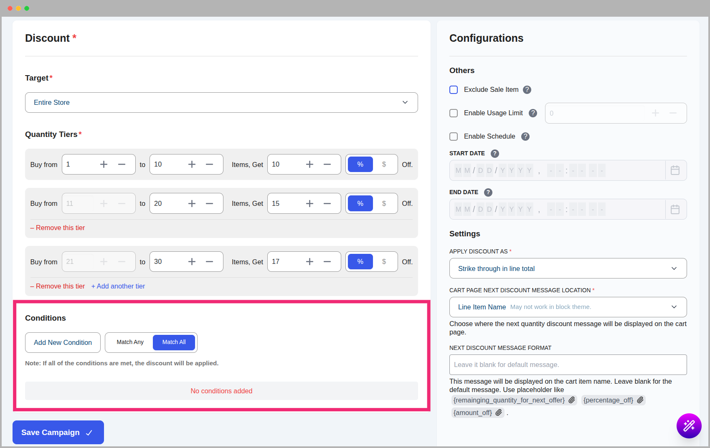

**[Read the Full Guide: How to Use Conditions &rarr;](../core-concepts/conditions.md)**

New in 1.2.0, two more conditions are available in the free plugin: **Guest / Logged-in** (apply the offer only to guests or only to logged-in customers) and **Cart Item Quantity**.

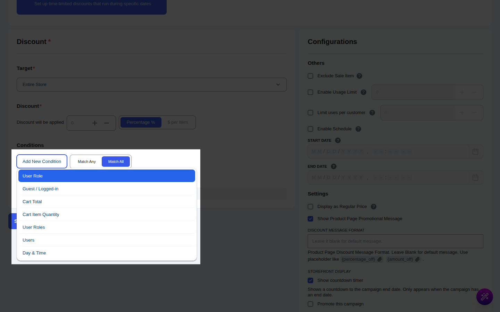

## Step 5: Set Other Configurations (Optional)

This section provides additional rules for your campaign.

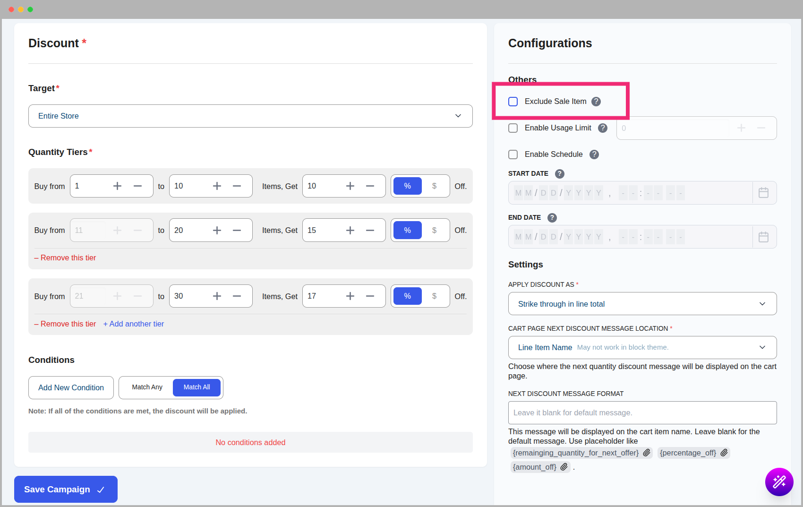

- **Exclude Sale Items:** Check this box if you do not want this campaign's discount to apply to products that are already on sale in WooCommerce. This is useful for preventing "double discounting."

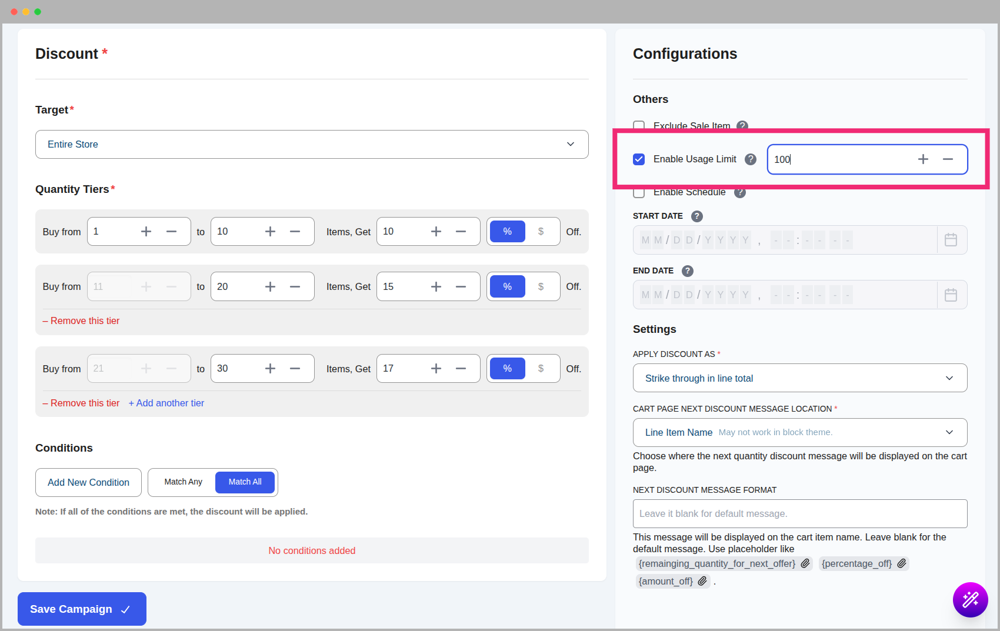

- **Enable Usage Limit:** Check this box to set a maximum number of **orders** that can use this campaign across your entire store. A limit of `N` expires the campaign after exactly `N` orders (a limit of `1` expires it after the first order). Only orders that reach **Processing** or **Completed** are counted. If a counted order is later cancelled, refunded or fails, its use is given back and a campaign that had expired because of its limit becomes active again.

## Step 6: Set the Schedule (Optional)

You can optionally schedule your campaign to run during a specific time window. This section controls when your campaign will automatically start and end.

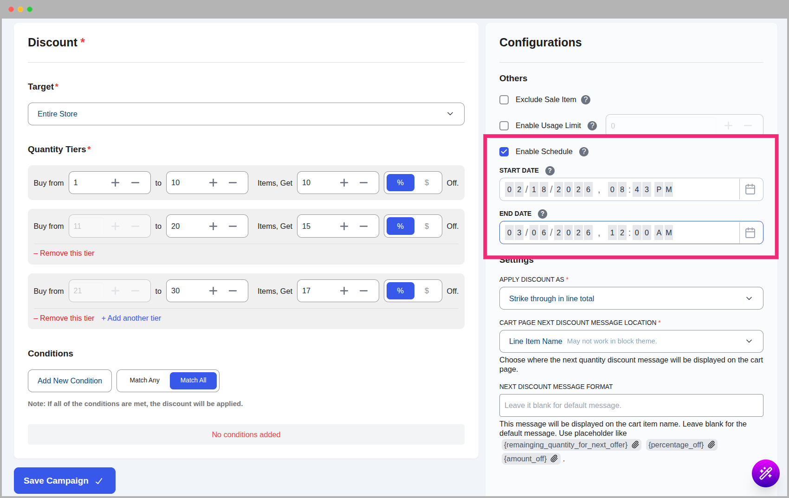

- **Start Time / End Time:** Use the date and time pickers to set the exact moment for the campaign to activate and expire.

::: tip Timezone Information
All dates and times are based on the timezone you have configured in your main WordPress settings under **Settings → General → Timezone**. The system automatically handles all UTC conversions for you.
:::

::: info Learn More About Automation
The status of your campaign is closely tied to the scheduling system, which uses WordPress Cron to automate activation and expiration.

**[Read the Full Guide: Scheduling & Automation &rarr;](../core-concepts/scheduling-and-automation.md)**
:::

## Step 7: Display Configurations

This section controls how the offer is communicated to the customer, both on the product page and in their cart.

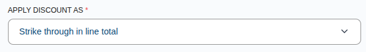

- **Apply Discount As:** Choose how the discount is displayed in the cart.
  - **Strike through in line total:** Shows the original price crossed out with the new quantity price next to it.
  - **Coupon:** Applies the discount as a virtual coupon in the cart.
  - **Fee:** Applies the discount as one negative fee per campaign, named after the campaign title.

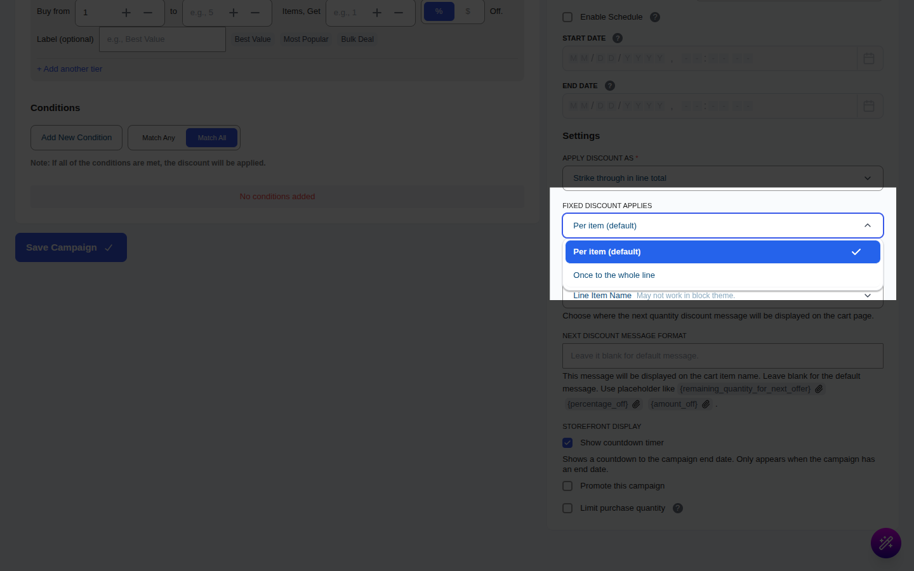

- **Fixed discount applies:** Only affects tiers whose mode is a fixed amount.
  - **Per item (default):** The amount comes off every unit. With a `5.00` tier on a `100.00` product, 3 units cost `3 x 95.00 = 285.00`.
  - **Once to the whole line:** The amount comes off the line total a single time. The same 3 units cost `300.00 - 5.00 = 295.00`. If the amount is larger than the line total, the line costs `0`.

- **Cart Page Discount Message Format:** Enter a message to display on the cart page when the discount is applied.
  - _Example:_ `Quantity discount applied: {discount_amount}`

- **Cart Page Message Location:** Choose where the cart message should appear (e.g., next to the line item name).

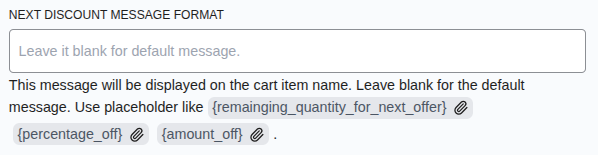

- **Next Discount Message Format:** Enter a custom message to be displayed on the cart item if the customer is close to unlocking the next discount tier. You can use placeholders like `{remaining_quantity_for_next_offer}`, `{percentage_off}`, and `{amount_off}`. The default message is "Add {remaining_quantity_for_next_offer} more and get {percentage_off}% off". No message is shown once the customer is on the last tier.

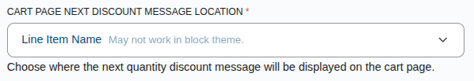

- **Cart Page Next Discount Message Location:** Choose where the "next discount" upsell message should appear on the cart page: **Line Item Name**, **Notice** or **Don't Show**.

::: warning Notice location
The **Notice** location is not active yet and prints nothing. Use **Line Item Name** to show the message.
:::

### Storefront Display: Countdown Timer and Promotion

Every campaign type has a **Storefront display** group at the bottom of the Display Configurations.

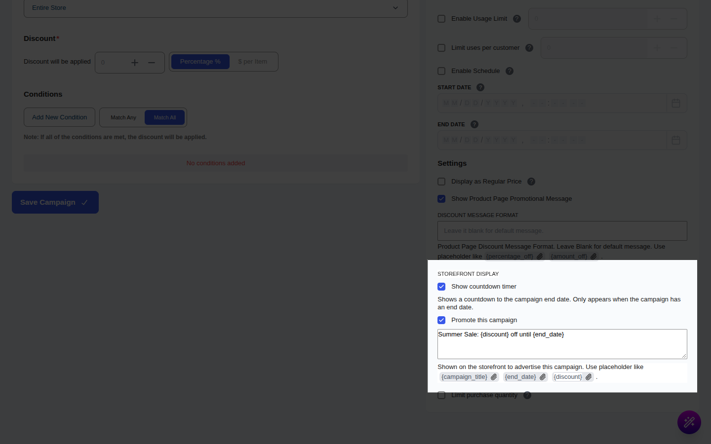

- **Show countdown timer:** Shows a live countdown to the campaign's end date. It only appears when the campaign has a **schedule enabled with an end date in the future**. Where it appears (product page, shop and category listings, cart) and what it says is controlled in **Settings → Product Settings → Countdown Timer**. You can also place it anywhere with the `[campaignbay_countdown id="12"]` shortcode.
- **Promote this campaign:** Tick this to let the campaign advertise itself on category pages and through the promotion blurb. Optionally type a **Promotion text**; leave it blank to use the default. You can use `{campaign_title}`, `{end_date}` and `{discount}` in the text.

::: info Learn More
The wording, colours and locations of the countdown timer, sale badge, category and shop offer messages and promotion blurbs are global settings. See the [Product Settings guide](../settings/product-settings.md).
:::

### Limit Purchase Quantity (Optional)

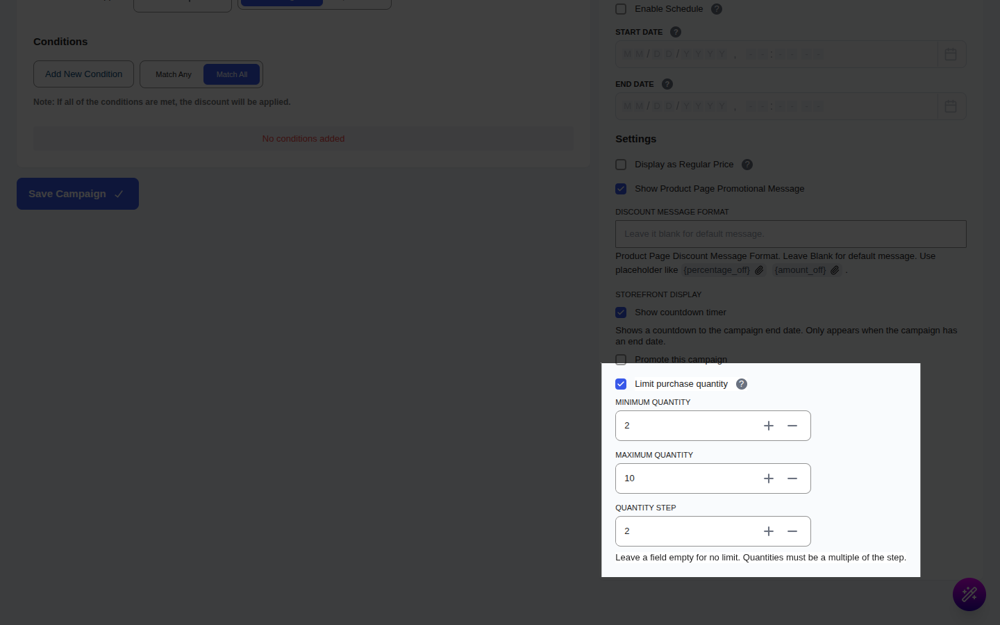

Tick **Limit purchase quantity** to set a **Minimum quantity**, **Maximum quantity** and **Quantity step** for the products this campaign targets, while the campaign is active.

- Leave a field empty for no limit. Each field has a minimum value of `1`.
- Quantities must be a multiple of the step. For example, minimum `5`, maximum `20`, step `5` allows only 5, 10, 15 or 20.
- Customers see a note on the product page such as "Purchase limits: minimum 5, maximum 20, multiples of 5", and get an error if they try to add or keep a quantity outside the limits.
- If a product is covered by more than one campaign with limits, the strictest combination applies.
- The limits are saved only if at least one of the three fields is filled, the minimum is not above the maximum, and some quantity actually fits the step.

::: warning Not enforced with some conditions
Limits are not enforced for campaigns that use **Cart Total** or **Cart Item Quantity** conditions.
:::

### Show the Tiers on the Product Page: Table or Cards

Quantity tiers are advertised to shoppers on the product page with a discount table. In **Settings → Product Settings** you can turn the table on (**Enable Quantity Discounts Table on Product Page**) and, under **Quantity Discount Layout**, choose a **Table** or **Cards** layout, show or hide tier labels, and edit the card title, price and discount wording.

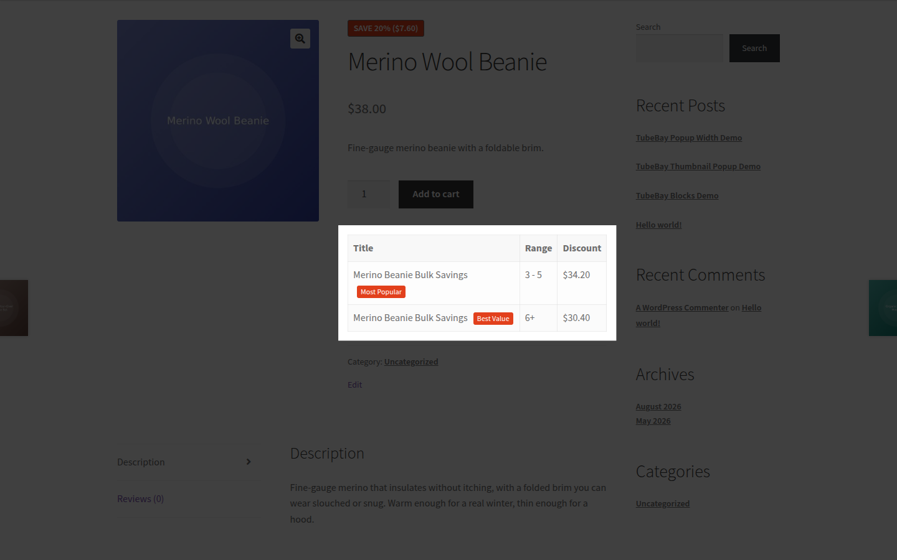

- **Table layout:** columns Title, Range and Discount, for example `1 - 4`, `5 - 9` and `10+`. Percentage tiers show the discounted unit price, fixed tiers show the amount off per piece, and tiers set to **Once to the whole line** show the amount off the total.
- **Cards layout:** one card per tier with the tier label as a ribbon. The defaults are "{min} - {max} items", "{price} each" and "Save {discount}". Clicking a card sets the quantity field to that tier's minimum (kept within any quantity limits).
- On a variable product the table is built from the first variation and does not change when a different variation is selected.

[Full details in the Product Settings guide &rarr;](../settings/product-settings.md)

::: tip Prices and Tax
Campaign prices follow your WooCommerce tax settings. The discount is worked out on the price as you entered it, and the final price shown to customers includes or excludes tax according to your **WooCommerce → Settings → Tax** display options.
:::

::: info Competing campaigns
When several campaigns could discount the same product, the **Discount priority method** in **Settings → Product Settings** decides which wins: Apply Highest Discount, Apply Lowest Discount, Apply First Match, or **Most Recently Started Wins** (the campaign that started, or was created, most recently takes the tier when tiers have identical ranges). See [Understanding the Engine](../core-concepts/understanding-the-engine.md).
:::

## Step 8: Save the Campaign

Once you have configured all the options, click the **Save Campaign** button at the top right of the page. After saving, you will be redirected back to the "All Campaigns" list.

## Next Steps

Next, learn how to create campaigns that reward your first customers.

- **[Creating an Early Bird Discount &rarr;](./early-bird-discounts.md)**
