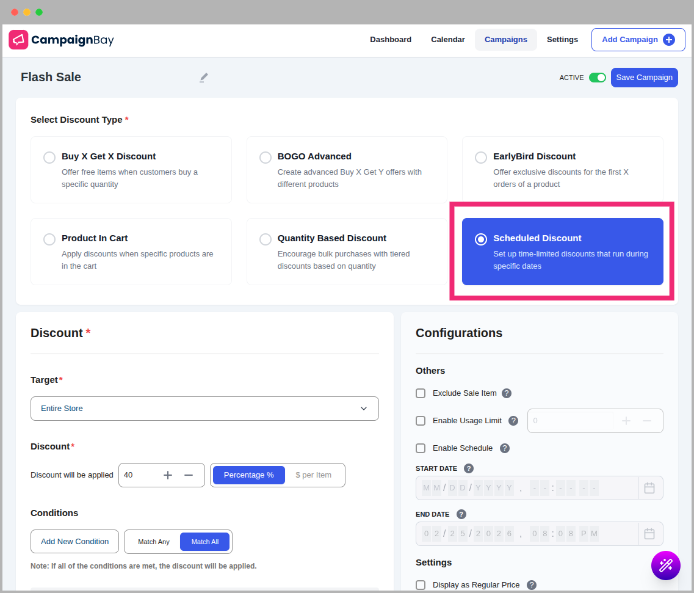
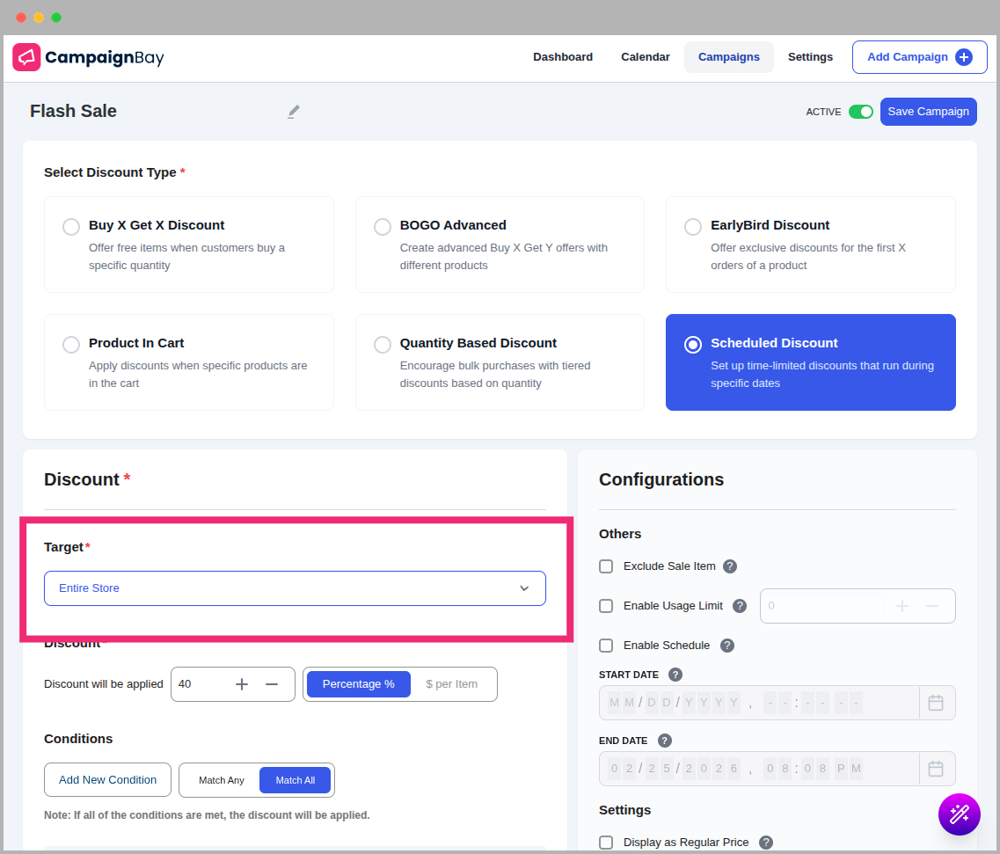
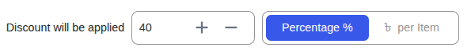
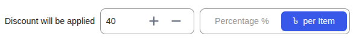
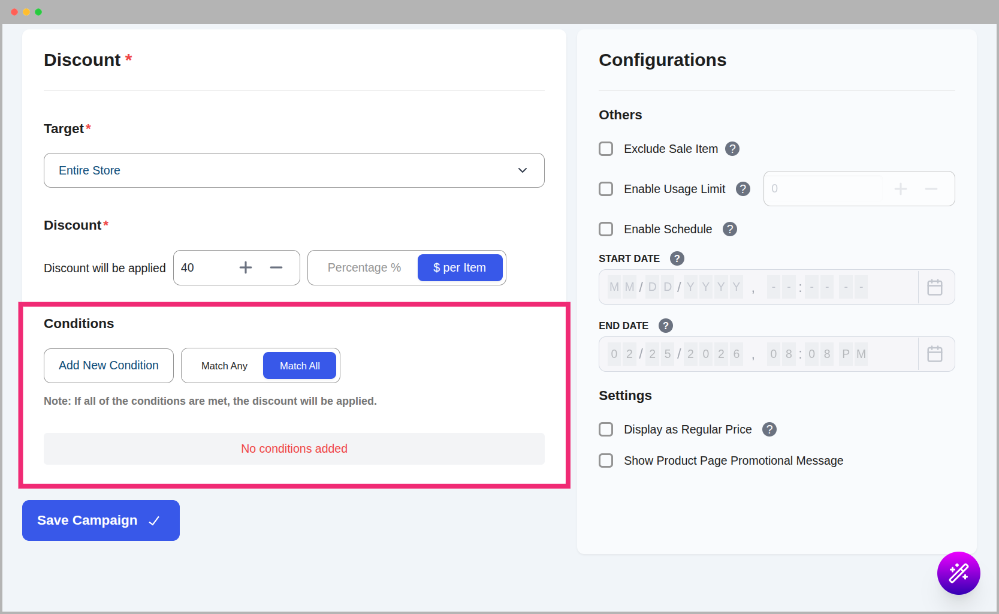
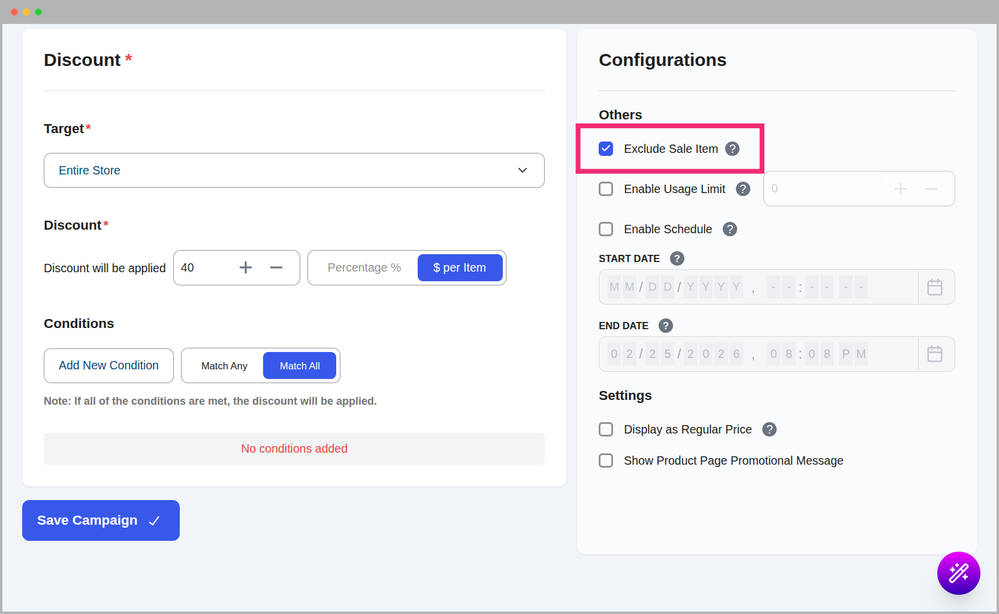
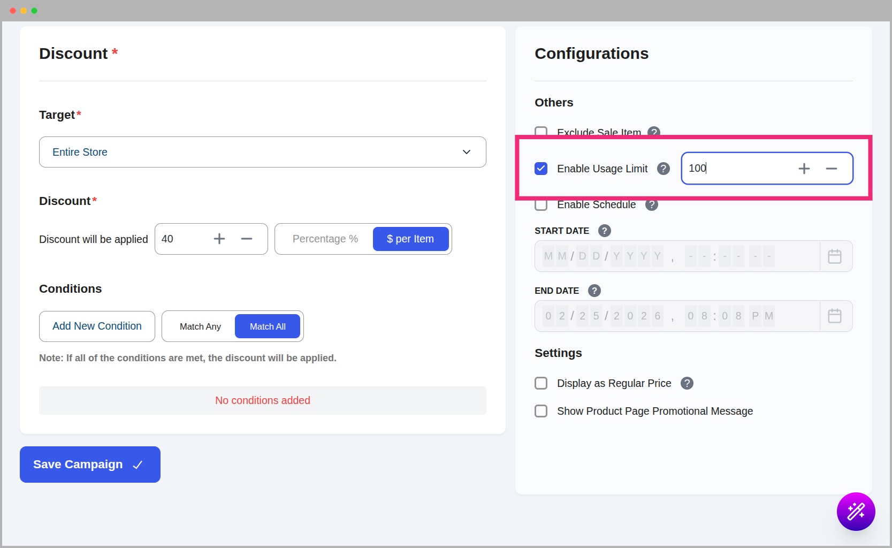
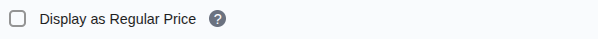
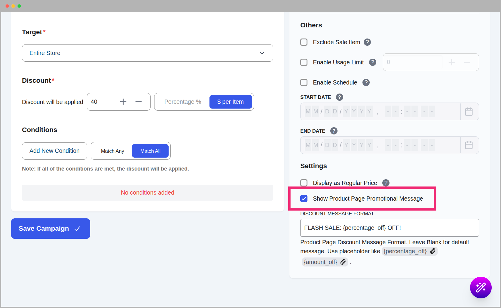
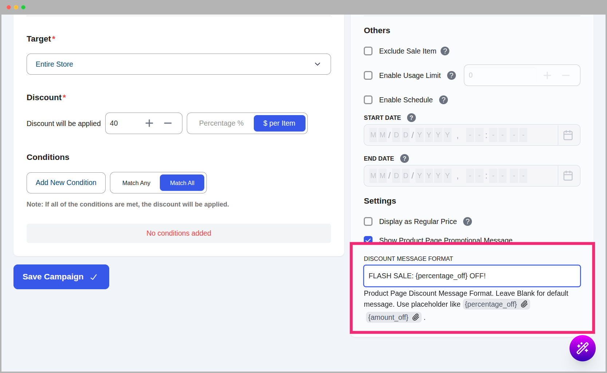

# Campaign Type: Scheduled Discount

A **Scheduled Discount** is the most common and straightforward type of campaign. It allows you to apply a direct price reduction (either a fixed amount or a percentage) to products for a specific, pre-defined period.

This is the perfect tool for running classic sales events like:

- Weekend Flash Sales
- Holiday Promotions (e.g., Black Friday, New Year's)
- Seasonal or End-of-Season Clearance Sales

This guide will walk you through creating a Scheduled Discount step by step.

## Step 1: Select Your Campaign Type

To begin, navigate to **CampaignBay → Add Campaign**.

- **Select Discount Type:** Choose **`Scheduled Discount`** from the list. This configures the campaign to apply a simple, direct price reduction.

- **Campaign Title:** Give your campaign a clear and descriptive name (e.g., "Summer Weekend Sale").

- **Select Status:**
  - **Active:** The campaign will be live as soon as its start time is reached.
  - **Inactive:** The campaign will be saved as a draft.

::: tip
For scheduled campaigns, set the Status to **Active** and enable the schedule. The system will display a **Scheduled** label in the campaign list until the start time is reached.
:::

## Step 2: Set the Discount Target

This crucial step defines which products in your store are eligible for the discount.

The **DISCOUNT TARGET** dropdown provides powerful options to control the scope of your campaign, such as applying it to the entire store, specific products, or categories.

::: info Learn More About Targeting
The "Discount Target" setting is a powerful feature shared by all campaign types. We've created a dedicated guide to explain all of its options and conditional fields in detail.

**[Read the Full Guide: Targeting &rarr;](../core-concepts/targeting.md)**
:::

## Step 3: Define the Discount Value

This is where you set the actual discount amount the customer will receive.

### 1. Percentage Discount

- **Percentage %:** Select this mode and enter the numeric value (e.g., `40`) to take a percentage off the product's price.

### 2. Fixed Amount Discount

- **Fixed ($) per Item:** Select this mode and enter the numeric value to deduct a fixed currency amount from **each individual item**.

::: info How the price is worked out
- Percentage: the new price is the base price minus the percentage. Fixed: the new price is the base price minus the amount. Neither can take the price below `0`; a `100%` discount makes the item free.
- The base is the product's **regular price**, unless **Calculate Discount From** in the global settings is set to **Sale Price**.
- Example: a `100.00` product with 10% off costs `90.00`; with `10` fixed off it also costs `90.00`; a `20.00` product with `25` fixed off costs `0.00`.
:::

## Step 4: Set Conditions (Optional)

You can add specific rules to restrict who can use this discount (e.g., specific User Roles).

**[Read the Full Guide: How to Use Conditions &rarr;](../core-concepts/conditions.md)**

New in 1.2.0, two more conditions are available in the free plugin: **Guest / Logged-in** (apply the offer only to guests or only to logged-in customers) and **Cart Item Quantity**.

## Step 5: Set Other Configurations (Optional)

This section provides additional rules for your campaign.

- **Exclude Sale Items:** Check this box if you do not want this campaign's discount to apply to products that are already on sale in WooCommerce. This is useful for preventing "double discounting."

- **Enable Usage Limit:** Check this box to set a maximum number of **orders** that can use this campaign across your entire store. A limit of `N` expires the campaign after exactly `N` orders (a limit of `1` expires it after the first order). Only orders that reach **Processing** or **Completed** are counted. If a counted order is later cancelled, refunded or fails, its use is given back and a campaign that had expired because of its limit becomes active again.

## Step 6: Set the Schedule (Optional)

You can optionally schedule your campaign to run during a specific time window. This section controls when your campaign will automatically start and end.

- **Start Time / End Time:** Use the date and time pickers to set the exact moment for the campaign to activate and expire.

::: tip Timezone Information
All dates and times are based on the timezone you have configured in your main WordPress settings under **Settings → General → Timezone**. The system automatically handles all UTC conversions for you.
:::

::: info Learn More About Automation
The status of your campaign is closely tied to the scheduling system, which uses WordPress Cron to automate activation and expiration.

**[Read the Full Guide: Scheduling & Automation &rarr;](../core-concepts/scheduling-and-automation.md)**
:::

## Step 7: Display Configurations

This section controls how the offer is communicated to the customer, both on the product page and in their cart.

- **Display as Regular Price:** If checked, the discounted price will be shown as the regular price on the product page, rather than showing a "sale" price with a strikethrough.

- **Show Product Page Promotional Message:** Toggle this to enable or disable the custom message on the product pages.

- **Discount Message Format:** Customize the promotional text using placeholders like `{percentage_off}` or `{amount_off}`. Leave it empty for the default ("You save {percentage_off}%" or "You save {amount_off} per item").
  - _Example:_ `Flash Sale! Get {percentage_off}% off today!`

If **Display as Regular Price** is ticked, the discounted price is shown with no strikethrough and no "Sale!" badge, and the message options are hidden.

::: tip Schedule rules worth knowing
The start time is inclusive and the end time is exclusive. You can set only a start or only an end. If the schedule is enabled, a start or end date is required. A campaign saved with a start date in the future has the status **Scheduled** until then. A campaign saved with no start date goes live immediately.
:::

### Storefront Display: Countdown Timer and Promotion

Every campaign type has a **Storefront display** group at the bottom of the Display Configurations.

- **Show countdown timer:** Shows a live countdown to the campaign's end date. It only appears when the campaign has a **schedule enabled with an end date in the future**. Where it appears (product page, shop and category listings, cart) and what it says is controlled in **Settings → Product Settings → Countdown Timer**. You can also place it anywhere with the `[campaignbay_countdown id="12"]` shortcode.
- **Promote this campaign:** Tick this to let the campaign advertise itself on category pages and through the promotion blurb. Optionally type a **Promotion text**; leave it blank to use the default. You can use `{campaign_title}`, `{end_date}` and `{discount}` in the text.

::: info Learn More
The wording, colours and locations of the countdown timer, sale badge, category and shop offer messages and promotion blurbs are global settings. See the [Product Settings guide](../settings/product-settings.md).
:::

### Limit Purchase Quantity (Optional)

Tick **Limit purchase quantity** to set a **Minimum quantity**, **Maximum quantity** and **Quantity step** for the products this campaign targets, while the campaign is active.

- Leave a field empty for no limit. Each field has a minimum value of `1`.
- Quantities must be a multiple of the step. For example, minimum `5`, maximum `20`, step `5` allows only 5, 10, 15 or 20.
- Customers see a note on the product page such as "Purchase limits: minimum 5, maximum 20, multiples of 5", and get an error if they try to add or keep a quantity outside the limits.
- If a product is covered by more than one campaign with limits, the strictest combination applies.
- The limits are saved only if at least one of the three fields is filled, the minimum is not above the maximum, and some quantity actually fits the step.

::: warning Not enforced with some conditions
Limits are not enforced for campaigns that use **Cart Total** or **Cart Item Quantity** conditions.
:::

::: tip Prices and Tax
Campaign prices follow your WooCommerce tax settings. The discount is worked out on the price as you entered it, and the final price shown to customers includes or excludes tax according to your **WooCommerce → Settings → Tax** display options.
:::

## Step 8: Save the Campaign

Once you have configured all the options, click the **Save Campaign** button at the top right or the **Save Changes** button at the bottom of the page. After saving, you will be redirected back to the "All Campaigns" list, where you can see your new campaign.

## Next Steps

Now that you've mastered the Scheduled Discount, learn how to create campaigns that reward customers for buying in bulk.

- **[Creating a Quantity Based Discount &rarr;](./quantity-discounts.md)**
