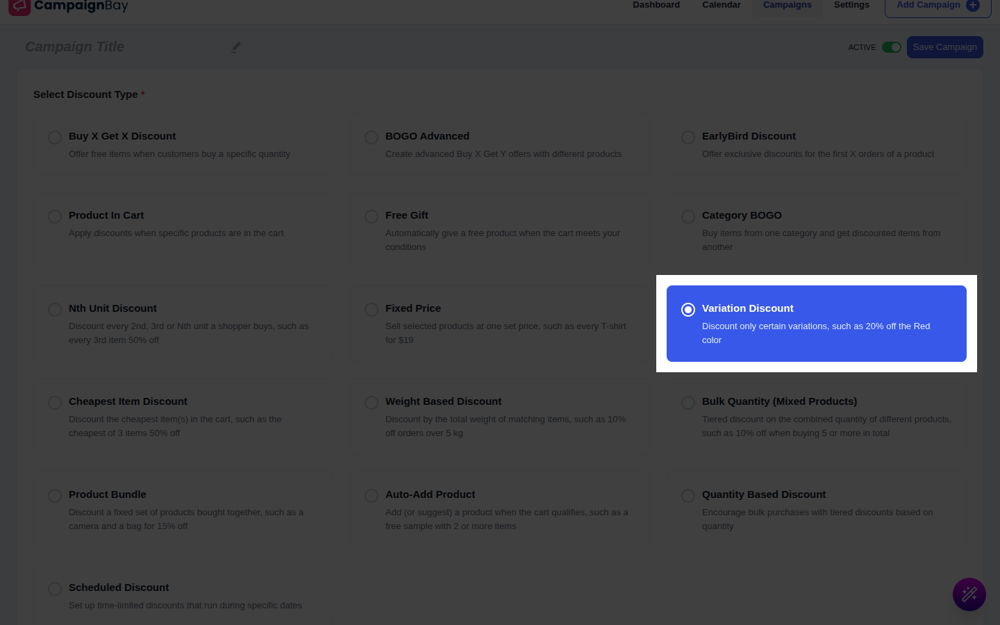
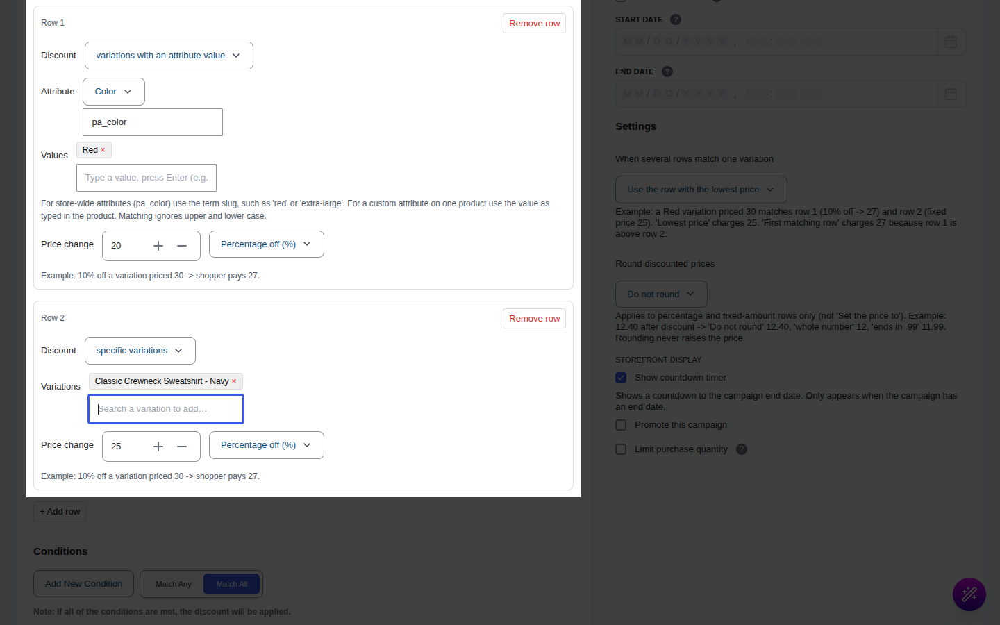
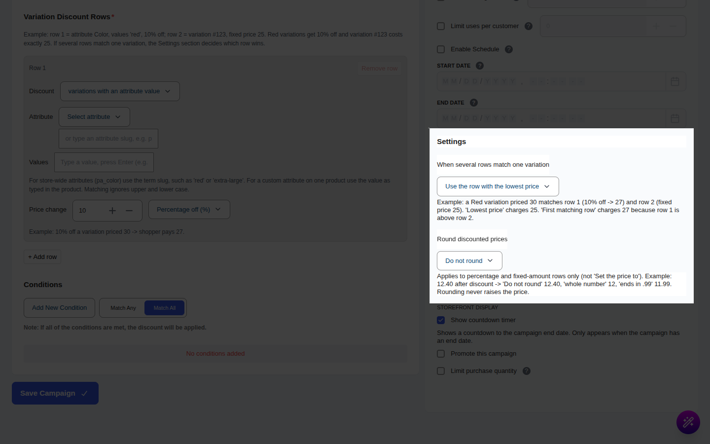
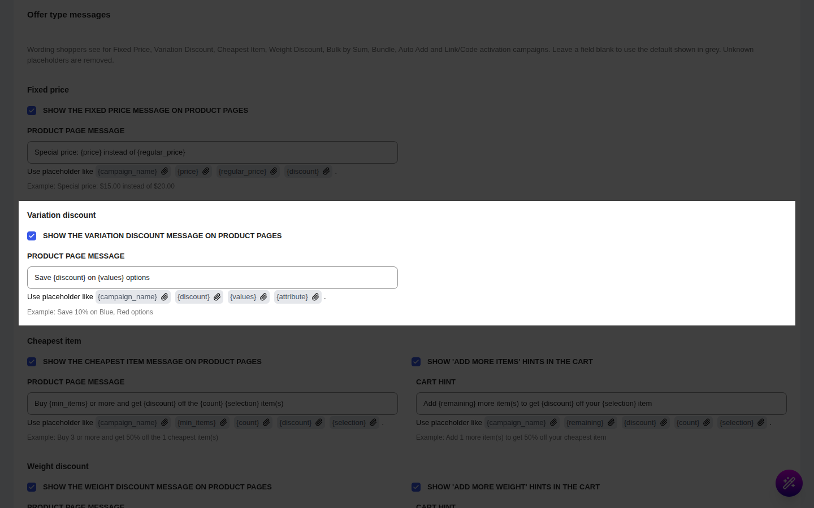

# Campaign Type: Variation Discount

::: tip Pro Feature
This is a **CampaignBayPro** feature (Pro 1.1.0 and later). [Upgrade to Pro](https://wpanchorbay.com/campaignbay) to unlock Variation Discounts and other powerful features.
:::

A **Variation Discount** discounts only **certain variations** of your variable products, picked by their attribute (for example Color = Red) or by name. Other variations of the same product keep their normal price.

This is the perfect campaign type for scenarios like:

- "20% off the **Red** color only"
- "Clear out size **XL** at $5 off"
- "Make the **Wool** version cost exactly $25"

Like Fixed Price, this is a **product-level** campaign: the new price shows on the product page when the shopper picks the variation, and in the cart and checkout.

## Step 1: Select Your Campaign Type

Go to **CampaignBay → Add Campaign**.

- **Select Discount Type:** Choose **`Variation Discount`** ("Discount only certain variations, such as 20% off the Red color").
- **Campaign Title:** e.g., "Red T-Shirt Sale".
- **Select Status:** **Active** to go live, **Inactive** to save a draft.

## Step 2: Set the Discount Target

Pick the products whose variations can be discounted (entire store, specific products, categories). The rows in the next step then decide **which variations** of those products are discounted.

**[Read the Full Guide: Targeting &rarr;](../core-concepts/targeting.md)**

## Step 3: Add Variation Discount Rows

The **Variation Discount Rows** section holds one or more rows. Each row says "these variations get this price change".

The section's own example: _row 1 = attribute Color, values "red", 10% off; row 2 = variation #123, fixed price 25. Red variations get 10% off and variation #123 costs exactly 25._

Each row has the following fields.

### Which variations (the "Discount" selector)

Choose how the row finds its variations:

- **variations with an attribute value:** matches variations by attribute. Shows two fields:
  - **Attribute:** pick one from the list (**Select attribute**) or type an attribute slug such as `pa_color`.
  - **Values:** type a value and press **Enter** (for example `red`, `large`). A variation matches if its attribute has **any** of the values. For store-wide attributes (`pa_color`) use the term slug, such as `red` or `extra-large`. For a custom attribute on one product use the value as typed in the product. Matching ignores upper and lower case, so `Dark Blue` matches `dark-blue`. You can add up to 100 values per row.
- **specific variations:** matches exact variations.
  - **Variations:** search for variations (**Search a variation to add…**) and add them. Up to 100 per row.

### Price change

Choose how the matched variation's price changes, then enter the number:

| Option | Meaning | Example |
| --- | --- | --- |
| **Percentage off (%)** | That percentage is taken off the variation's price. Must be above 0 and at most 100. | 10% off a variation priced 30 → shopper pays 27 |
| **Fixed amount off** | A flat amount is taken off the variation's price. It cannot go below zero. | 5 off a variation priced 30 → shopper pays 25 |
| **Set the price to** | The variation costs exactly this price, whatever its regular price. | Price 25 → the variation costs exactly 25 |

Use **+ Add row** to add more rows (up to 50) and **Remove row** to delete one.

## Step 4: Choose the Row Settings

Two settings in the **Settings** section control how rows combine.

### When several rows match one variation

- **Use the row with the lowest price** (default): of all rows that match, the one giving the lowest final price is used.
- **Use the first matching row (top to bottom):** the first matching row in the list is used. Row order matters.

Example: a Red variation priced 30 matches row 1 (10% off → 27) and row 2 (Set the price to 25). _Lowest price_ charges 25. _First matching row_ charges 27 because row 1 is above row 2.

### Round discounted prices

- **Do not round** (default): the calculated price is used as is (rounded to your store's decimals).
- **Round down to a whole number:** 12.40 becomes 12.
- **Round down to end in .99:** 12.40 becomes 11.99.

Rounding applies to **Percentage off** and **Fixed amount off** rows only, never to **Set the price to**. It never raises the price. When the rule is "lowest price", rounding happens **before** the rows are compared.

## Step 5: Conditions, Other Configurations and Schedule

These work like every other campaign type.

- **[Conditions &rarr;](../core-concepts/conditions.md)** (who is eligible)
- **Exclude Sale Items** skips products already on sale.
- **Enable Usage Limit** limits how many orders can use the campaign.
- **Start Time / End Time** schedules it. See **[Scheduling & Automation &rarr;](../core-concepts/scheduling-and-automation.md)**.

## Step 6: Product Page Message (Optional)

When the shopper picks a discounted variation, a short message appears above the form, such as _Save 10% on Red options_.

Set it under **CampaignBay → Settings → Cart Settings → Offer type messages → Variation discount**:

| Setting | What it does | Default |
| --- | --- | --- |
| **Show the variation discount message on product pages** | Turns the message on or off for all Variation Discount campaigns. | On |
| **Product page message** | The wording. Placeholders: `{campaign_name}`, `{discount}`, `{values}`, `{attribute}`. | `Save {discount} on {values} options` |

`{values}` shows the attribute's display names (for example "Red"), not the slugs.

## Step 7: Save the Campaign

Click **Save Campaign**.

## Worked Examples

All examples use a T-shirt with these variations: Red/S 30.00, Red/L 36.00, Dark Blue/S 40.00, Green/S 24.00.

### Example 1: 10% off the Red color

**Setup:** one row: _variations with an attribute value_, Attribute = Color (`pa_color`), Values = `red`, Percentage off = 10.

| Variation | Regular | Shopper pays |
| --- | --- | --- |
| Red/S | 30.00 | 27.00 |
| Red/L | 36.00 | 32.40 |
| Dark Blue/S | 40.00 | 40.00 |
| Green/S | 24.00 | 24.00 |

- **Product page:** when the shopper selects Red/S they see ~~$30.00~~ $27.00 and the message "Save 10% on Red options". Selecting Dark Blue/S shows $40.00 only.
- **Shop and category pages:** the price range shows `$24.00 - $40.00` (nothing changes for the cheapest and most expensive variation), so the discount is only visible once a variation is chosen.
- **Cart:** one Red/S, one Red/L and one Dark Blue/S → 27.00 + 32.40 + 40.00 = **99.40** subtotal.

### Example 2: Two rows, which one wins?

**Setup:** row 1 = Color `red`, **Percentage off** 10. Row 2 = Color `red`, **Set the price to** 25.

| "When several rows match" | Red/S (30.00) pays | Why |
| --- | --- | --- |
| Use the row with the lowest price | 25.00 | Row 2 gives 25, row 1 gives 27, the lowest wins |
| Use the first matching row | 27.00 | Row 1 is first |

Swap the order of the rows: _lowest price_ still charges 25.00, and _first matching row_ now also charges 25.00.

### Example 3: Rounding

**Setup:** a wool product priced 31.00, row = Material `wool`, Percentage off 60 (31.00 × 0.40 = 12.40).

| Round discounted prices | Shopper pays |
| --- | --- |
| Do not round | 12.40 |
| Round down to a whole number | 12.00 |
| Round down to end in .99 | 11.99 |

## Gotchas

- **Values are slugs, not labels.** Use `red`, `extra-large`, `dark-blue`. Case does not matter, and spaces are treated like dashes.
- **Only attributes used for variations match.** A variation only "knows" the attributes the shopper selects (for example Color and Size). An attribute that is shown on the product page but not marked **Used for variations** will not match a row.
- **"Any Color" variations.** A variation set to "Any Color" has no color of its own, so an attribute row for Color never matches it. If you want to discount it, add a **specific variations** row.
- **Explicit variations win.** If a shopper's choices match an exact variation (Red/L) and also an "Any Color / L" variation, WooCommerce uses the exact one.
- **Attributes that are not on the product never match.** A row for `pa_brand` on a product without a Brand attribute does nothing.
- **Simple products work too.** A row can match a simple product's own attribute options.
- **"Set the price to" ignores the regular price.** It can raise a price if the number is higher than the variation's price. If the resulting price is not lower, the variation is not shown as being on sale.
- **Competing campaigns.** Variation Discount competes with other product-level campaigns by the **Discount priority method** in [Product Settings](../settings/product-settings.md#product-prioritization).

Next, learn about cart-level offers that depend on what is in the whole cart.

- **[Cheapest Item Discount &rarr;](./cheapest-item-discounts.md)**
