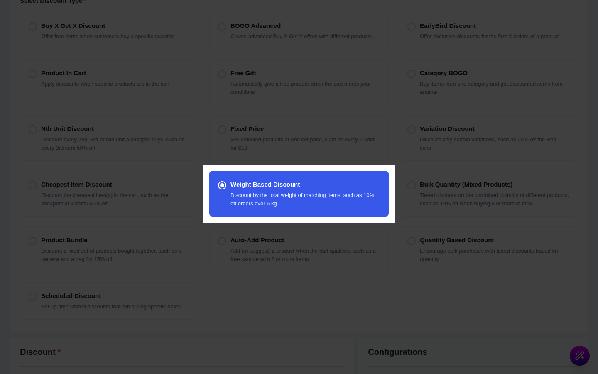
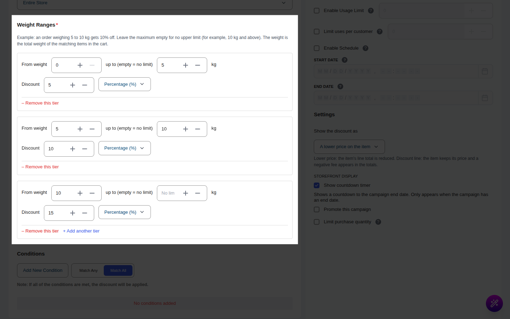
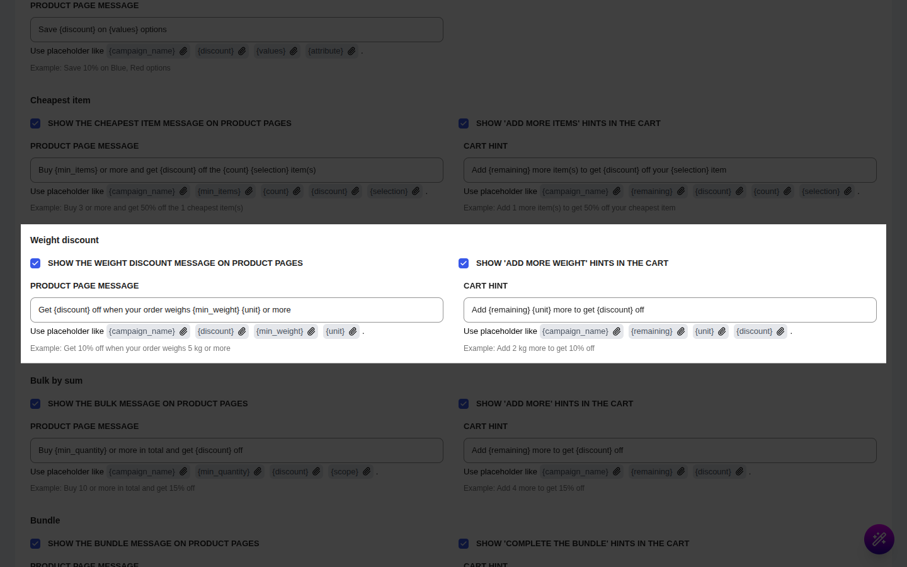

# Campaign Type: Weight Based Discount

::: tip Pro Feature
This is a **CampaignBayPro** feature (Pro 1.1.0 and later). [Upgrade to Pro](https://wpanchorbay.com/campaignbay) to unlock Weight Based Discounts and other powerful features.
:::

A **Weight Based Discount** gives a discount that depends on the **total weight of the matching items in the cart**. The heavier the order, the bigger the discount.

This is the perfect campaign type for scenarios like:

- "10% off orders over **5 kg**"
- "Heavy-order bonus: **$20 off** when the cart weighs 10 kg or more"
- Bulk goods sold by weight (coffee, fertilizer, pet food) where a bigger order should earn a better rate.

This is a **cart-level** campaign. It never changes the price on the product page or in the shop. The discount appears in the cart, at checkout and on the order.

::: info Weight comes from WooCommerce
The weight of each product is the **Weight** field on the product's Shipping tab. Variations use their own weight, or the parent's weight if they have none. The unit (kg, lb, g, oz) is your WooCommerce weight unit, set under **WooCommerce → Settings → Products**. CampaignBay does **not** convert units: if your store uses kg, enter your ranges in kg.
:::

## Step 1: Select Your Campaign Type

Go to **CampaignBay → Add Campaign**.

- **Select Discount Type:** Choose **`Weight Based Discount`** ("Discount by the total weight of matching items, such as 10% off orders over 5 kg").
- **Campaign Title:** e.g., "Heavy Order Savings". When the discount is shown as a separate line, this title is its name in the cart.
- **Select Status:** **Active** or **Inactive** (draft).

## Step 2: Set the Discount Target

Choose which products count towards the weight and can be discounted. Only matching items add to the total weight and only they are discounted.

**[Read the Full Guide: Targeting &rarr;](../core-concepts/targeting.md)**

## Step 3: Add Weight Ranges

The **Weight Ranges** section holds up to 20 ranges. Each range says "when the total weight is between X and Y, give this discount".

The section's own example: an order weighing 5 to 10 kg gets 10% off, and leaving the maximum empty means there is no upper limit.

Each range has:

- **From weight:** the lowest total weight (in your store's weight unit) for this range.
- **up to (empty = no limit):** the highest total weight. Leave it empty (it shows "No limit") for an open-ended top range.
- **Discount:** the amount, and its type:
  - **Percentage (%):** a percentage off the price of every eligible line.
  - **Fixed amount:** **one** flat amount off the whole eligible set of items, not per item or per kg. It is spread across the lines in proportion to their value.

Use **+ Add another tier** to add a range and **– Remove this tier** to delete one.

Both ends are **inclusive**: a range of 5 to 10 includes exactly 5 and exactly 10. If a total sits on a boundary shared by two ranges (for example exactly 5 kg with ranges 1-5 and 5-10), the range with the **higher "From weight"** wins, so 5 kg falls in the 5-10 range.

### Show the discount as

- **A lower price on the item** (default): each eligible line's price is reduced and shown crossed out.
- **A separate discount line in the cart totals:** the items keep their price and one negative line named after the campaign appears in the totals.

A coupon-line option is not offered for this campaign type.

## Step 4: Conditions, Other Configurations and Schedule

- **[Conditions &rarr;](../core-concepts/conditions.md)**: who is eligible, or a minimum cart total.
- **Exclude Sale Items:** sale items are neither weighed nor discounted.
- **Enable Usage Limit:** one order counts as one use.
- **Start Time / End Time:** see **[Scheduling & Automation &rarr;](../core-concepts/scheduling-and-automation.md)**.

## Step 5: Shopper Messages (Optional)

Set these under **CampaignBay → Settings → Cart Settings → Offer type messages → Weight**.

| Setting | What it does | Default |
| --- | --- | --- |
| **Show the weight discount message on product pages** | Message above Add to Cart. | On |
| **Show 'add more weight' hints in the cart** | A hint while the cart is below the next range. | On |
| **Product page message** | Placeholders: `{campaign_name}`, `{discount}`, `{min_weight}`, `{unit}` | `Get {discount} off when your order weighs {min_weight} {unit} or more` |
| **Cart hint** | Placeholders: `{campaign_name}`, `{remaining}`, `{unit}`, `{discount}` | `Add {remaining} {unit} more to get {discount} off` |

A blank field uses the default. Unknown placeholders are removed.

## Step 6: Save the Campaign

Click **Save Campaign**.

## Worked Examples

All examples use these ranges: **R1** 1 to 5 kg at 10%, **R2** 5 to 10 kg at 15%, **R3** 10 kg and up at 20%. Products: A costs 100.00 and weighs 1 kg; B costs 50.00 and weighs 2 kg.

### Example 1: Percentage, shown as a lower price

**Cart:** A ×1 and B ×2.

- Total weight = 1 + (2 × 2) = **5 kg**. Exactly 5 kg falls in **R2** (higher "From weight" wins).
- Eligible value = 100 + 100 = 200.00. 15% of 200.00 = **30.00**.
- A becomes 85.00 and B's line becomes 85.00. **Total 170.00.**

| Where | What the shopper sees |
| --- | --- |
| Product page | Message "Get 10% off when your order weighs 1 kg or more" (the first range). Prices unchanged. |
| Cart | Both lines shown with crossed-out prices. With only A in the cart (1 kg), the hint "Add 4 kg more to get 15% off" appears. |
| Checkout and order | Order lines carry the discounted prices; the campaign is recorded in the discount breakdown. |

### Example 2: The same cart as a separate line

Same cart and ranges, **Show the discount as** = **A separate discount line in the cart totals**.

- Item lines stay at 100.00 and 100.00 (subtotal 200.00).
- A line named after the campaign shows **−30.00** in the totals. **Total 170.00.**

The total is the same; only the presentation differs.

### Example 3: A fixed amount

**Setup:** R2 is changed to **Fixed amount** = 20. Same cart as example 1 (5 kg, eligible value 200.00).

- One discount of **20.00** is spread by line value: A and B's line are 100.00 each, so each takes 10.00.
- A becomes 90.00, B's line becomes 90.00. **Total 180.00.**

### Rounding of a fixed amount

When the amount does not divide evenly, the last line takes the remainder so the discount always adds up exactly. A fixed 10.00 over A (100.00), B (50.00) and D (80.00) (base 230.00) is split 4.35, 2.17 and 3.48.

## Gotchas

- **Fixed amount means different things in different campaigns.** In a Weight campaign it is **one** amount for the whole cart. In a [Bulk Quantity](./bulk-sum-discounts.md) campaign it is an amount **per unit**.
- **A fixed amount is never more than the eligible value.** A 500.00 discount on a 200.00 cart takes 200.00 off, not more.
- **Products without a weight count as 0 kg, but are still discounted.** They add nothing to the total, yet once a range is reached they receive their share of the discount. A range starting at 0 therefore also applies to a cart of weightless products.
- **No unit conversion.** If the products are entered in grams and your store unit is kg, a "5" range means 5 kg. Check the unit shown next to the field and in the messages.
- **Overlapping ranges are accepted.** The range with the highest "From weight" that the total reaches is used; keep ranges tidy to avoid surprises.
- **Weight counts everything that matches.** Items already discounted by another campaign still count towards the weight, but if **Allow Stacking with Other Discount Campaigns** is off in [Cart Settings](../settings/cart-settings.md), they are not discounted again by this one.
- **Order of Pro cart campaigns.** [Cheapest Item](./cheapest-item-discounts.md) runs first, then Weight, then [Bulk Quantity](./bulk-sum-discounts.md). A unit already discounted by an earlier one is not discounted again by a later one.
- **Product and shop prices never change.** Advertise the offer with the product page message.
- **Editing an order in the admin does not recalculate** this discount. It is worked out when the shopper's cart is calculated.

Next, discount a mix of products by their combined quantity.

- **[Bulk Quantity (Mixed Products) &rarr;](./bulk-sum-discounts.md)**
