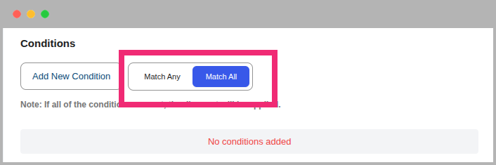
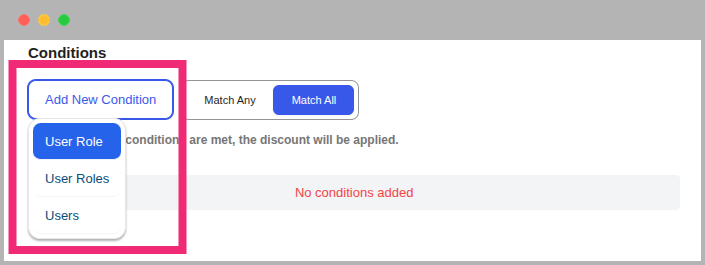
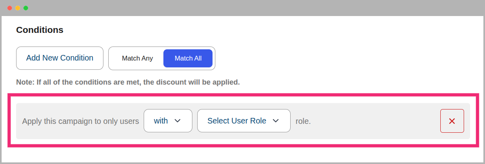
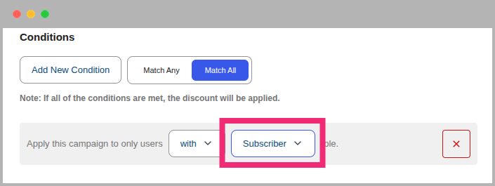
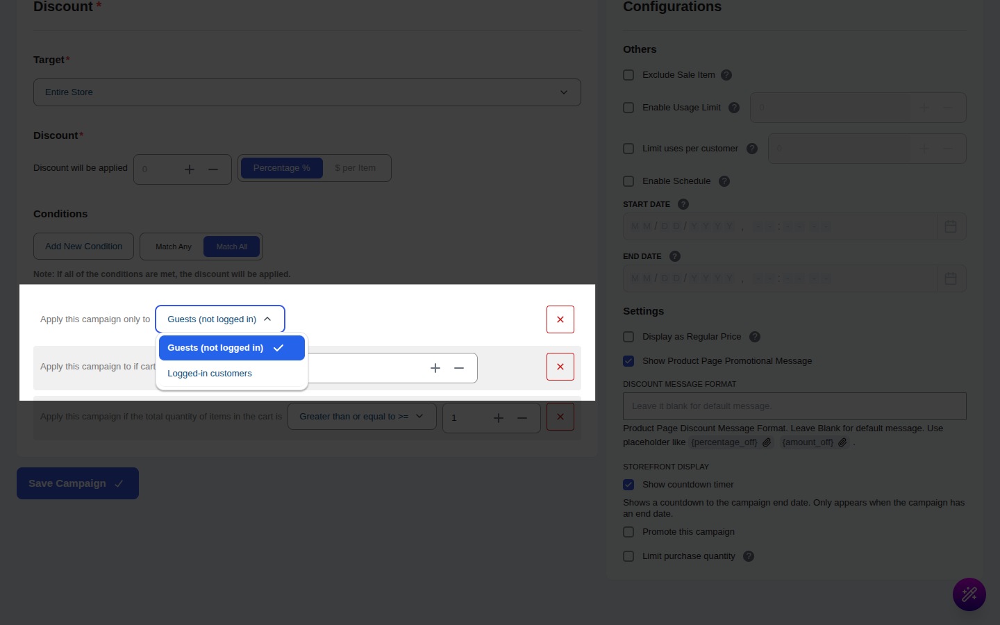
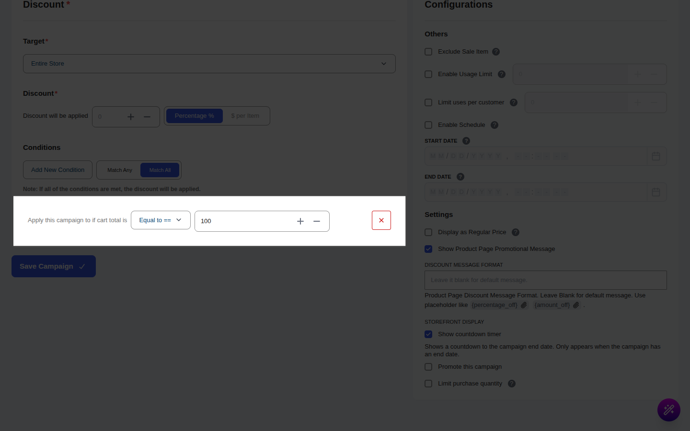
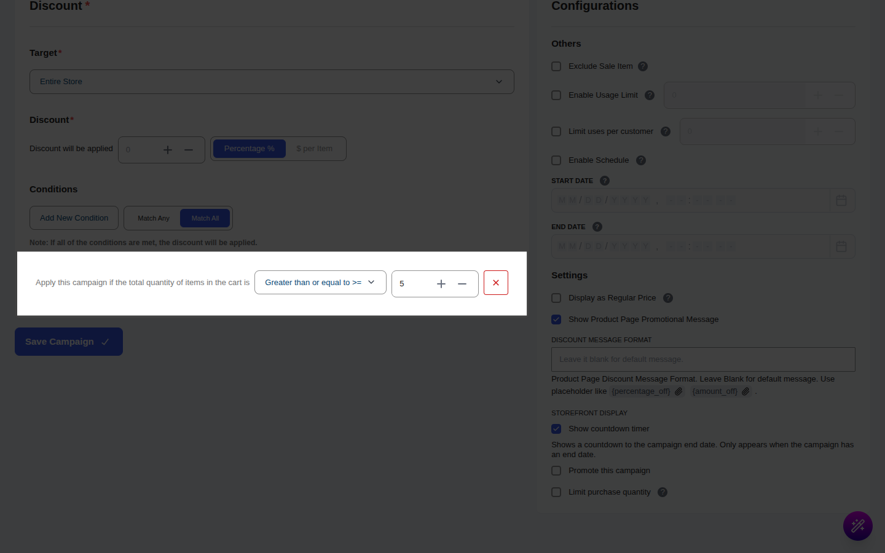

# Conditions

Campaign Bay allows you to add **Conditions** to any campaign. These conditions "gate" the discount, ensuring it only applies when specific criteria are met.

---

## How Conditions Work

Every campaign includes a **Conditions** section where you can add one or more rules.

### Match Logic

| Mode          | Behavior                                             |
| ------------- | ---------------------------------------------------- |
| **Match Any** | Discount applies if _at least one_ condition is true |
| **Match All** | Discount applies _only if all_ conditions are true   |

### Adding Conditions

Click **Add New Condition** to see the available options:

---

## Available Conditions

CampaignBay Free includes four conditions: **User Role**, **Guest / Logged-in**, **Cart Total** and **Cart Item Quantity**.

::: info More conditions in Pro
CampaignBay Pro adds further conditions (such as multiple roles, specific users and order history). See [Pro Conditions](/core-concepts/pro-conditions).
:::

### 1. User Role

Restrict the campaign to shoppers who have a specific WordPress role.

The rule reads: **"Apply this campaign to only users with [role] role."**

Choose from any role on your site:

- Administrator, Editor, Author, Contributor, Subscriber
- WooCommerce roles: Customer, Shop Manager
- Custom roles from other plugins

Guests (visitors who are not logged in) have no role, so they never match a User Role rule. To target guests, use the **Guest / Logged-in** condition below.

You can add only one User Role rule per campaign. Once it exists, the entry shows "Already in Use" in the dropdown.

::: tip Use Case
Create a "VIP Only" sale: `User Role` → `VIP Customer`
:::

---

### 2. Guest / Logged-in

Restrict the campaign to visitors who are **not logged in**, or only to **logged-in customers**.

| Option                      | Behavior                                            |
| --------------------------- | --------------------------------------------------- |
| **Guests (not logged in)**  | The discount applies only to visitors without an account session |
| **Logged-in customers**     | The discount applies only to shoppers who are logged in |

The default for a new rule is **Guests (not logged in)**. You can add this rule together with a User Role rule (using **Match All**) to build things like "logged-in customers with the Customer role".

::: tip Use Case
Encourage sign-ups: `Guest / Logged-in` → `Logged-in customers`. Guests will not see the discounted price, so promote the offer and invite them to create an account.
:::

---

### 3. Cart Total

Apply the campaign only when the cart total meets a threshold.

Choose an operator and enter an amount:

| Operator                      | Behavior                              |
| ----------------------------- | ------------------------------------- |
| **Greater than or equal to**  | Cart total is at least the amount     |
| **Less than or equal to**     | Cart total is at most the amount      |
| **Greater than**              | Cart total is above the amount        |
| **Less than**                 | Cart total is below the amount        |
| **Equal to**                  | Cart total equals the amount (compared at your store's price precision, e.g. 2 decimals) |

There is no "not equal" or "between" operator. To build a range, add two Cart Total rules and set **Match All**: for example `>= 50` and `<= 100`.

**What "cart total" means.** CampaignBay waits until WooCommerce has calculated the cart, and compares the amount against the cart total *before this campaign's own discount*. That total already reflects discounts from other campaigns that don't depend on the cart total, WooCommerce coupons, and any shipping, fees and taxes WooCommerce has added. It is not the plain product subtotal.

Because the cart must be calculated first, a campaign with a Cart Total rule does **not** show its discount on product pages or shop listings. The discount appears once the shopper has the items in the cart.

::: warning Newly added rules start at "Equal to 0"
A freshly added Cart Total rule is set to `== 0`. Change the operator and amount before saving, otherwise the campaign will almost never apply.
:::

::: tip Worked example
Rule: `Cart Total` → `>=` → `100`, discount: 10% on the entire store.
A cart worth $120 gets the discount. A cart worth $80 does not. If the shopper's cart drops below $100 after removing an item, the discount disappears again.
:::

---

### 4. Cart Item Quantity

Apply the campaign only when the cart holds a certain number of items.

It uses the same five operators as Cart Total (`>=`, `<=`, `>`, `<`, `==`) and a whole number. The default for a new rule is `>= 1`.

The count is the **total number of units** across all cart lines (3 T-shirts plus 2 mugs counts as 5). Free items added by a BOGO campaign are **not** counted.

Like Cart Total, this is checked after the cart is calculated, so the discount shows up in the cart rather than on product pages.

::: tip Worked example
Rule: `Cart Item Quantity` → `>=` → `3`, discount: 15% on a category.
A cart with 3 eligible items gets the discount; with 2 it does not.
:::

---

### Using several conditions together

- **Match All** with `Guest / Logged-in = Logged-in` and `Cart Total >= 100`: only logged-in shoppers with a cart of $100 or more.
- **Match Any** with `User Role = Wholesale` or `Cart Item Quantity >= 10`: wholesale buyers, or anyone buying ten or more units.
- A campaign with **no conditions** applies to everyone.

::: tip
Conditions only decide *who or what cart* qualifies. *Which products* are discounted is decided by [Targeting](./targeting.md).
:::

[**Upgrade to CampaignBayPro →**](https://wpanchorbay.com/campaignbay)

---

## Next Steps

Now that you know how to apply specific rules to shoppers and carts, learn how to target your discounts to specific products and categories.

- **[Targeting &rarr;](./targeting.md)**
