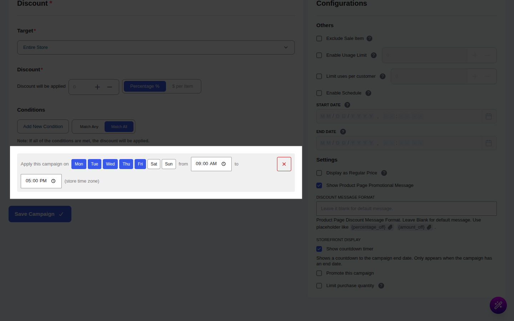
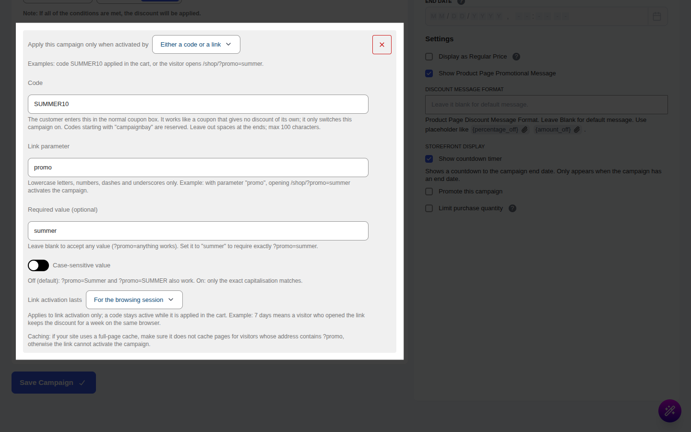
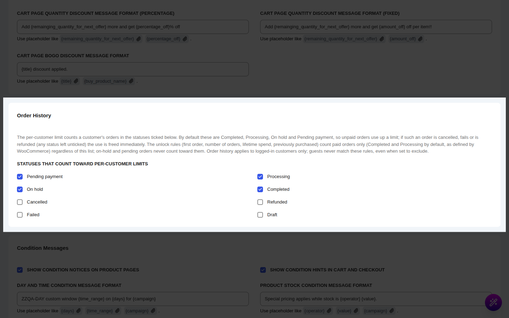
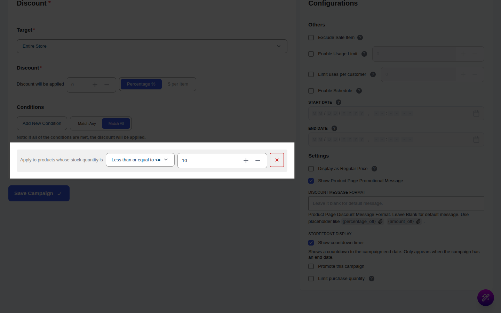
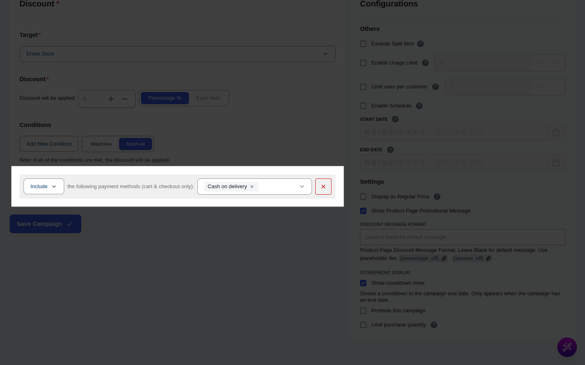
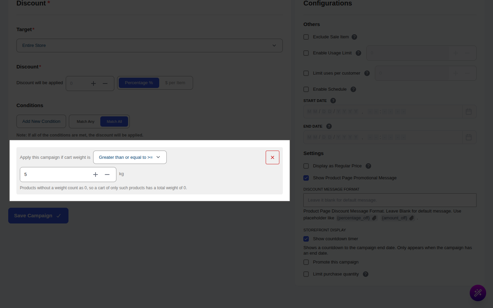
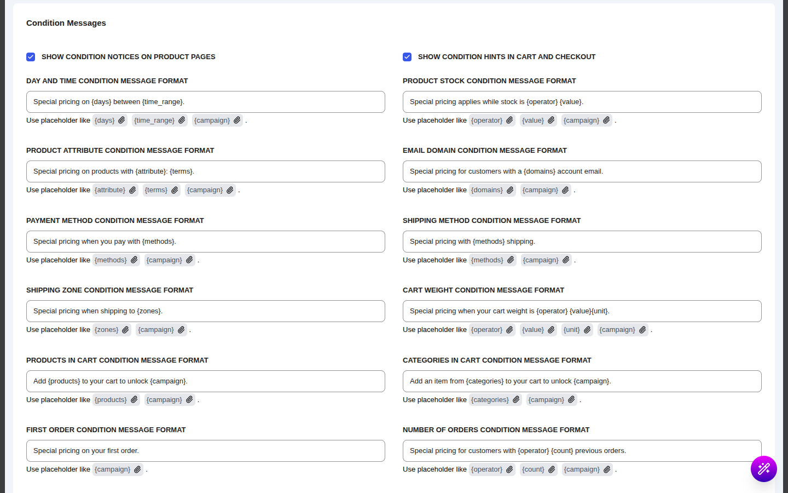

# Pro Conditions

::: tip Pro Feature
This is a **CampaignBayPro** feature. [Upgrade to Pro](https://wpanchorbay.com/campaignbay) to unlock the conditions described on this page. The free plugin keeps its own conditions (User Role, Guest / Logged-in, Cart Total and Cart Item Quantity); see [Conditions](/core-concepts/conditions).
:::

CampaignBay Pro adds conditions that look at **who** the shopper is, **when** they are shopping, **what is in the cart**, and **how they will pay and ship**. They work exactly like the free conditions: you add them in the **Conditions** section of a campaign, and the discount only applies when the rules pass.

---

## How Pro Conditions Work

### Match logic

Pro conditions share the same list as the free ones, and the same **Match Any / Match All** switch applies to all of them.

| Mode          | Behavior                                             |
| ------------- | ---------------------------------------------------- |
| **Match Any** | Discount applies if _at least one_ condition is true |
| **Match All** | Discount applies _only if all_ conditions are true   |

Most Pro conditions with a list of choices (users, domains, methods, zones, categories, products, terms) have an **Include / Exclude** dropdown. Include means "the shopper must match one of these". Exclude means "the shopper must match none of these".

### When is each condition checked?

Some conditions can be answered the moment a shopper opens a page. Others can only be answered once there is a cart, a chosen shipping rate or a chosen payment method. This matters because it changes where the discount is visible.

| Checked | Conditions | What it means |
| ------- | ---------- | ------------- |
| **Any time** (product pages, shop pages, cart, checkout) | Users and roles, Day and time, Product stock, Product attribute, Email domain, Link or code activation, and the four order-history conditions | The discounted price shows up on product pages and shop cards, as long as the rule passes. |
| **Only while the cart is being calculated** | Payment method, Shipping method, Shipping zone, Cart weight, Product in cart, Category in cart | Outside the cart these conditions cannot pass, so product pages and shop cards show the **regular price**. The discount appears once the shopper is in the cart or checkout. |

::: warning Campaigns that depend on the cart
If a campaign uses a cart-based condition, do not expect the sale price on the shop page or the product page. This is by design: the plugin cannot know the payment method, shipping zone or cart contents before the shopper has a cart. Use a [condition message](#condition-messages) to tell shoppers what to do.
:::

### Guests

Anything that needs an account does not match guests: roles, specific users, email domain, and every order-history condition (including **First order**). Details are under each condition below.

---

## Who the Shopper Is

### 1. User Roles

**What it checks:** whether the logged-in shopper has at least one of the roles you pick.

| Option | Description |
| ------ | ----------- |
| **Roles** | One or more roles (Administrator, Customer, Shop Manager, custom roles). |
| **Include / Exclude** | **Include** applies the campaign to shoppers who have one of the roles. **Exclude** applies it to everyone except those roles. |

**Example:** Wholesale buyers have a custom `wholesale` role. Add **User Roles - Include - wholesale** to give them 20% off.

**What the shopper sees:** nothing. This condition has no message, so a shopper who does not match simply sees the regular price.

**Gotchas**

- Guests (not logged in) have no role. **Include** never matches a guest; **Exclude** always matches a guest.
- The check is made at the moment the price is calculated, so a shopper who logs in sees the discount appear after login.

### 2. Users

**What it checks:** whether the logged-in shopper is one of the user accounts you select.

| Option | Description |
| ------ | ----------- |
| **Users** | Search and select one or more customers. |
| **Include / Exclude** | **Include** applies the campaign only to those users. **Exclude** applies it to everyone except them. |

**Example:** Give your three beta testers a private 30% price by adding **Users - Include** and selecting their accounts.

**What the shopper sees:** nothing; there is no message for this condition.

**Gotchas**

- Guests never match **Include**, and always match **Exclude**.

---

## When the Shopper Is Shopping

### 3. Day & Time

**What it checks:** whether the current moment falls inside the days and hours you set, using the **store time zone** (Settings > General in WordPress).

| Option | Description |
| ------ | ----------- |
| **Days** | Tick any of Mon to Sun. |
| **From / to** | Start and end time (24-hour clock, HH:MM). |

How the window behaves:

- **No days ticked** means every day.
- **No times** means the whole day.
- The **start time is included and the end time is not**. A window of 09:00 to 17:00 is active at 09:00 and no longer active at 17:00.
- A window can cross midnight. For example **Fri, 22:00 to 02:00** covers Friday night and the early hours of Saturday. The early-morning part counts as belonging to the day that started the window.
- If the start and end are the same, the rule covers the whole day.

**Example:** A "Happy Hour" campaign: tick **Mon to Fri**, from **16:00** to **18:00**, 15% off.

**What the shopper sees:** on the product page, a notice such as "Special pricing available Monday to Friday from 4:00 pm to 6:00 pm." (days and times are written out using your site's time format). Because day and time are not a cart matter, this notice appears on product pages only, not on the cart or checkout.

**Gotchas**

- If your site uses full-page caching, a cached product page can keep showing the price from before or after the window until the cache refreshes. Exclude pages that depend on time from caching if this matters.
- This condition is different from a campaign **schedule**: a schedule sets the start and end date of the whole campaign, while Day and Time repeats every week inside it. You can use both. See [Scheduling & Automation](/core-concepts/scheduling-and-automation).

### 4. Activated by Code or Link

**What it checks:** whether the shopper has "switched on" the campaign, either by entering a code in the cart or by opening a special link.

| Option | Description |
| ------ | ----------- |
| **Activated by** | **A code** (entered in the cart), **A link** (visitor opens a special URL), or **Either a code or a link**. |
| **Code** | The coupon code the shopper types in the normal coupon box. It works like a coupon that gives no discount of its own; it only switches this campaign on. Codes starting with "campaignbay" are reserved. Maximum 100 characters. |
| **Link parameter** | The URL parameter name, lowercase letters, numbers, dashes and underscores only. Example: `promo`. |
| **Required value** (optional) | Leave blank to accept any value (`?promo=anything` works). Set it to `summer` to require exactly `?promo=summer`. |
| **Case-sensitive value** | Off by default: `?promo=Summer` and `?promo=SUMMER` both work. |
| **Link activation lasts** | **For the browsing session**, or **For a number of days** (1 to 365). Applies to link activation only. A code stays active while it is applied in the cart. |

**Example:** A "VIP Preview" campaign with **Either a code or a link**, code `VIP15`, parameter `promo`, required value `vip`, lasting **7 days**. Email subscribers get `https://yourstore.com/shop/?promo=vip`. Anyone who opens it keeps the discount for a week on the same browser.

**What the shopper sees**

- **Before activating:** on the product page, a notice such as "Summer Sale is available with a special code or link" (the message format controls the wording). If you put `{code}` in the message format the shopper sees the code; the default does not show it.
- **At the moment of activating:** a one-time success notice, "Summer Sale is now active!". You can edit it or turn it off under [Offer type messages](/settings/offer-messages) (Link and code activation).
- Once active, the teaser notice is no longer shown.

**Gotchas**

- Activation is remembered for the shopper. Session-based activation lasts for the browsing session; day-based link activation also sets a cookie, so it lasts for the number of days you chose, on the same browser only.
- **Page caching:** if your site uses a full-page cache, make sure it does not cache pages whose address contains your link parameter (for example `?promo`), otherwise the link cannot activate the campaign.

---

## Customer History

These four conditions use the shopper's past orders. They are meant for first-purchase offers, loyalty rewards and "welcome back" prices.

### How history is counted

- History conditions count **paid orders only**: **Completed** and **Processing** orders. On-hold and pending-payment orders do not count towards them.
- Counts are cached for up to six hours, and refreshed for a customer whenever one of their orders changes status, so a new order is reflected quickly.
- **Guests never match any history condition**, whether it is set to include or exclude and whatever the operator. A first-time shopper who buys without an account does not get a "first order" discount. Encourage account creation at checkout if you rely on these.

### 5. Customer: First Order

**What it checks:** whether the customer has no previous qualifying order.

| Option | Description |
| ------ | ----------- |
| **Include / Exclude** | **Include** applies the campaign to first-time customers (logged-in, no previous paid order). **Exclude** applies it only to returning customers. |

**Example:** "Welcome offer: 10% off your first order" for new customers.

**What the shopper sees:** on the product page, "Special pricing for first-time customers." (editable). If the shopper is logged out, they do not match.

**Gotchas**

- Because guests never match, the offer reaches new customers only once they are logged in.
- A customer whose only order is still on hold or pending is still counted as a first-time customer.

### 6. Customer: Number of Previous Orders

**What it checks:** how many previous paid orders the customer has placed.

| Option | Description |
| ------ | ----------- |
| **Operator** | `>=`, `<=`, `>`, `<`, `==` |
| **Number of orders** | The number to compare with. |

**Example:** `>=` **3** orders: a "Loyal customer" price for people who have already bought three times.

**What the shopper sees:** a teaser on the product page ("Special pricing for customers with at least 3 previous orders."). For a logged-in customer who is still short of the goal, there is also a progress hint such as "Place 2 more order(s) to unlock Loyal customer."

**Gotchas**

- The progress hint is shown for logged-in shoppers on the product page.
- It counts previous paid orders, not the order being placed.

### 7. Customer: Lifetime Spend

**What it checks:** the total amount a customer has spent across their previous paid orders.

| Option | Description |
| ------ | ----------- |
| **Operator** | `>=`, `<=`, `>`, `<`, `==` |
| **Amount** | The amount in your store currency. |

**Example:** `>=` **500** gives a VIP price once a customer has spent 500 in total.

**What the shopper sees:** the product page teaser ("Special pricing for customers who have spent at least $500.00.") and, for logged-in customers who are close, a progress hint such as "Spend $120.00 more to unlock VIP Price."

**Gotchas**

- It sums the totals of the customer's previous paid orders, minus any refunded amount, in the store currency.

### 8. Customer: Previously Purchased Product

**What it checks:** whether the customer has bought any of the products you pick in an earlier paid order.

| Option | Description |
| ------ | ----------- |
| **Products** | One or more products. |
| **Include / Exclude** | **Include** applies the campaign to customers who bought at least one of them. **Exclude** applies it to everyone who has not. |

**Example:** "Printer owners get 20% off ink": **Previous Product - Include - Printer X**.

**What the shopper sees:** on the product page, "Special pricing for customers who have bought Printer X before." (editable).

**Gotchas**

- Guests do not match, even with **Exclude**.

### Per-customer limit

Not a condition, but it uses the same order history. In the campaign's side settings, switch on **Limit uses per customer** and set a number. Each logged-in customer can then use the campaign that many times; guests cannot use a limited offer.

The orders counted for this limit are chosen separately in **Settings > Cart Settings > Order History**, under **Statuses that count toward per-customer limits**. By default these are **Completed, Processing, On hold and Pending payment**, so an order that is still unpaid uses up a use. If such an order is cancelled, fails or is refunded (any status you leave unticked), the use is given back.

**What the shopper sees:** if the campaign has a limit, a notice on the product page and on the cart and checkout:

| Situation | Default message |
| --------- | --------------- |
| Customer can still use it | "You have used this offer 1 of 3 times." |
| Limit reached | "You have already used Summer Sale the maximum of 3 times." |
| Guest | "Log in to use Summer Sale. It is limited to 3 per customer." |

---

## What Is in the Product and the Catalogue

### 9. Product Stock

**What it checks:** the product's stock quantity, as managed by WooCommerce.

| Option | Description |
| ------ | ----------- |
| **Operator** | `>=`, `<=`, `>`, `<`, `==` |
| **Quantity** | The stock number to compare with. |

**Example:** `<=` **10**: a "Last chance" clearance price for products with 10 or fewer left.

**What the shopper sees:** on the product page, "Special pricing applies while stock is at most 10." (editable; operators are written as words: at least, at most, exactly, more than, less than).

**Gotchas**

- Stock must be **managed** for the product. A product with "Manage stock" turned off never matches.
- The check is made on the product being priced, so each variation with its own managed stock is judged separately.

### 10. Product Attribute

**What it checks:** whether the product has one of the attribute terms you choose.

| Option | Description |
| ------ | ----------- |
| **Attribute** | A global product attribute (for example Colour, Size). |
| **Terms** | One or more terms of that attribute. |
| **Include / Exclude** | **Include** applies the campaign to products that have one of the terms. **Exclude** excludes them. |

**Example:** **Attribute: Colour - Include - Red, Orange** gives a seasonal price to red and orange products.

**What the shopper sees:** on the product page, "Special pricing for Colour: Red, Orange." (editable).

**Gotchas**

### 11. Email Domain

**What it checks:** the domain of the logged-in customer's account email.

| Option | Description |
| ------ | ----------- |
| **Domains** | Type a domain and press Enter, such as `example.com` or `company.org`. A leading `@` is ignored. |
| **Include / Exclude** | **Include** applies the campaign to those domains. **Exclude** excludes them. |

An entry matches the domain itself and its sub-domains. `company.org` also matches `mail.company.org`.

**Example:** "Staff discount": **Email Domain - Include - yourstore.com**.

**What the shopper sees:** on the product page, "Special pricing for customers with a @yourstore.com account email." (editable).

**Gotchas**

- The account email is checked, not the billing email typed at checkout. Guests have no account email, so **Include** never matches them and **Exclude** always matches them.
- Anyone can register with an address they control, so do not use this for deep discounts without email verification.

---

## What Is in the Cart

These conditions are only evaluated while the cart is being calculated (see the table at the top of this page). Product pages and shop cards show the regular price; the discount appears in the cart.

### 12. Payment Method (cart & checkout)

**What it checks:** the payment gateway the shopper has chosen.

| Option | Description |
| ------ | ----------- |
| **Payment methods** | One or more gateways active in WooCommerce. |
| **Include / Exclude** | Include or exclude them. |

**Example:** "Pay by bank transfer and save 3%": **Payment Method - Include - Direct bank transfer**.

**What the shopper sees:** on the cart and checkout, an info notice such as "Special pricing when you pay with Direct bank transfer." appears until the matching gateway is chosen. On product pages the same text describes the offer.

**Gotchas**

- The discount only applies once the shopper has selected the gateway.
- When the cart total is already zero, there is no payment step, and the condition passes instead of removing the discount.

### 13. Shipping Method (cart & checkout)

**What it checks:** the type of shipping rate the shopper has chosen (for example **Flat rate**, **Free shipping**, **Local pickup**).

| Option | Description |
| ------ | ----------- |
| **Shipping methods** | One or more method types. |
| **Include / Exclude** | Include or exclude them. |

**Example:** "Pick up in store and save 5%": **Shipping Method - Include - Local pickup**.

**What the shopper sees:** "Special pricing with Local pickup shipping." as an info notice on the cart and checkout until the matching rate is chosen.

**Gotchas**

- The condition matches the **method type**, not a particular rate. Two flat-rate rates in different zones are both "Flat rate".
- A shipping rate must be selected for the condition to pass.

### 14. Shipping Zone (cart & checkout)

**What it checks:** the WooCommerce shipping zone of the rate the shopper has chosen.

| Option | Description |
| ------ | ----------- |
| **Shipping zones** | One or more zones from WooCommerce > Settings > Shipping. |
| **Include / Exclude** | Include or exclude them. |

**Example:** "Free-delivery region offer": **Shipping Zone - Include - Domestic**.

**What the shopper sees:** "Special pricing when shipping to Domestic." as an info notice on the cart and checkout until the shopper's address falls in the zone.

**Gotchas**

- The shipping address must be known for the zone to be determined. Until a rate is chosen, the condition does not pass.

### 15. Cart Weight (cart & checkout)

**What it checks:** the total weight of the cart: the weight of every item multiplied by its quantity, added up. Products without a weight count as zero.

| Option | Description |
| ------ | ----------- |
| **Operator** | `>=`, `<=`, `>`, `<`, `==` |
| **Weight** | The weight in your WooCommerce weight unit (Settings > Products). |

**Example:** `>=` **10**: a heavy-order discount.

**What the shopper sees:** on the cart and checkout, an info notice using the format "Special pricing when your cart weight is {operator} {value}{unit}." until the weight rule is met. Use the default template as a guide when editing; the unit is added from your WooCommerce weight setting.

**Gotchas**

- The unit is the one set in WooCommerce. It is not converted.
- For discount tiers based on weight rather than a yes/no gate, see the weight discount campaign type.

### 16. Cart Total

Cart Total is a free condition. See [Conditions](/core-concepts/conditions). It is listed here only because it is often combined with the Pro cart conditions.

### 17. Products in Cart (cart & checkout)

**What it checks:** whether the cart contains at least one of the products you choose.

| Option | Description |
| ------ | ----------- |
| **Products** | One or more products. |
| **Include / Exclude** | **Include** requires at least one of them to be in the cart. **Exclude** applies when none of them is. |

**Example:** "Buy a camera, get 20% off the memory card": campaign targets the memory card, with **Products in Cart - Include - Camera**.

**What the shopper sees:** until the product is in the cart, a hint "Add Camera to your cart to unlock Memory card deal." on the product page, cart and checkout. Once the product is in the cart, the hint disappears and the discount applies.

**Gotchas**

- The discount appears in the cart, not on the product page. The hint tells shoppers what to add.
- For a dedicated "buy X, get Y" workflow with its own settings, see [Product in Cart Discounts](/campaigns/product-in-cart-discounts).

### 18. Categories in Cart (cart & checkout)

**What it checks:** whether the cart contains an item from at least one of the categories you choose.

| Option | Description |
| ------ | ----------- |
| **Categories** | One or more product categories. |
| **Include / Exclude** | Require one of them, or require none. |

**Example:** "Any shoes in the cart unlocks 10% off socks": the campaign targets the socks category, with **Categories in Cart - Include - Shoes**.

**What the shopper sees:** "Add an item from Shoes to your cart to unlock Sock deal." until a shoe is in the cart.

**Gotchas**

- Same as Product in Cart: the discount is applied in the cart, and the message guides the shopper.

---

## Condition Messages

Pro conditions can describe to shoppers what an offer requires. These messages are plain-text info notices (the standard WooCommerce info box with the class `campaignbaypro-condition-message`).

### Where they appear

| Place | Which conditions |
| ----- | ---------------- |
| **Product page** (above the add-to-cart form) | Day and time, Product stock, Product attribute, Email domain, Payment method, Shipping method, Shipping zone, Cart weight, Product in cart, Category in cart, First order, Order count, Lifetime spend, Previous product, Link or code activation, plus the per-customer limit notice |
| **Cart and checkout** (classic and block layouts) | Only the cart-based conditions (Payment method, Shipping method, Shipping zone, Cart weight, Product in cart, Category in cart) while they are not yet satisfied, plus the per-customer limit notice |

History and activation teasers (and the order-count and lifetime-spend progress hints) appear on the product page.

Only **Include** rules show a message; an **Exclude** rule shows nothing. User Roles, Users and Cart Total have no message.

### Settings

Messages are configured in **Settings > Cart Settings > Condition Messages**.

| Setting | Default | What it does |
| ------- | ------- | ------------ |
| **Show condition notices on product pages** | On | Shows the product-page messages. |
| **Show condition hints in cart and checkout** | On | Shows the cart and checkout messages. |
| One field per condition | See below | The wording. Leave it blank to use the default. |

Message wording is plain text: any HTML you type is removed. Placeholders are written in curly braces, like `{campaign}`. A placeholder that does not exist for that condition is removed rather than shown.

### Default messages and placeholders

| Condition | Default message |
| --------- | --------------- |
| Day & Time | Special pricing available {days} {time_range}. |
| Product stock | Special pricing applies while stock is {operator} {value}. |
| Product attribute | Special pricing for {attribute}: {terms}. |
| Email domain | Special pricing for customers with a {domains} account email. |
| Payment method | Special pricing when you pay with {methods}. |
| Shipping method | Special pricing with {methods} shipping. |
| Shipping zone | Special pricing when shipping to {zones}. |
| Cart weight | Special pricing when your cart weight is {operator} {value}{unit}. |
| Products in Cart | Add {products} to your cart to unlock {campaign}. |
| Categories in Cart | Add an item from {categories} to your cart to unlock {campaign}. |
| Customer: first order | Special pricing for first-time customers. |
| Customer: number of previous orders | Special pricing for customers with {operator} {count} previous orders. |
| Customer: lifetime spend | Special pricing for customers who have spent {operator} {amount}. |
| Customer: previously purchased product | Special pricing for customers who have bought {products} before. |
| Activated by code or link | {campaign_name} is available with a special code or link |
| Order count progress | Place {remaining} more order(s) to unlock {campaign}. |
| Lifetime spend progress | Spend {remaining} more to unlock {campaign}. |
| Limit: still available | You have used this offer {used} of {limit} times. |
| Limit: reached | You have already used {campaign} the maximum of {limit} times. |
| Limit: guest | Log in to use {campaign}. It is limited to {limit} per customer. |

`{campaign}` is the campaign name in every message. Link or code activation also offers `{campaign_name}`, `{code}` and `{url_param}`. The progress messages offer `{remaining}`, `{current}` and `{target}`, and the limit messages offer `{limit}`, `{used}` and `{remaining}`.

::: tip Use Case
**Weekend Flash Offer for Loyal Customers**

A store wants a 20% weekend price for customers who have already spent 300:

1. Create a Scheduled campaign and set its discount to 20%.
2. Add **Day and Time**: Sat and Sun, whole day.
3. Add **Lifetime Spend >= 300**.
4. Set the match mode to **Match All**.

A logged-in customer under the threshold sees a progress notice such as "Spend $60.00 more to unlock Weekend Flash Offer." on product pages. At the weekend with a lifetime spend of 300 or more, they see the discounted price.
:::

---

## Related

- [Conditions](/core-concepts/conditions) - the free conditions and match logic
- [Offer type messages](/settings/offer-messages) - wording for the Pro campaign types
- [Cart Settings](/settings/cart-settings)
