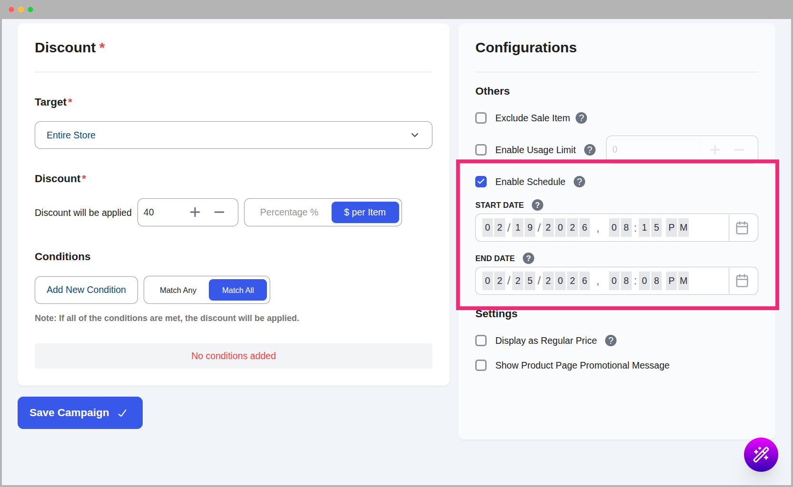

# Core Concepts: Scheduling & Automation

One of the most powerful features of CampaignBay is its ability to automatically start and stop your campaigns based on a schedule. This "set and forget" system allows you to plan your sales calendar in advance, ensuring your promotions run with precision.

This guide explains how the automation engine works.

## How Scheduling Works

The automation in CampaignBay is entirely controlled by the **Enable Schedule** checkbox and the associated **Start Time** and **End Time** fields found in the campaign sidebar.

### The Two States

Your campaign's eligibility is determined by the relationship between its main status and its schedule:

1.  **Status: Active + Schedule: OFF**
    - The campaign runs indefinitely. It is always eligible to apply discounts until you manually change the status to **Inactive**.

2.  **Status: Active + Schedule: ON**
    - The campaign only applies discounts between the defined **Start Time** and **End Time**.
    - If the current time is _before_ the Start Time, the campaign name will appear with a **Scheduled** label in the list view.
    - If the current time is _after_ the End Time, the campaign name will appear with an **Expired** label in the list view.

Behind the scenes, CampaignBay only discounts while a campaign's stored status is **Active**. Turning **Enable Schedule** on moves the campaign to **Scheduled**; it switches to **Active** at the Start Time and to **Expired** at the End Time (the automation described below does the switching).

::: tip Proactive Planning
You can set up your entire month's promotions in one sitting by creating multiple campaigns, setting them to **Active**, and enabling their specific schedules.
:::

### Start and End Time Edge Cases

| Situation | What happens |
| --------- | ------------ |
| **Start Time left empty** (End Time set) | There is no start restriction, so the campaign activates **immediately** when you save it. |
| **End Time left empty** (Start Time set) | The campaign starts at the Start Time and then runs until you stop it or it hits its usage limit. |
| **Both empty** with Enable Schedule on | Not allowed. The editor asks for a Start Time. |
| **Start Time exactly "now" or in the past** | The campaign activates right away. The Start Time is inclusive. |
| **End Time exactly "now"** | The campaign expires. The End Time is exclusive: at the End Time the discount is over. |
| **Empty or "zero" dates** (for example `0000-00-00`, which can appear in imported files) | Treated the same as "no date set". |
| **End Time earlier than Start Time** | CampaignBay does not check this. Such a campaign expires as soon as the schedule runs, so double-check your dates. |

::: tip Worked example
It is 3 June, 10:00. You save a campaign with Enable Schedule on, no Start Time, and End Time `10 June 23:59`. It is active right away and expires at 23:59 on 10 June.
:::

### Usage Limits

A campaign can also end early with an **Enable Usage Limit** number of orders. When the limit is reached the campaign becomes **Expired**, no matter what its schedule says. See [Usage Limits and Early Bird Tiers](./understanding-the-engine.md#usage-limits-and-early-bird-tiers).

---

## The Automation Engine: Built for Reliability

CampaignBay uses a robust, two-part system to ensure your campaigns always run on time without requiring manual intervention.

### 1. WordPress Cron Events

When you save a campaign with **Enable Schedule** turned on, CampaignBay schedules automated tasks with WordPress. These "cron jobs" are designed to trigger at the precise moment your campaign is due to start or expire.

### 2. The CampaignBay Failsafe

We understand that on some hosting environments, the WordPress Cron system might be unreliable. To solve this, CampaignBay includes a powerful **failsafe mechanism** that is always working for you in the background.

Every time a customer interacts with your store (adding to cart, visiting a product page, etc.), our system performs a lightning-fast check on active schedules. If it finds any campaign where a scheduled time was missed (e.g., because a cron job didn't fire), it will **immediately correct the campaign's behavior**.

::: info Peace of Mind
This built-in failsafe guarantees that your discounts will always be accurate and your sales will run on time, regardless of your server's background task configuration.
:::

---

## Important Tips

- **Timezone Information:** All dates and times are entered and shown in the timezone you have configured in your main WordPress settings (**Settings → General → Timezone**), not your computer's timezone. A Start Time of `09:00` means 09:00 on your store's clock. If you change the site timezone later, existing campaign times keep the same clock time but now refer to the new timezone, so review them.
- **Pick a time with the date picker:** The picker works to the minute. The **Today** button fills in the current time on your site's clock.
- **Manual Overrides:** You can always instantly stop a scheduled campaign by simply toggling its main status to **Inactive**.

Now that you understand how scheduling works, learn how to add specific rules to restrict who can use your discounts.

- **[How to Use Conditions &rarr;](./conditions.md)**
