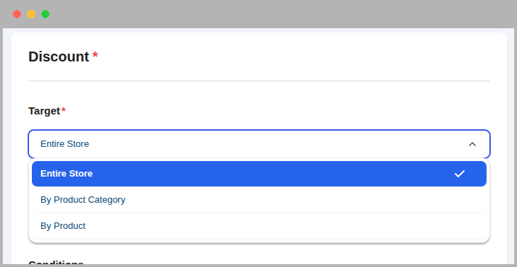
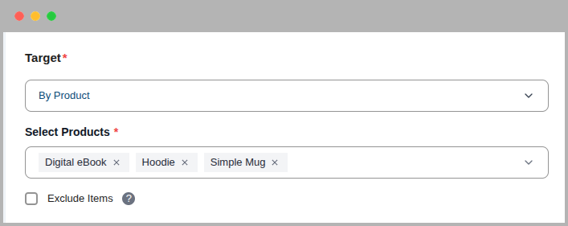
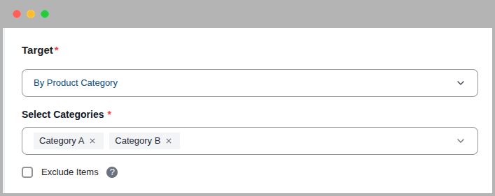
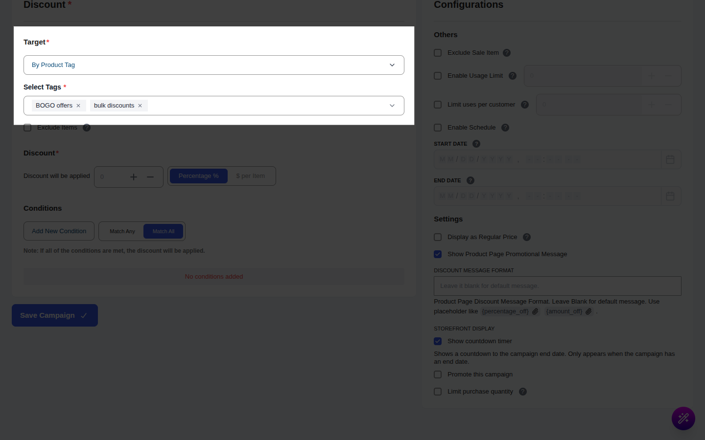
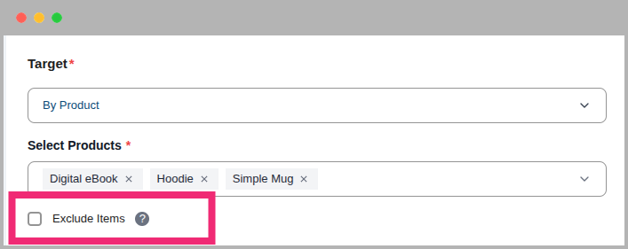

# Core Concepts: Targeting

One of the most powerful features of CampaignBay is the ability to precisely control which products are eligible for a discount. The **Discount Target** setting, which appears on the "Add/Edit Campaign" screen, is the primary tool for defining this scope.

This guide provides a detailed explanation of each available targeting option.

## Targeting Options Overview

When you create or edit any campaign, you will see the "DISCOUNT TARGET" dropdown menu. This is where you select the core logic for how the plugin will find eligible products.

There are four methods for targeting your discounts:

1.  Entire Store
2.  By Product
3.  By Product Category
4.  By Product Tag

Let's explore each option in detail.

### 1. Entire Store

- **What it does:** This is the broadest and simplest option. When selected, the campaign's discount will be applied to **every single product** in your WooCommerce store (unless excluded by other campaign rules like "Exclude Sale Items").
- **Best for:** Store-wide sales events like Black Friday, Cyber Monday, anniversary sales, or any promotion where you want to offer a discount on everything.
- **Configuration:** No further configuration is needed. Simply select this option.

### 2. By Product

- **What it does:** This is the most specific targeting option. It allows you to hand-pick individual products that will be included in (or excluded from) the discount.
- **Best for:** Promoting a new product, running a "Deal of the Week" on a specific item, or clearing out the remaining stock of a few specific products.
- **Configuration:** When selected, a **"Select Products"** field will appear.

- **Select Products:** Click inside the box and start typing the name of a product to search. Select one or more products from the list. If you select a **variable product**, the rule will apply to all of its variations.
- **Exclude Items:** This powerful checkbox inverts the logic.
  - **Unchecked (Default):** The discount will apply **only** to the products you selected.
  - **Checked:** The discount will apply to **all products in your store EXCEPT** for the ones you selected.

### 3. By Product Category

- **What it does:** This option allows you to apply a discount to all products that belong to one or more specific categories.
- **Best for:** Targeted promotions, such as "15% off all T-Shirts" or a clearance sale on your "Electronics" and "Accessories" categories.
- **Configuration:** When you select this option, a **"Select Categories"** field will appear.

- **Select Categories:** Click inside the box and start typing the name of a category to search. Select one or more categories from the list. The discount will apply to all products assigned to the selected categories.
- **Exclude Items:** This checkbox inverts the logic.
  - **Unchecked (Default):** The discount will apply **only** to products within the categories you selected.
  - **Checked:** The discount will apply to **all products in your store EXCEPT** for those in the categories you selected.

::: warning Sub-categories are matched exactly
CampaignBay matches the exact categories you select. A product that is only assigned to a *child* category (for example "T-Shirts") is **not** discounted when you select only the *parent* ("Clothing"). Select the child categories too, or assign the products to the parent category as well.
:::

### 4. By Product Tag

- **What it does:** Applies the discount to every product that carries one or more of the selected WooCommerce product tags.
- **Best for:** Promotions that cut across categories, such as a "summer" or "clearance" tag, or a hand-managed "on promotion" tag you add and remove as products come and go.
- **Configuration:** When you select **By Product Tag**, a **"Select Tags"** field appears.

- **Select Tags:** Click inside the box and start typing a tag name. Select one or more tags. A product matches if it has **at least one** of the selected tags.
- **Exclude Items:** Works exactly like it does for products and categories.
  - **Unchecked (Default):** Only products with a selected tag are discounted.
  - **Checked:** Every product **except** those with a selected tag is discounted.

::: tip Tip
Because tags are managed in **Products → Tags** and on each product, you can change which products are on sale without ever editing the campaign: just add or remove the tag on the product.
:::

## Variable Products

For **By Product**, **By Product Category** and **By Product Tag**, a variation always follows its parent product. Selecting a variable product (or giving it a matching category or tag) discounts all of its variations.

## Inverting the Logic: The 'Exclude Items' Checkbox

For "By Product", "By Product Category" and "By Product Tag" targeting, you will see an **`Exclude Items`** checkbox. This is a powerful feature that completely inverts the logic of your selection, allowing you to create store-wide discounts with a few specific exceptions.

#### Default Behavior (Exclude Items is UNCHECKED)

- The discount will apply **ONLY** to the items you have selected in the box.
- This is an **"include list"**. All other products are ignored.

#### Inverted Behavior (Exclude Items is CHECKED)

- The discount will apply to **EVERYTHING in your store EXCEPT** for the items you have selected in the box.
- This is an **"exclude list"**.

### Practical Use Cases for "Exclude Items"

**Example 1: Store-wide Sale, Excluding a New Product**

- **Goal:** Run a 15% off sale on everything, but keep your brand new, full-priced flagship product excluded.
- **Setup:**
  1.  **Discount Target:** `By Product`
  2.  **Select Products:** Search for and select your "Flagship Product".
  3.  **Exclude Items:** **Check this box.**
- **Result:** The 15% discount will apply to every product in your store _except_ the flagship product.

**Example 2: Discount All Clothing, Except for "New Arrivals"**

- **Goal:** Put all clothing on sale, but exclude the items in your "New Arrivals" category.
- **Setup:**
  1.  **Discount Target:** `By Product Category`
  2.  **Select Categories:** Search for and select the "New Arrivals" category.
  3.  **Exclude Items:** **Check this box.**
- **Result:** The discount will apply to every product in your store _except_ for those in the "New Arrivals" category.

**Example 3: Everything Except "Clearance"-Tagged Products**

- **Setup:** `Discount Target: By Product Tag` → select the "Clearance" tag → **Exclude Items** checked.
- **Result:** All products except those tagged "Clearance" are discounted.

## Exclude Sale Items

The **Exclude Sale Item** checkbox (in the *Others* section of the campaign sidebar) works alongside any target type. When it is checked, any product that already has a WooCommerce **sale price** in effect is skipped by this campaign, even if it matches the target. Products with no sale price are unaffected.

- **Example:** A 20% store-wide campaign with **Exclude Sale Item** checked. A $20 T-shirt that is on sale for $15 stays at $15. A full-price $30 mug becomes $24.
- Only a sale price you set on the product counts. A price reduced by *another CampaignBay campaign* does not count as "on sale" for this checkbox.

## Targeting vs. Conditions

Targeting decides *which products* a campaign covers. [Conditions](./conditions.md) decide *who and under what cart circumstances* it applies. A product receives the discount only when it passes both.

## Next Steps

Now that you've configured your settings, head to the FAQ for common questions and answers.

- **[FAQ &rarr;](../faq.md)**
