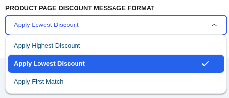
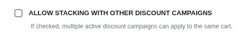

# Core Concepts: The Discount Engine & Stacking

The heart of CampaignBay is its powerful pricing engine. To get the most out of the plugin, it's essential to understand the rules it uses to calculate and prioritize discounts, especially when multiple campaigns apply to the same products.

This guide explains the different discount groups, how the engine handles conflicts, and how stacking works.

## The Discount Groups

CampaignBay organizes discounts into distinct groups that are processed in a specific order.

1.  **Product-Level Discounts:** These campaigns apply a direct price change to an individual product.
    - Includes: `Scheduled Discount`, `Early Bird Discount`.

2.  **Cart-Level Discounts:** These campaigns apply a discount based on the contents of the entire cart, like the quantity of items or the presence of specific items.
    - Includes: `Quantity Based Discount`. (CampaignBay Pro adds more cart-level types, such as `Product In Cart`.)

3.  **Special Discounts:** These campaigns operate with their own unique logic and do not typically stack with other discounts.
    - Includes: `BOGO (Buy X Get X)`. (CampaignBay Pro adds `BOGO Advanced (Buy X Get Y)`.)

## How a Price Is Calculated

Before any competition between campaigns, the engine works out what each campaign would charge.

### The starting ("base") price

Under **Settings → Global → Calculate Discount From** you choose which price the discount is taken from:

- **Regular Price (Default):** The discount is taken from the product's regular price. A product's own sale price is ignored for the calculation.
- **Sale Price:** If a product is on sale, the discount is taken from its sale price. Products that are not on sale still use the regular price.

::: tip Worked example
A mug has a regular price of $20 and a sale price of $15. A campaign gives 20% off.

- **Regular Price:** 20% of $20 = $4, so the mug costs **$16**.
- **Sale Price:** 20% of $15 = $3, so the mug costs **$12**.

If you don't want already-discounted products to be reduced a second time, use the campaign's **Exclude Sale Item** checkbox (see [Targeting](./targeting.md#exclude-sale-items)).
:::

All campaigns competing for the same product start from the same base price. They compete, they don't compound (unless stacking is enabled, see Step 2).

### Percentage and fixed discounts

- **Percentage:** `base price - (base price x value / 100)`.
- **Fixed amount (per item):** `base price - value`.

The price never goes below zero. Rounding is done by WooCommerce when prices and totals are displayed, according to your store's decimal settings.

### Taxes

CampaignBay takes the discount from the price **as WooCommerce stores it** (the price you typed in the product editor, whether you entered prices with or without tax), and WooCommerce then works out the tax on the discounted price. Shop and cart prices follow your normal WooCommerce "display prices including/excluding tax" settings.

For example, with 10% tax, prices entered **excluding** tax, a $100 product with a 20% campaign is $80 plus $8 tax = $88. With prices entered **including** tax, a $110 product with a 20% campaign is $88 including tax.

### Apply Discount As (Quantity campaigns)

Quantity campaigns let you choose how the discount shows up in the cart:

| Option                          | What the shopper sees                                                                    |
| ------------------------------- | ---------------------------------------------------------------------------------------- |
| **Strike through in line total** (Default) | The item's price is lowered directly; the original price is struck through. |
| **Coupon**                      | The item keeps its normal price and a coupon row (named after the campaign) shows the discount. |
| **Fee**                         | A negative fee row (named after the campaign) shows the discount.                        |

All three reduce the amount the customer pays and the tax they are charged. The difference is how the discount is displayed, and (for coupon and line-total modes) how it interacts with WooCommerce's free-shipping minimum: a **Fee** does not lower the cart subtotal that WooCommerce compares with the free-shipping minimum, while line-total and coupon discounts do.

## Step 1: Finding the Best Product-Level Discount

What happens if a product is eligible for both a "20% Off Store-Wide" (`Scheduled`) campaign and a "50% Off for the first 100 sales" (`Early Bird`) campaign?

The engine first finds the single best discount from the **Product-Level group**. This is controlled by the **"Handle Multiple Product Discounts"** setting, found in **Settings → Product Settings**.

- **Apply Highest Discount (Default):** The engine calculates the final price for all applicable `Scheduled` and `Early Bird` campaigns and applies **only the one that gives the customer the biggest saving**. In the example above, the 50% Early Bird discount would win.

- **Apply Lowest Discount:** The engine applies only the campaign that gives the customer the smallest saving.

- **Apply First Match:** The first matching campaign wins, regardless of how large its saving is. "First" means the campaign that was **created first**.

- **Most Recently Started Wins:** The campaign that started most recently wins. A campaign's start is its **Start Time** if it has one, otherwise the date it was created. If two campaigns started at exactly the same moment, the one already holding the product keeps it.

In every method, if two campaigns give exactly the same price, the earlier-created campaign keeps the product.

::: tip Worked example
A $100 product (regular price base) is covered by campaign A (created first, 20% off, started June 1) and campaign B (created second, 30% off, started June 10).

| Method | Winner | Price |
| ------ | ------ | ----- |
| Apply Highest Discount | B | $70 |
| Apply Lowest Discount | A | $80 |
| Apply First Match | A (created first) | $80 |
| Most Recently Started Wins | B (started later) | $70 |
:::

At the end of this step, the engine has determined the single "best" product-level discount.

## Step 2: Stacking Between Discount Groups

Next, the engine decides how to handle the winning Product-Level discount and any applicable Cart-Level discounts. This is controlled by the **`Allow Stacking with Other Discount Campaigns`** setting in the **Settings → Cart Settings** tab.

#### If Stacking is OFF (Default)

The system performs a final competition:

- It compares the winning **Product-Level discount** against the **Cart-Level discount**, both calculated from the same base price.
- A Quantity tier is used **only if its price is lower** than the Product-Level price. Otherwise the Product-Level price stays and the tier is ignored.
- It applies **only the single, overall best discount** to the product. The other is ignored.

#### If Stacking is ON

Discounts are applied in a specific, layered "waterfall" order:

1.  **First, the winning Product-Level discount is applied.** (The best of all `Scheduled` and `Early Bird` campaigns).
2.  **Then, the Cart-Level discount is applied** to the _new, already-discounted price_ from the first step.

::: tip Stacking Example
Imagine a $100 product that qualifies for two campaigns, and stacking is **ON**:

- A **Scheduled** sale (Product-Level) offers 10% off.
- A **Quantity** discount (Cart-Level) for buying 3+ offers 20% off.

If a customer buys 3 of this item, the discounts will stack:

1.  The Product-Level discount is applied first: `$100 - 10% = $90`.
2.  The Cart-Level discount is then applied to the new subtotal: `$90 - 20% = $72`.

The final price per item will be **$72**.
:::

## Stacking with WooCommerce Coupons

Separately from campaign stacking, **Settings → Cart Settings → Allow Stacking with WooCommerce Coupons** controls ordinary WooCommerce coupons (the ones your customers type in at checkout).

- **OFF (Default):** If a CampaignBay discount applies to the cart, regular WooCommerce coupons are rejected (or removed from the cart) so the customer does not get both. Coupons created by CampaignBay itself (used by the "Coupon" display mode) are not affected.
- **ON:** Customers can use WooCommerce coupons on top of CampaignBay discounts.

A coupon is only rejected while a CampaignBay discount is actually applied. If the cart has no CampaignBay discount, coupons work as usual.

## Usage Limits and Early Bird Tiers

### Usage limit

Every campaign can have an **Enable Usage Limit** setting with a number of **orders**. The count goes up by **one per order**, no matter how many units are in it, when the order reaches **Processing** or **Completed**. When the count reaches the limit, the campaign automatically becomes **Expired**.

If an order later leaves Processing/Completed (for example it is cancelled or refunded), the count goes back down by one. A campaign that expired only because of its usage limit is then given back (set to Active again, or Scheduled if its start time is still in the future), unless its end time has passed.

::: tip Worked example
Usage limit: 50. The 50th paid order uses the last slot and the campaign expires. If that order is cancelled, the count drops to 49 and the campaign is active again.
:::

### Early Bird tiers

An **Early Bird** campaign has tiers, and each tier's **quantity** is the number of **orders** that get that tier's discount (not a cart quantity). Tiers are used in order, using the campaign's usage count:

| Tier | Quantity (orders) | Discount |
| ---- | ----------------- | -------- |
| 1 | 5 | 25% |
| 2 | 10 | 15% |

- Orders 1-5 get 25% off.
- Orders 6-15 get 15% off.
- After 15 orders all tiers are used up and the Early Bird campaign stops discounting. It no longer competes with other campaigns, and no countdown is shown for it.

The product page always shows the tier that is current *right now*; when a tier is used up, prices move on to the next tier automatically.

## The BOGO & Special Exception

::: warning
**BOGO (Buy X Get X)** campaigns typically operate **independently** from the logic described above. The Pro-only **BOGO Advanced** and **Product In Cart** campaigns do as well.

- **BOGO:** A simple check: if the conditions are met in the cart, the free items are added as their own separate cart line.
- **Product In Cart (Pro):** Applies a discount to the cart subtotal or specific items once a trigger product is present.
  :::

Understanding these core rules will help you build complex and predictable discount strategies for your store.

## Next Steps

Now that you understand the engine, learn how to automate your sales with scheduling.

- **[Scheduling & Automation &rarr;](./scheduling-and-automation.md)**
