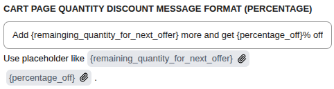
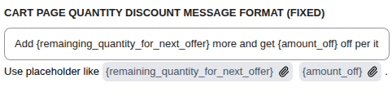
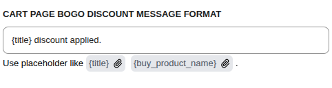
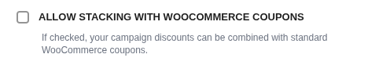

# Cart Settings

The **Cart Settings** tab manages how discounts are communicated and calculated within the WooCommerce cart and checkout flow.

## Cart Page Display

### Message Formats

Configure the upsell and discount messages that appear in the cart for different campaign types.

#### Quantity Discount (Percentage)

| Placeholder                           | Description                         |
| ------------------------------------- | ----------------------------------- |
| `{remaining_quantity_for_next_offer}` | Items needed to reach the next tier |
| `{percentage_off}`                    | Discount percentage at next tier    |

**Default:** `Add {remaining_quantity_for_next_offer} more and get {percentage_off}% off`

#### Quantity Discount (Fixed)

| Placeholder                           | Description                         |
| ------------------------------------- | ----------------------------------- |
| `{remaining_quantity_for_next_offer}` | Items needed to reach the next tier |
| `{amount_off}`                        | Fixed discount amount at next tier  |

**Default:** `Add {remaining_quantity_for_next_offer} more and get {amount_off} off per item!`

#### BOGO Discount

| Placeholder          | Description                    |
| -------------------- | ------------------------------ |
| `{title}`            | Campaign title                 |
| `{buy_product_name}` | Name of the qualifying product |

**Default:** `{title} discount applied.`

::: info Pro
Cart messages for CampaignBayPro offers (BOGO Advanced, gifts, bundles and so on) are documented in the Pro **offer type messages** page.
:::

---

## Cart Discount Options

### Allow Stacking with WooCommerce Coupons

Helper text: *If checked, your campaign discounts can be combined with standard WooCommerce coupons.* **Default: unchecked.**

- **Checked:** Campaign discounts can be combined with standard WooCommerce coupons. The coupon is calculated on the already-discounted price. Example: a 20% campaign takes a 100.00 product to 80.00, and a 10% WooCommerce coupon then takes 8.00 off, for a total of 72.00.
- **Unchecked:** The two discount systems are mutually exclusive. While a CampaignBay discount applies to the cart, ordinary WooCommerce coupons are rejected or removed automatically (the shopper sees WooCommerce's usual "coupon removed" notice). Since 1.2.0 this also removes coupons that the classic cart used to leave in place with a zero discount. CampaignBay's own virtual coupons are not affected.

### Allow Stacking with Other Discount Campaigns

Controls whether different _types_ of CampaignBay campaigns can be applied together on the same cart.

Helper text: *If checked, multiple active discount campaigns can apply to the same cart.* **Default: unchecked.**

- **Checked:** Multiple active discount campaigns can apply to the same cart.
- **Unchecked:** Only the single best discount applies to a product, chosen by the **Discount priority method** on the [Product Settings](./product-settings.md#product-prioritization) tab. Campaigns on different products do not affect each other.

::: info Learn More
The order and logic for how campaigns are stacked is very specific.

**[Read the Full Guide: The Discount Engine & Stacking &rarr;](../core-concepts/understanding-the-engine.md#step-2-stacking-between-discount-groups)**
:::

---

::: tip Discount applied as a coupon or a fee
Quantity campaigns can apply their discount as a price change, a virtual coupon, or a negative fee (the campaign's **Apply Discount As** option). Fee-mode discounts are shown correctly on tax-inclusive stores since 1.2.0.
:::

---

## Next Steps

Continue exploring advanced data management and licensing options.

- **[Advanced Settings &rarr;](./advanced-settings.md)**
