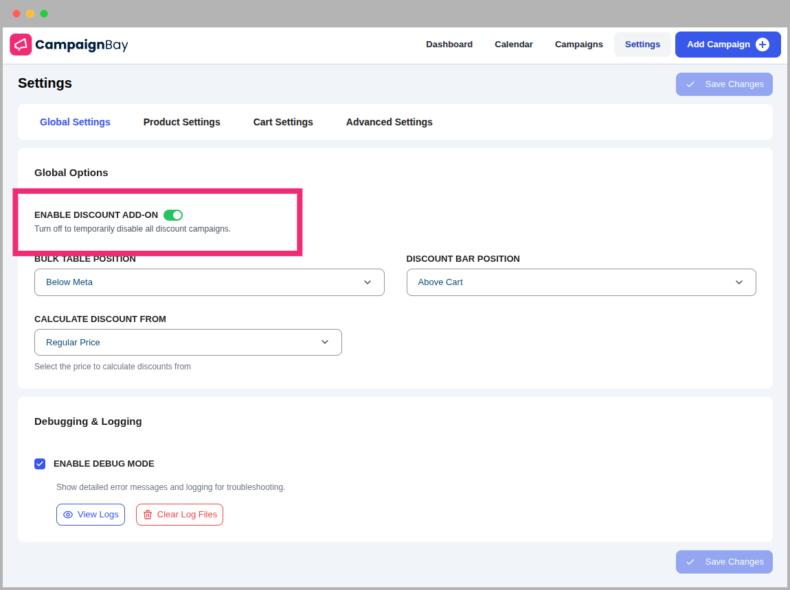
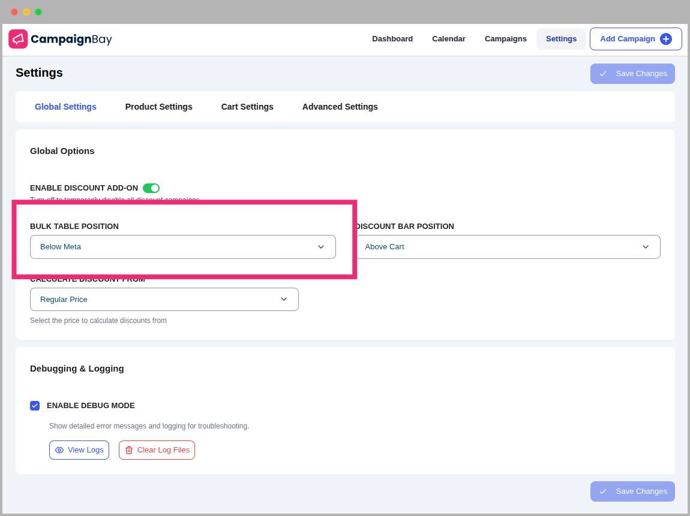
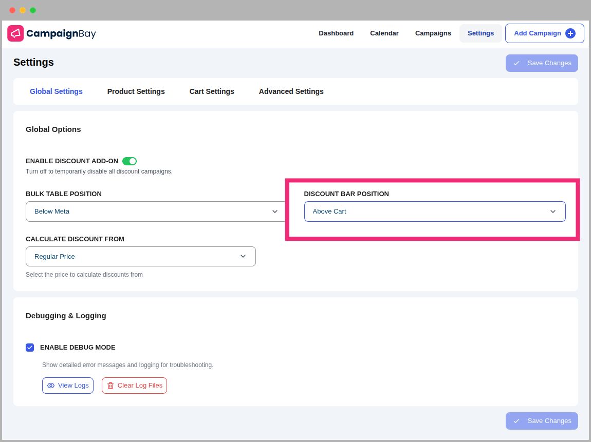
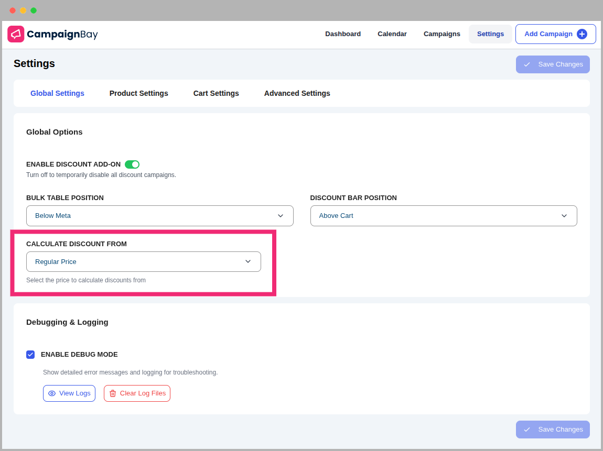
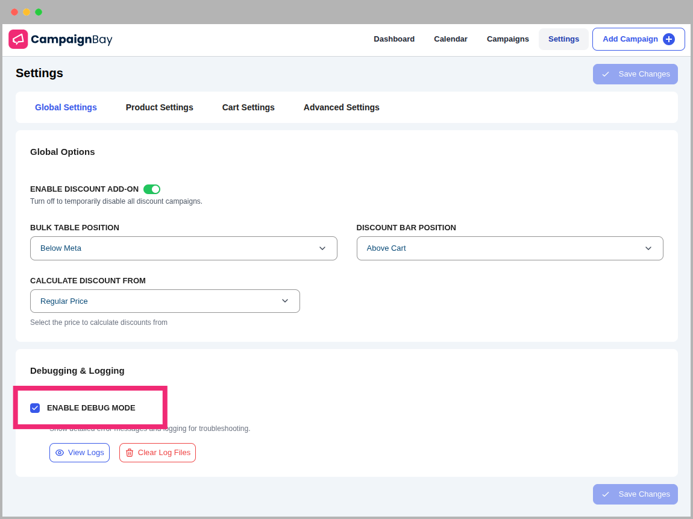
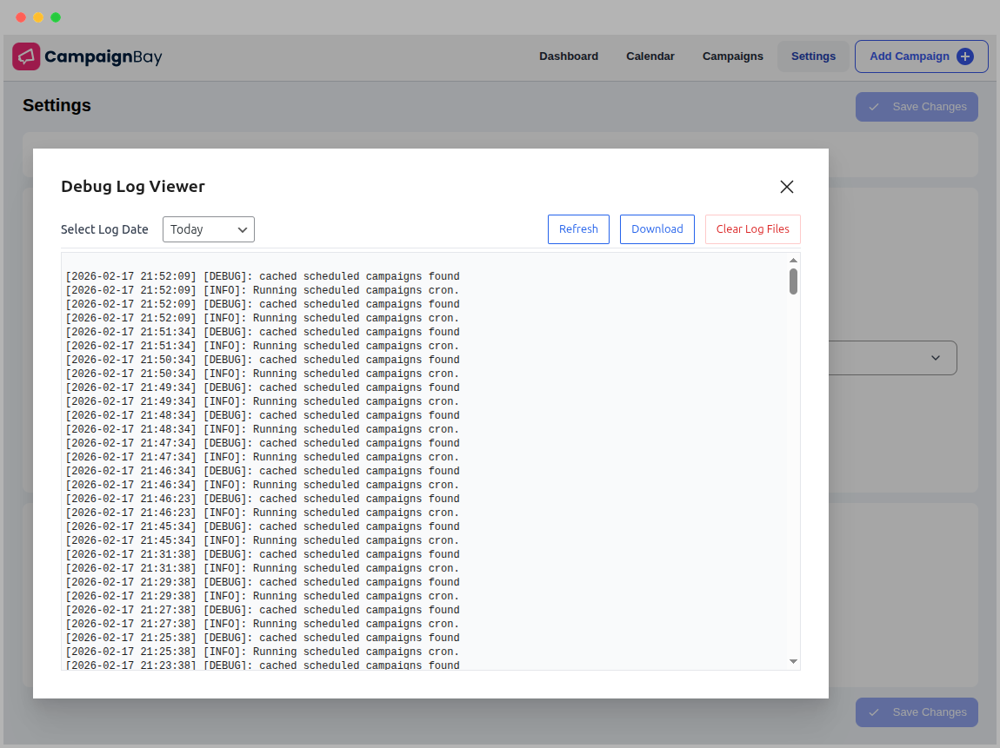

# Global Settings

The **Global Settings** tab contains the main operational controls for the entire plugin, affecting how discounts are calculated and displayed across your store.

## Global Options

### Enable Discount Add-on

This is the master "on/off" switch for CampaignBay.

Helper text in the admin: *Turn off to temporarily disable all discount campaigns.* **Default: ON.**

- **ON (Green):** The plugin is active and will apply discounts to your store.
- **OFF (Grey):** The entire pricing engine is disabled. No discounts will be calculated or applied (product pages, shop, cart and checkout all show regular prices). Your campaigns and settings are kept, so switching back ON restores prices without re-saving anything. This is a quick way to temporarily pause all campaigns.

### Bulk Table Position

Controls where the "Quantity Discount" pricing table appears on product pages. **Default: Below Cart.**

| Option         | Placement                               |
| -------------- | --------------------------------------- |
| **Below Cart** | Directly below the "Add to Cart" button (default) |
| **Above Cart** | Directly above the "Add to Cart" button |
| **Below Meta** | Below product metadata (SKU, Category)  |
| **Above Meta** | Above product metadata                  |

### Discount Bar Position

Controls where promotional bars (for Scheduled, Early Bird or BOGO discounts) appear on product pages. **Default: Above Cart.**

| Option         | Placement                       |
| -------------- | ------------------------------- |
| **Below Cart** | Below the "Add to Cart" section |
| **Above Cart** | Above the "Add to Cart" section (default) |
| **Below Meta** | Below the product metadata      |
| **Above Meta** | Above the product metadata      |

### Calculate Discount From

Determines which price is used as the base for discount calculations.

Helper text in the admin: *Select the price to calculate discounts from.* **Default: Regular Price.**

- **Regular Price:** Always calculates from the product's original price, ignoring any existing WooCommerce sales. Example: a product with a regular price of 20.00 and a WooCommerce sale price of 15.00, under a 20% campaign, becomes 16.00 (20% off 20.00).
- **Sale Price:** If a product is currently on sale in WooCommerce, the discount is calculated from that reduced price (prevents deep stacking). In the same example the result is 12.00 (20% off 15.00). Products that are not on sale (including products whose WooCommerce sale is scheduled for the future or has already ended) use the regular price.

The change applies the next time a price is calculated; nothing is stored per product.

## Debugging & Logging

### Enable Debug Mode

When checked, the plugin logs detailed process information for troubleshooting (helper text: *Show detailed error messages and logging for troubleshooting*). Errors are always logged; with Debug Mode off, only the informational lines are dropped. **Default: ON for a fresh install** (the settings are seeded with it enabled).

Once enabled, two action buttons appear:

- **View Logs:** Opens the Debug Log Viewer modal.
- **Clear Log Files:** Purges all current log history.

### Debug Log Viewer

The log viewer provides:

- **Select Log Date:** Choose which day's logs to view.
- **Refresh:** Reload the current log file.
- **Download:** Save the log file locally for sharing with support.
- **Clear Log Files:** Permanently delete all log entries.

::: tip
Enable Debug Mode when diagnosing issues. Remember to disable it in production to avoid performance overhead.
:::

---

## Tax and price display

CampaignBay works with your WooCommerce tax settings and has no tax options of its own. A discount is calculated on the price **as you entered it** in WooCommerce (the plugin never converts between prices entered with and without tax), and the result is then displayed according to **WooCommerce > Settings > Tax**:

- **Prices entered with tax / without tax** and **Display prices in the shop / during cart and checkout** (including or excluding tax) are respected for quantity discounts and fixed-price discounts on the product page, shop, cart and orders (fixed in 1.2.0).
- Example (10% tax, 20% Scheduled campaign on a product entered at 100.00 excluding tax): the campaign price is 80.00, shown as 80.00 when prices are displayed excluding tax, or 88.00 when displayed including tax. If the same product is entered *including* tax, the campaign price is 80.00 including tax (72.73 net + 7.27 tax).
- Quantity discounts applied as a **fee** are also correct on tax-inclusive stores since 1.2.0.

---

## Next Steps

Continue exploring the settings for products and messaging.

- **[Product Settings &rarr;](./product-settings.md)**
