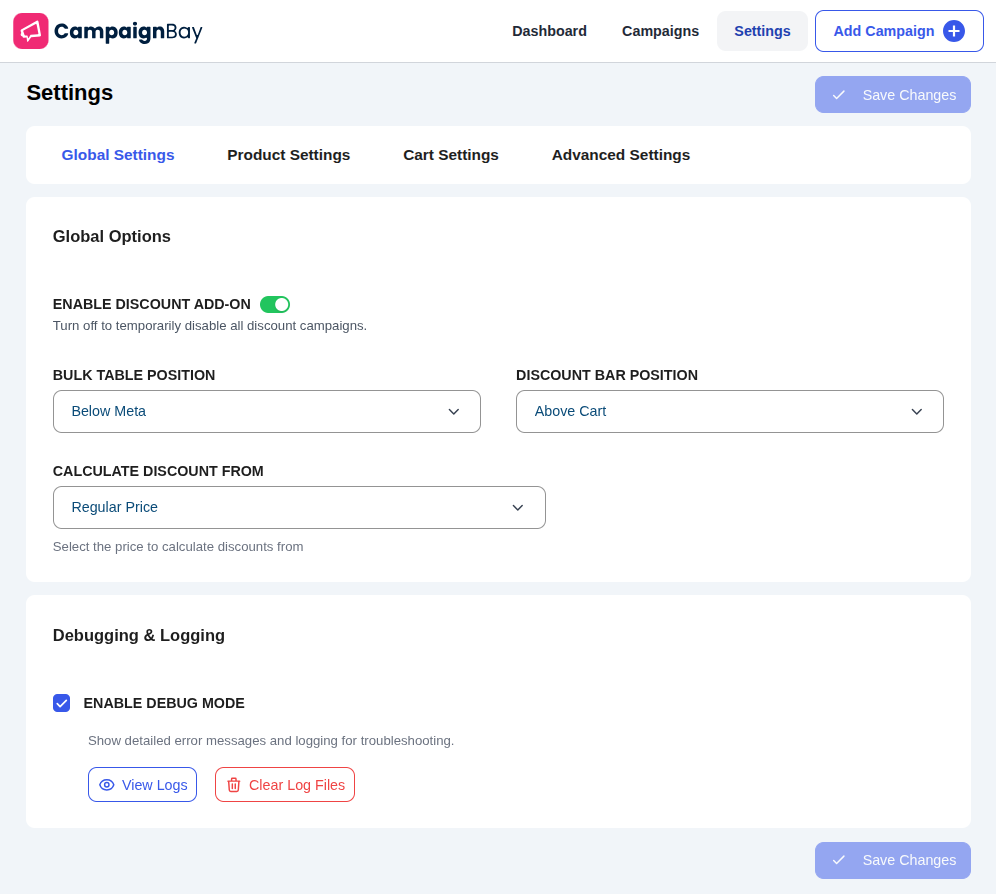

# Settings

The Settings page contains all the global configuration options for the CampaignBay plugin. These settings control the default behavior of the discount engine, display options, and more.

The settings are organized into **four tabs**. Click any tab below to view its detailed documentation:

| Tab                                             | Description                                               |
| ----------------------------------------------- | --------------------------------------------------------- |
| [**Global Settings**](./global-settings.md)     | Master controls, display positions, and calculation logic |
| [**Product Settings**](./product-settings.md)   | Product page messages, quantity table, countdown timer, sale badge, offer messages, and discount prioritization |
| [**Cart Settings**](./cart-settings.md)         | Cart messaging and stacking rules (coupons and campaigns) |
| [**Advanced Settings**](./advanced-settings.md) | Data management and cleanup options                       |

::: info Pro settings
CampaignBayPro adds its own messages and options to the same Settings page. These are described in the Pro offer type messages page.
:::

After making changes on any tab, click the **Save Changes** button to apply them.
