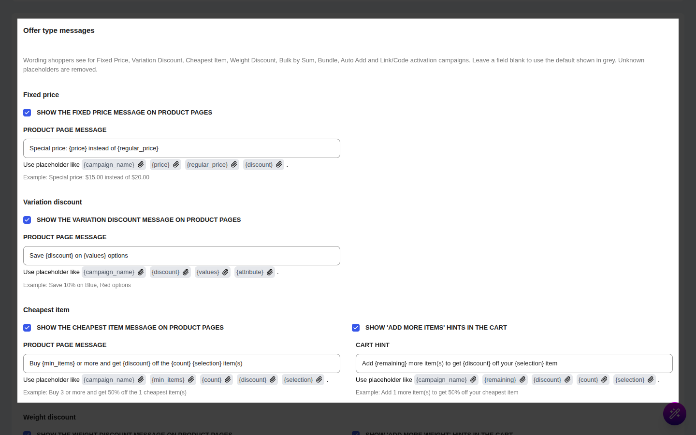

# Offer Type Messages

::: tip Pro Feature
This is a **CampaignBayPro** feature. [Upgrade to Pro](https://wpanchorbay.com/campaignbay) to use the Pro campaign types and edit the messages that go with them.
:::

The **Offer type messages** card controls the wording shoppers see for the Pro campaign types: Fixed Price, Variation Discount, Cheapest Item, Weight Discount, Bulk by Sum, Bundle, Auto Add and Link/Code activation.

You find it in **CampaignBay > Settings > Cart Settings**, below the **Condition Messages** card and the **Gifts and offers messages** card (which covers Free Gift, Category BOGO and Nth Unit Discount).

---

## How the Messages Work

- **Each group has toggles and message fields.** A toggle switches one kind of message on or off. All toggles are **on** by default.
- **A blank field uses the default.** The default text is shown in grey inside the field. If you clear a field and save, the default comes back.
- **Placeholders** are words in curly braces, such as `{discount}`. They are replaced with real values. A placeholder that does not exist for that message is removed rather than printed.
- **Messages are plain text.** Any HTML you type is removed.
- **Each message lists the placeholders it supports** under its field, with an example of how it reads.
- Product-page messages appear **above the add-to-cart form**. Cart hints appear **above the cart** on the classic cart and **after the cart block** on the block-based cart.

::: tip Money placeholders
Placeholders that show money, such as `{discount}` on a fixed-amount offer, use your store currency and are written as plain text (for example "$30.00").
:::

---

## Fixed Price

Used by the [Fixed Price](/campaigns/fixed-price-discounts) campaign type.

| Setting | Default |
| ------- | ------- |
| **Show the fixed price message on product pages** | On |
| **Product page message** | Special price: {price} instead of {regular_price} |

Placeholders: `{campaign_name}`, `{price}`, `{regular_price}`, `{discount}` (the amount saved).

Example: "Special price: $15.00 instead of $20.00".

**Where it prints:** on the product page, only when the fixed price is the price the product actually gets. If another campaign wins the price, this message is not shown. On the shop page, shoppers see the usual sale price and badge.

---

## Variation Discount

Used by the [Variation Discount](/campaigns/variation-discounts) campaign type.

| Setting | Default |
| ------- | ------- |
| **Show the variation discount message on product pages** | On |
| **Product page message** | Save {discount} on {values} options |

Placeholders: `{campaign_name}`, `{discount}`, `{values}` (the variations or attribute values the discount covers), `{attribute}` (the attribute name, for rules that match by attribute).

Example: "Save 10% on Blue, Red options".

**Where it prints:** on the product page of the variable product, when the campaign sets the price of at least one of its variations.

---

## Cheapest Item

Used by the [Cheapest Item](/campaigns/cheapest-item-discounts) campaign type.

| Setting | Default |
| ------- | ------- |
| **Show the cheapest item message on product pages** | On |
| **Show 'add more items' hints in the cart** | On |
| **Product page message** | Buy {min_items} or more and get {discount} off the {count} {selection} item(s) |
| **Cart hint** | Add {remaining} more item(s) to get {discount} off your {selection} item |

Placeholders:

- Product page message: `{campaign_name}`, `{min_items}`, `{count}`, `{discount}`, `{selection}`
- Cart hint: `{campaign_name}`, `{remaining}`, `{discount}`, `{count}`, `{selection}`, `{min_items}`

`{selection}` is "cheapest" or "most expensive", following the campaign's item-selection setting. `{discount}` reads as a percentage ("50%") or a price.

Example: "Buy 3 or more and get 50% off the 1 cheapest item(s)". Cart hint: "Add 1 more item(s) to get 50% off your cheapest item".

**Where it prints:** the product message appears on the product pages of items the campaign targets. The cart hint appears in the cart while the cart has some eligible items but fewer than the minimum.

---

## Weight Discount

Used by the Weight Discount campaign type.

| Setting | Default |
| ------- | ------- |
| **Show the weight discount message on product pages** | On |
| **Show 'add more weight' hints in the cart** | On |
| **Product page message** | Get {discount} off when your order weighs {min_weight} {unit} or more |
| **Cart hint** | Add {remaining} {unit} more to get {discount} off |

Placeholders:

- Product page message: `{campaign_name}`, `{discount}`, `{min_weight}`, `{unit}`
- Cart hint: `{campaign_name}`, `{remaining}`, `{unit}`, `{discount}`, `{min_weight}`

`{unit}` is your WooCommerce weight unit (Settings > Products).

Example: "Get 10% off when your order weighs 5 kg or more". Cart hint: "Add 2 kg more to get 10% off".

**Where it prints:** the product message shows the first (smallest) weight range of the campaign. The cart hint shows the next range the shopper has not reached yet.

---

## Bulk by Sum

Used by the Bulk by Sum campaign type.

| Setting | Default |
| ------- | ------- |
| **Show the bulk message on product pages** | On |
| **Show 'add more' hints in the cart** | On |
| **Product page message** | Buy {min_quantity} or more in total and get {discount} off |
| **Cart hint** | Add {remaining} more to get {discount} off |

Placeholders:

- Product page message: `{campaign_name}`, `{min_quantity}`, `{discount}`, `{scope}`
- Cart hint: `{campaign_name}`, `{remaining}`, `{discount}`, `{min_quantity}`, `{scope}`

`{scope}` is a short phrase about which items get the discount: "on every item" or "on the items beyond the minimum".

Example: "Buy 10 or more in total and get 15% off". Cart hint: "Add 4 more to get 15% off".

**Where it prints:** the product message shows the first tier. The cart hint shows the next tier the shopper has not reached.

---

## Bundle

Used by the [Bundle](/campaigns/bundle-discounts) campaign type.

| Setting | Default |
| ------- | ------- |
| **Show the bundle message on product pages** | On |
| **Show 'complete the bundle' hints in the cart** | On |
| **Product page message** | Buy {bundle_items} together and save {discount} |
| **Cart hint** | Add {missing_items} to complete the bundle and save {discount} |

Placeholders:

- Product page message: `{campaign_name}`, `{bundle_items}`, `{discount}`
- Cart hint: `{campaign_name}`, `{missing_items}`, `{discount}`

Example: "Buy Camera, Tripod together and save $30.00". Cart hint: "Add Tripod to complete the bundle and save $30.00".

**Where it prints:** the product message on the product pages of items in the bundle. The cart hint lists the bundle items still missing from the cart.

---

## Auto Add

Used by the [Auto Add / Recommended Product](/campaigns/auto-add-recommended-product) campaign type.

| Setting | Default |
| ------- | ------- |
| **Show the auto add message on product pages** | On |
| **Show the recommended product suggestion in the cart** | On |
| **Label on the automatically added cart line** | Added for you: {product_name} |
| **Suggestion title** | Recommended for you |
| **Suggestion button** | Add {product_name} |
| **Product page message** | Add this to your cart and get {product_name} {discount} |

Placeholders:

- Label on the automatically added cart line: `{product_name}`, `{campaign_name}`
- Suggestion title: `{campaign_name}`
- Suggestion button: `{product_name}`, `{campaign_name}`, `{price}`, `{discount}`
- Product page message: `{product_name}`, `{campaign_name}`, `{price}`, `{discount}`

Example: label "Added for you: Gift Card", button "Add Gift Card", product message "Add this to your cart and get Gift Card 100% off".

**Where it prints:**

- The **label** is shown on the cart line of the product that was added automatically.
- The **suggestion title and button** appear in a panel in the cart that suggests the campaign's product to the shopper.
- The **product page message** appears on products the campaign targets, when its conditions are met and the shopper has not reached the per-customer limit. It is not shown on the reward product itself.

---

## Link and Code Activation

Used by campaigns that carry a **Link or code activation** condition. See [Pro Conditions](/core-concepts/pro-conditions).

| Setting | Default |
| ------- | ------- |
| **Show a notice when a code or link activates a campaign** | On |
| **Campaign activated notice** | {campaign_name} is now active! |

Placeholders: `{campaign_name}`, `{code}`.

Example: "Summer Sale is now active!".

**Where it prints:** as a one-time success notice (the green WooCommerce notice) at the moment a code is applied or an activation link is opened. The message the shopper sees **before** activation is not in this card: it is the **Link or code activation** message in the **Condition Messages** card.

---

## Quick Reference

| Campaign type | Product page | Cart hint | Other |
| ------------- | ------------ | --------- | ----- |
| Fixed Price | Yes | No | |
| Variation Discount | Yes | No | |
| Cheapest Item | Yes | Yes | |
| Weight Discount | Yes | Yes | |
| Bulk by Sum | Yes | Yes | |
| Bundle | Yes | Yes | |
| Auto Add | Yes | Suggestion panel | Cart line label |
| Link and code activation | No | No | Success notice |

::: tip Related message cards
- **Condition Messages** covers the notices for Pro conditions. See [Pro Conditions](/core-concepts/pro-conditions).
- **Gifts and offers messages** (the card above this one) covers Free Gift, Category BOGO and Nth Unit Discount. See [Free Gift](/campaigns/free-gift), [Category BOGO](/campaigns/category-bogo) and [Nth Unit Discount](/campaigns/nth-unit-discounts).
- The free message formats are in [Cart Settings](/settings/cart-settings).
:::
