# Product Settings

The **Product Settings** tab controls how discounts and promotional messaging appear on your individual product pages, in the shop and category listings, and how competing campaigns on the same product are resolved. It is divided into cards: Product Page Display, Quantity Limit Messages, Quantity Discount Layout, Countdown Timer, Sale Badge, Category & Shop Offer Message, Promotion Blurbs, and Product Exclusion & Prioritization.

::: info Pro messages
Messages for CampaignBayPro offer types (gifts, bundles, fixed price, cheapest item, and so on) are documented separately. See the Pro **offer type messages** page.
:::

## Message Formats

Customize how promotional messages are displayed on product pages for different campaign types. Placeholders are written in curly braces and replaced with live values.

### Percentage Schedule / Early Bird Discount

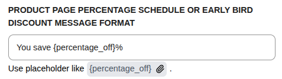

**Placeholder:** `{percentage_off}` — The percentage discount value.

**Default:** `You save {percentage_off}%`

### Fixed Schedule / Early Bird Discount

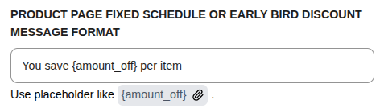

**Placeholder:** `{amount_off}` — The fixed amount discount.

**Default:** `You save {amount_off} per item`

The `{amount_off}` placeholder is replaced with plain text in your store currency format (for example `$5.00`).

### BOGO Discount

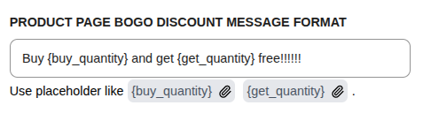

| Placeholder      | Description                |
| ---------------- | -------------------------- |
| `{buy_quantity}` | Quantity customer must buy |
| `{get_quantity}` | Quantity customer receives |

**Default:** `Buy {buy_quantity} and get {get_quantity} free!`

### BOGO Advanced Discount (Pro)

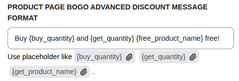

Available with CampaignBayPro.

| Placeholder           | Description                |
| --------------------- | -------------------------- |
| `{buy_quantity}`      | Quantity customer must buy |
| `{get_quantity}`      | Quantity customer receives |
| `{get_product_name}`  | Name of the free product   |

**Default:** `Buy {buy_quantity} and get {get_quantity} {get_product_name} free!`

---

## Quantity Discounts Table

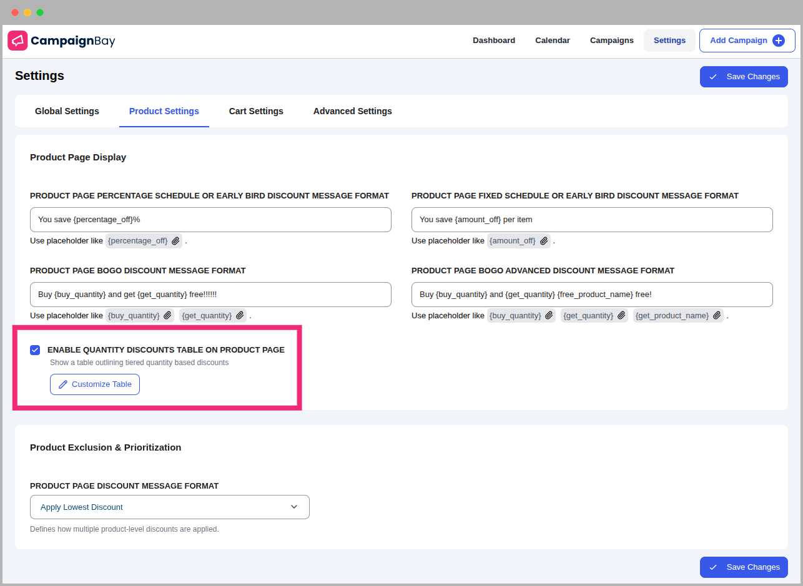

### Enable Quantity Discounts Table on Product Page

Helper text: *Show a table outlining tiered quantity based discounts.* **Default: ON.**

When enabled, a pricing table showing tiered discounts appears on product pages for Quantity-based campaigns. Turn it off to hide the table; the discount bar message and the cart behaviour are unchanged. (In 1.2.0 this checkbox was fixed so that it controls the table correctly.)

The table (or cards) is placed according to **Bulk Table Position** on the Global Settings tab.

### Customize Discount Table

Click **Customize Table** to open the configuration modal:

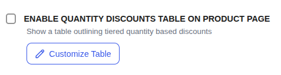

| Setting               | Description                                                            |
| --------------------- | ---------------------------------------------------------------------- |
| **Show Table Header** | Toggle visibility of column header row                                 |
| **Title Column**      | Enable/disable and customize the campaign title column (default label: `Title`) |
| **Range Column**      | Enable/disable and customize the quantity range column (default label: `Range`) |
| **Discount Column**   | Enable/disable, customize label (default `Discount`), and choose **Content To Show**: **Price** (default, price per unit after discount) or **Percentage** |

The **Preview** section shows a live preview of how the table will appear. Open-ended top tiers display as, for example, `6+`.

---

## Quantity Discount Layout

Controls how quantity tiers are presented to shoppers.

| Setting             | Description                                                                                                  | Default |
| ------------------- | ------------------------------------------------------------------------------------------------------------ | ------- |
| **Show Tier Label** | Shows each tier's label (the optional name you give a tier in the campaign editor) next to it. | ON |
| **Layout**          | **Table** shows the classic table described above. **Cards** shows one card per tier.                        | Table   |

When **Layout** is set to **Cards**, three more formats appear:

| Setting                                  | Placeholders              | Default                |
| ---------------------------------------- | ------------------------- | ---------------------- |
| **Card Title Format (Cards layout)**     | `{min}`, `{max}`, `{range}` | `{min} - {max} items`  |
| **Card Price Format (Cards layout)**     | `{price}`                 | `{price} each`         |
| **Card Discount Format (Cards layout)**  | `{discount}`              | `Save {discount}`      |

The column show/hide switches from **Customize Table** (title, range, discount) also apply to the cards. For fixed discounts that apply once to the whole line, the card price is shown as "from ..." (the per-unit price at the tier's minimum quantity).

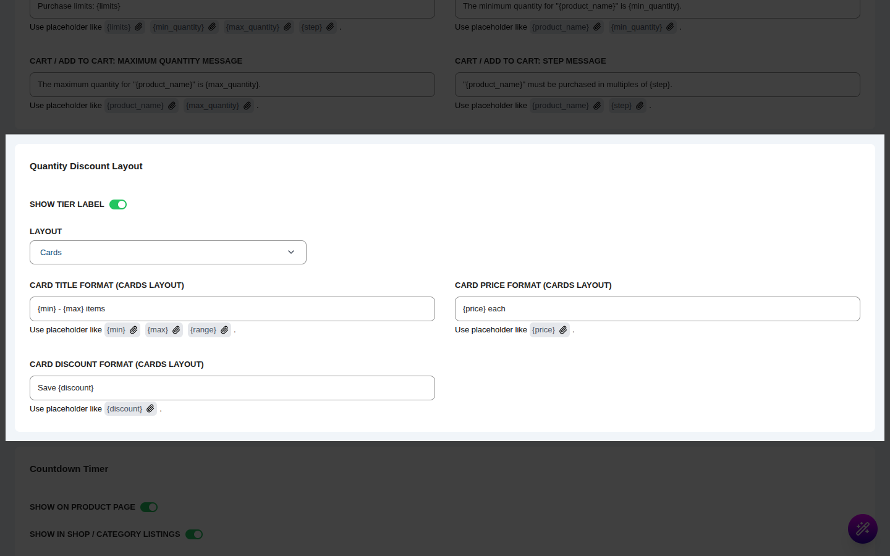
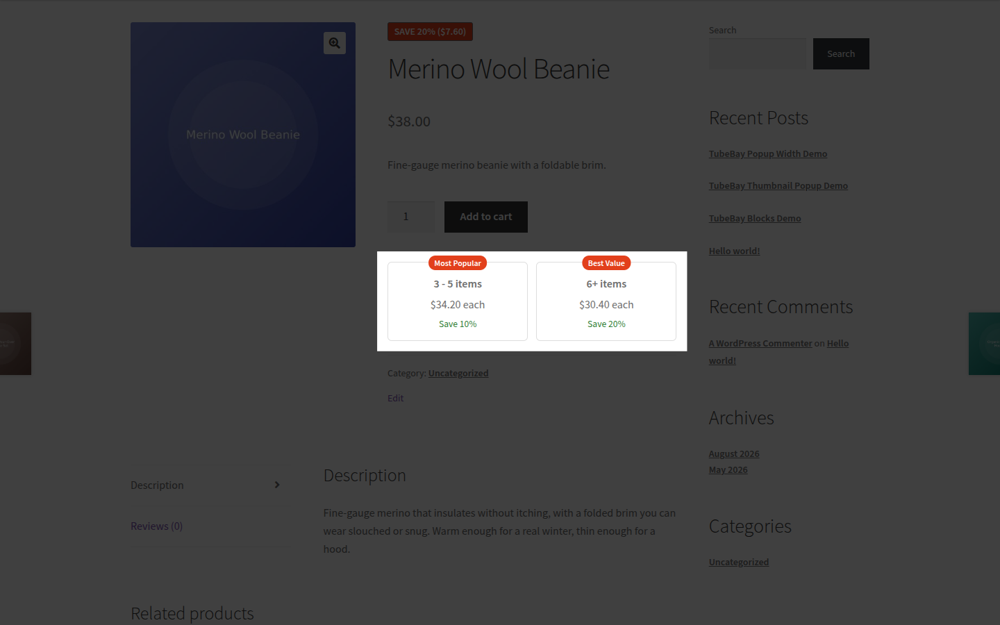

---

## Quantity Limit Messages

Quantity limits (minimum, maximum and step quantity) are set per campaign in the campaign editor. This card controls the wording shoppers see.

| Setting                                          | Placeholders                                          | Default |
| ------------------------------------------------ | ----------------------------------------------------- | ------- |
| **Show Limits on Product Page** (switch)         | -                                                     | ON      |
| **Product Page Quantity Limits Message Format**  | `{limits}`, `{min_quantity}`, `{max_quantity}`, `{step}` | `Purchase limits: {limits}` |
| **Cart / Add to Cart: Minimum Quantity Message** | `{product_name}`, `{min_quantity}`                    | `The minimum quantity for "{product_name}" is {min_quantity}.` |
| **Cart / Add to Cart: Maximum Quantity Message** | `{product_name}`, `{max_quantity}`                    | `The maximum quantity for "{product_name}" is {max_quantity}.` |
| **Cart / Add to Cart: Step Message**             | `{product_name}`, `{step}`                            | `"{product_name}" must be purchased in multiples of {step}.` |

- `{limits}` expands to a readable summary such as `minimum 2, maximum 10, multiples of 2`.
- Turning off **Show Limits on Product Page** only hides the line on the product page; the limits are still enforced.
- If you clear a cart message and save, the default text is used.
- If a cart breaks more than one limit, the minimum message is shown first, then maximum, then step.
- On the classic cart the specific message is shown. The block cart and block checkout silently correct the quantity to the nearest allowed value instead of showing a banner.

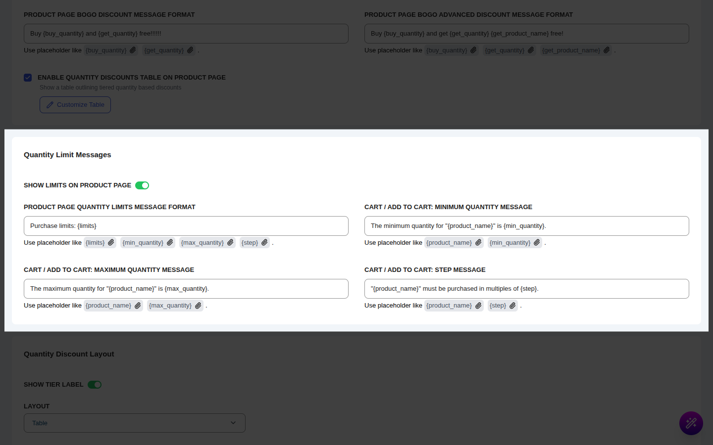

---

## Countdown Timer

Shows a live countdown to the end of a campaign. A timer appears only for an **Active** campaign with scheduling turned on and a future end date (and it can be switched off per campaign with the campaign's "Show countdown timer" option). It is not shown for an Early Bird whose tiers are used up.

| Setting                                  | Placeholders                                | Default |
| ---------------------------------------- | ------------------------------------------- | ------- |
| **Show on Product Page** (switch)        | -                                           | ON      |
| **Show in Shop / Category Listings** (switch) | -                                      | ON      |
| **Show in Cart** (switch)                | -                                           | ON      |
| **Product Page Countdown Format**        | `{countdown}`, `{end_date}`, `{campaign_title}` | `Sale ends in {countdown}` |
| **Shop / Category Listing Countdown Format** | same                                    | `Ends in {countdown}` |
| **Cart Countdown Format**                | same                                        | `Offer ends in {countdown}` |
| **Shortcode Countdown Format**           | same                                        | `Offer ends in {countdown}` |
| **Message When Offer Ends (leave empty to hide)** | -                                  | `This offer has ended.` |

`{end_date}` follows the date and time format and timezone set in **Settings > General** in WordPress. When the timer reaches zero it is replaced by the "offer ends" message; leave that field empty to hide the timer instead.

### Countdown shortcode

Place a timer anywhere with the `[campaignbay_countdown]` shortcode. Use `id` for the campaign ID and, optionally, `format` to override the shortcode format for this one timer:

```
[campaignbay_countdown id="12"]
[campaignbay_countdown id="12" format="Hurry: {countdown}"]
```

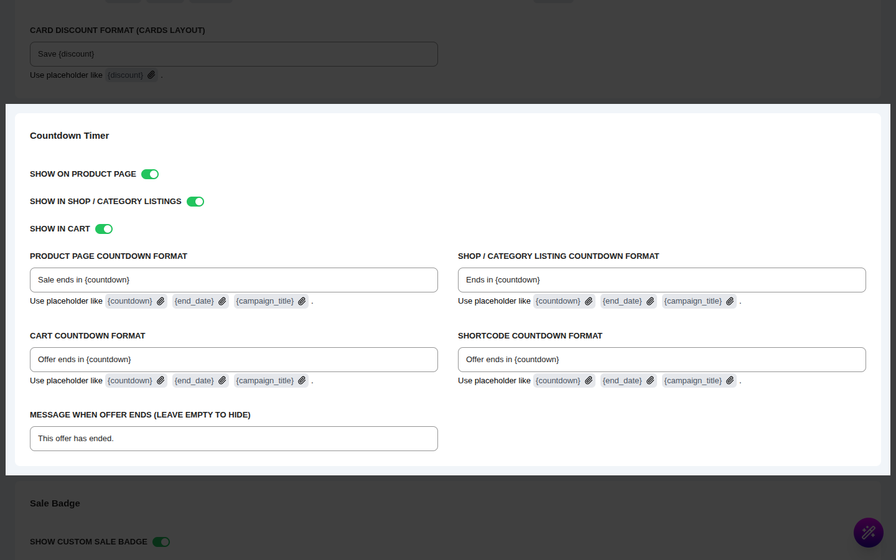
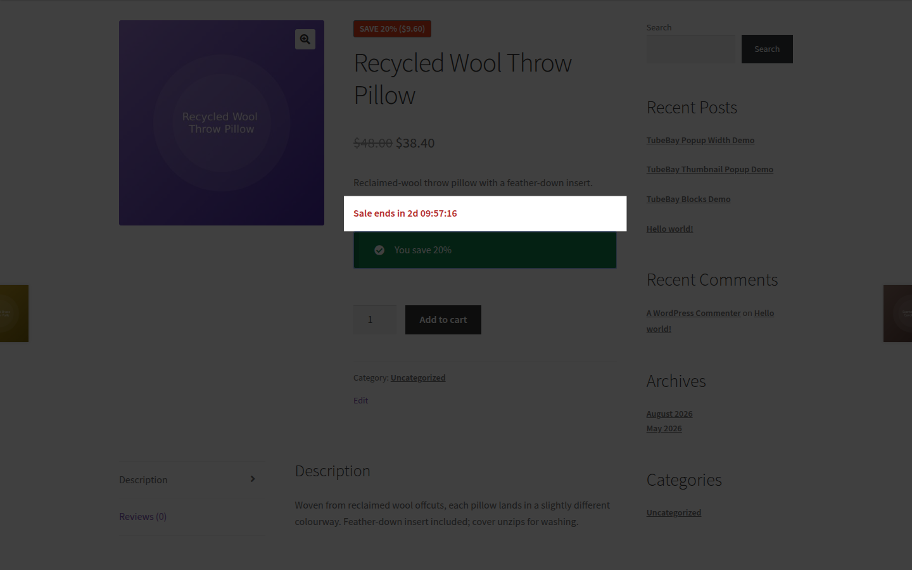

---

## Sale Badge

Replaces the standard WooCommerce "Sale!" badge with a CampaignBay badge on products that have an active CampaignBay discount (including products that only have a quantity-tier discount). Products with no campaign discount get no CampaignBay badge.

| Setting                      | Description                                                                 | Default   |
| ---------------------------- | --------------------------------------------------------------------------- | --------- |
| **Show Custom Sale Badge**   | Master switch for the badge                                                 | OFF       |
| **Badge Text**               | Text on the badge. Placeholders: `{percentage_off}`, `{amount_off}`          | `Sale!`   |
| **Badge Background Color**   | Colour picker plus hex field                                                | `#e2401c` |
| **Badge Text Color**         | Colour picker plus hex field                                                | `#ffffff` |

**Examples:** with a 20% campaign, `-{percentage_off}%` shows `-20%` and `Save {amount_off}` shows `Save $20.00`. When several campaigns compete for the product, the badge shows the figures of the winning campaign (see Product Prioritization below). An invalid colour value is replaced with the default colour on save.

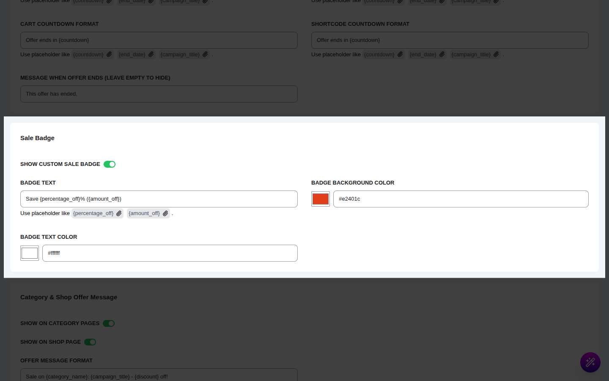
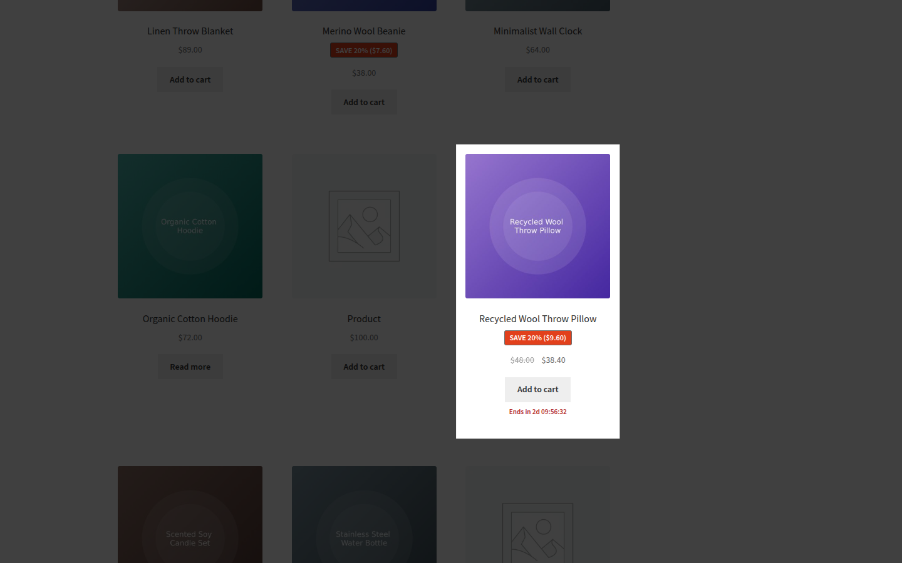

---

## Category & Shop Offer Message

Shows a banner announcing a running campaign on category archive pages and on the main shop page.

| Setting                      | Placeholders                                                  | Default |
| ---------------------------- | ------------------------------------------------------------- | ------- |
| **Show on Category Pages** (switch) | -                                                      | ON      |
| **Show on Shop Page** (switch)      | -                                                      | ON      |
| **Offer Message Format**     | `{campaign_title}`, `{discount}`, `{category_name}`, `{end_date}` | `Sale on {category_name}: {campaign_title} - {discount} off!` |

On a category page the message is shown for campaigns that target that category. On the shop page only campaigns that target the **entire store** are listed.

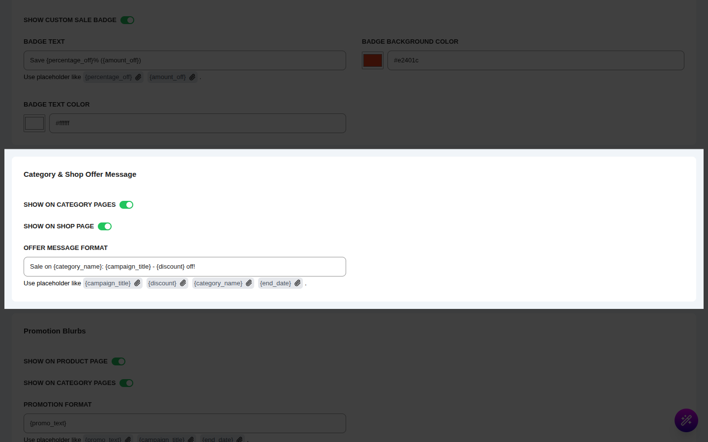

---

## Promotion Blurbs

A promotion blurb is a short promotional text you can add to a campaign in the campaign editor. These settings control where it is shown and how it is wrapped.

| Setting                            | Placeholders                                   | Default |
| ---------------------------------- | ---------------------------------------------- | ------- |
| **Show on Product Page** (switch)  | -                                              | ON      |
| **Show on Category Pages** (switch)| -                                              | ON      |
| **Promotion Format**               | `{promo_text}`, `{campaign_title}`, `{end_date}` | `{promo_text}` |

A campaign with no promo text shows nothing. The blurb is also available with the `[campaignbay_promo]` and `[campaignbay_offers]` shortcodes.

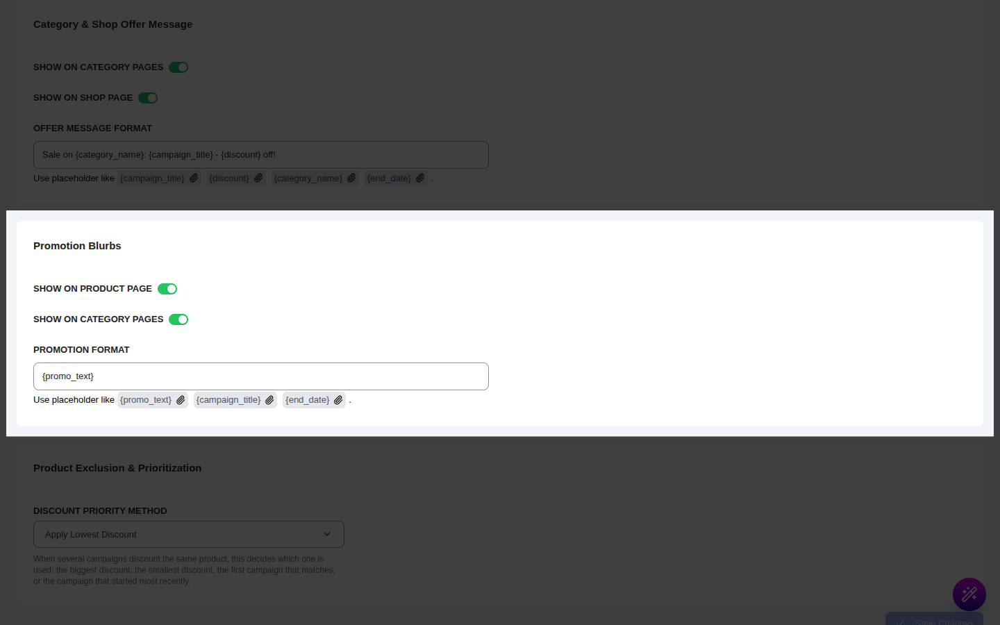

---

## Product Prioritization


The card is titled **Product Exclusion & Prioritization**. Its **Discount priority method** defines the logic when multiple discounts could apply to the same product. **Default: Apply Highest Discount.**

| Option                          | Behavior                                                                 |
| ------------------------------- | ------------------------------------------------------------------------ |
| **Apply Highest Discount**      | Uses the campaign giving the biggest price reduction                     |
| **Apply Lowest Discount**       | Uses the campaign giving the smallest price reduction                    |
| **Apply First Match**           | Applies the first matching campaign by priority order                    |
| **Most Recently Started Wins**  | Uses the campaign with the most recent start date. If start dates are identical, the campaign found first is kept. |

**Example:** Campaign A (20% off, started 5 days ago) and Campaign B (a fixed 10.00 off, started 2 days ago) both target a 100.00 product. Apply Highest gives 80.00, Apply Lowest gives 90.00, and Most Recently Started Wins gives 90.00 (B started later).

::: info
This setting only applies when campaign stacking is disabled. If stacking is enabled, discounts can be layered according to the stacking rules.
:::

---

## Next Steps

Continue exploring the settings for cart and stacking logic.

- **[Cart Settings &rarr;](./cart-settings.md)**
